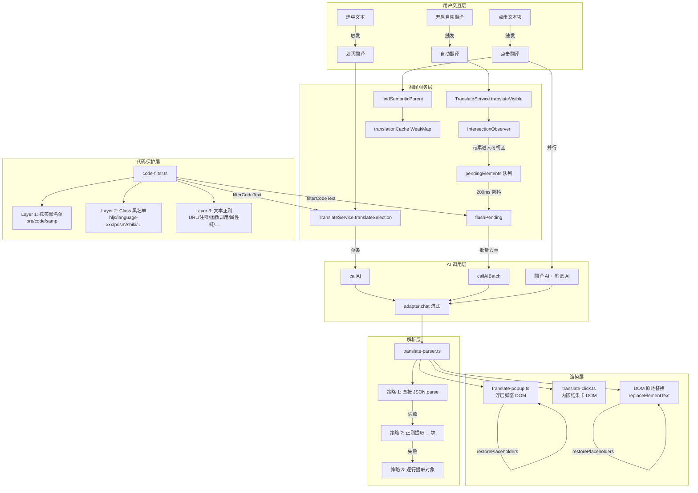

# 翻译模块架构文档

## 模块概述

翻译模块为 AI Browser 提供三种互补的页面翻译模式，将 AI 翻译能力无缝融入用户浏览体验。所有模式均绕过 Phase1/Phase2 pipeline，直接调用 AI adapter 实现流式翻译。

| 模式 | 触发方式 | 典型场景 | 交互形式 |
|------|---------|---------|---------|
| **划词翻译** | 用户选中文本 | 快速理解局部段落 | 浮层弹窗（translate-popup） |
| **自动翻译** | 开关切换 | 全页沉浸式阅读 | 原地 DOM 替换 |
| **点击翻译** | 用户点击文本块 | 按需逐段理解 | 元素下方内嵌结果卡 |

**源文件**:

| 文件 | 职责 |
|------|------|
| `src/browser/translate-service.ts` | 翻译服务核心（TranslateService 类，AI 调用 + DOM 替换） |
| `src/browser/translate-popup.ts` | 划词翻译浮层 UI（纯 DOM，拖拽/拉伸/流式更新） |
| `src/browser/translate-click.ts` | 点击翻译逻辑（语义父级查找 + WeakMap 缓存 + 并行翻译+笔记） |
| `src/browser/translate-parser.ts` | AI 回复解析器（三层容错：JSON.parse → 正则提取 → 逐行匹配） |
| `src/browser/code-filter.ts` | 代码过滤器（三层过滤：标签黑名单 → Class 黑名单 → 文本正则） |
| `src/input/prompts/translate.ts` | 翻译提示词（系统指令 + 消息构建） |

### 核心依赖关系

```mermaid
graph LR
    TS[TranslateService] --> CF[code-filter.ts]
    TS --> TP[translate-parser.ts]
    TS --> PR[prompts/translate.ts]
    TS --> AD[adapters/ adapter.chat]

    TP --> CF

    SEL[划词翻译] --> TS
    AUTO[自动翻译] --> TS
    CLK[点击翻译] --> TP
    CLK --> AD
    CLK --> NS[note-service]

    TS --> POP[translate-popup.ts]
    CLK --> POP2[内嵌结果卡 DOM]
```



## 架构设计



## 核心类型定义

### TranslateElement — 待翻译元素

```typescript
/** 单个待翻译元素（translate-service.ts 内部接口） */
interface TranslateElement {
  id: string                    // data-skeleton-id 唯一标识
  text: string                  // 提取的原始文本（含内联代码占位符）
  el: HTMLElement               // DOM 元素引用
  inlineCodes: Map<string, string>  // 内联代码映射：{{ic_N}} → 原始代码
}
```

### TranslateResult — 翻译结果

```typescript
/** 批量翻译结果（translate-service.ts + translate-parser.ts 导出） */
interface TranslateResult {
  id: string        // 元素 id（格式 "e1", "e2", ...）
  translated: string // 翻译后的文本
}
```

### FilterResult — 代码过滤结果

```typescript
/** 代码过滤结果（code-filter.ts 导出） */
interface FilterResult {
  text: string                    // 过滤后文本（代码被替换为 {{code_N}} 占位符）
  placeholders: Map<string, string>  // 占位符映射：{{code_N}} → 原始代码片段
}
```

### TranslateService 内部状态

```typescript
class TranslateService {
  private translatedList: Array<{ id: string; original: string; translated: string }>
  private abortController: AbortController | null
  private isTranslating: boolean
  private observer: IntersectionObserver | null
  private pendingElements: TranslateElement[]
  private observedIds: Set<string>
  private pendingTimer: ReturnType<typeof setTimeout> | null
  private currentTargetLang: string
  private currentSettings: AppSettings | null
  private currentModelId: string | undefined
}
```

### 点击翻译缓存结构

```typescript
// WeakMap 以源元素为键，元素被 GC 时自动清理
translationCache: WeakMap<HTMLElement, {
  translated: string       // 翻译文本
  noteContent: string      // 笔记 markdown
  resultEl: HTMLElement    // 结果卡片 DOM
}>
```

## 实现细节

### 1. TranslateService 类（translate-service.ts）

翻译服务是整个模块的核心，管理翻译的完整生命周期：提取文本 → 过滤代码 → 调用 AI → 替换 DOM。自动去重，已翻译元素不会重复翻译。

#### 1.1 translateSelection — 划词翻译

单条文本翻译流程：代码过滤 → AI 调用 → 占位符回填。

```typescript
async translateSelection(
  text: string, targetLang: string, settings: AppSettings, modelId?: string
): Promise<string> {
  // 1. 代码过滤：内联代码替换为 {{code_N}} 占位符
  const { text: filtered, placeholders } = filterCodeText(text)

  // 2. 调用 AI（流式收集完整结果）
  const translated = await this.callAI(filtered, targetLang, settings, false, modelId)

  // 3. 占位符回填：{{code_N}} → 原始代码
  const result = restorePlaceholders(translated, placeholders)
  return result
}
```

#### 1.2 translateVisible — 自动翻译入口

使用 `IntersectionObserver` 实现"元素进入可视区域才翻译"的惰性策略。`translateIncremental()` 是其别名（接口兼容）。

```typescript
async translateVisible(targetLang, settings, modelId?): Promise<number> {
  // 1. 全量打标 skeletonId（确保每个元素有唯一标识）
  ensureAllSkeletonIds()

  // 2. 提取所有文本元素（不限可视区域，observer 会过滤）
  const elements = this.extractAllTextElements()

  // 3. 过滤已翻译元素（translatedList 中已有记录的跳过）
  const newElements = elements.filter(el => !translatedIds.has(el.id))

  // 4. 初始化 IntersectionObserver（如果还没创建）
  if (!this.observer) {
    this.observer = new IntersectionObserver(
      (entries) => this.onIntersection(entries),
      { rootMargin: '0px', threshold: 0 }
    )
  }

  // 5. 注册新元素到 observer（跳过已在队列中或已注册的）
  for (const el of newElements) {
    if (pendingIds.has(el.id)) continue
    if (this.observedIds.has(el.id)) continue
    this.observer.observe(el.el)
    this.observedIds.add(el.id)
  }
}
```

#### 1.3 IntersectionObserver 回调

元素进入可视区域后加入待翻译队列，200ms 防抖后批量处理：

```typescript
private onIntersection(entries: IntersectionObserverEntry[]): void {
  for (const entry of entries) {
    if (!entry.isIntersecting) continue  // 离开可视区域 → 跳过

    const el = entry.target as HTMLElement
    const id = el.dataset.skeletonId

    // 已翻译或已在队列中 → 取消观察
    if (translatedIds.has(id) || pendingElements.some(p => p.id === id)) {
      this.observer?.unobserve(el)
      continue
    }

    // 提取文本（含内联代码占位符）
    const { text, inlineCodes } = this.getDirectTextWithCodes(el)
    if (!text || text.length < 2) { this.observer?.unobserve(el); continue }

    // 加入队列 + 取消观察
    this.pendingElements.push({ id, text, el, inlineCodes })
    this.observer?.unobserve(el)

    // 防抖 200ms 后批量翻译
    if (this.pendingTimer) clearTimeout(this.pendingTimer)
    this.pendingTimer = setTimeout(() => this.flushPending(), 200)
  }
}
```

#### 1.4 flushPending — 批量翻译核心

按文本去重 → 批量调用 AI → 回填所有相同文本的元素：

```typescript
private async flushPending(): Promise<void> {
  const batch = [...this.pendingElements]
  this.pendingElements = []

  // 若正在进行翻译，重新入队
  if (this.isTranslating) {
    this.pendingElements.push(...batch)
    return
  }

  // 按原始文本去重：相同文本只翻译一次
  const textGroupMap = new Map<string, {
    ids: string[]; elements: TranslateElement[]
    filtered: string; placeholders: Map<string, string>
  }>()

  for (const el of batch) {
    const existing = textGroupMap.get(el.text)
    if (existing) {
      existing.ids.push(el.id)
      existing.elements.push(el)
    } else {
      const { text: filtered, placeholders } = filterCodeText(el.text)
      textGroupMap.set(el.text, { ids: [el.id], elements: [el], filtered, placeholders })
    }
  }

  // 给所有元素添加 loading 旋转圈圈
  for (const el of batch) this.addLoadingMark(el.el)

  // 构建去重后的翻译列表（每个唯一文本只发一条，用第一个 id 作为代表）
  const translateItems = [...textGroupMap.values()].map(g => ({
    id: g.ids[0], text: g.filtered
  }))

  // 调用 AI 批量翻译
  const results = await this.callAIBatch(translateItems, targetLang, settings, signal, modelId)

  // 翻译结果回填到所有相同文本的元素
  for (const { id, translated } of results) {
    const group = groupById.get(id)
    if (!group) continue
    const finalText = group.placeholders.size > 0
      ? restorePlaceholders(translated, group.placeholders)
      : translated
    for (const el of group.elements) {
      this.replaceElementText(el.el, finalText)
      this.removeLoadingMark(el.el)
      this.translatedList.push({ id: el.id, original: el.text, translated: finalText })
    }
  }
}
```

#### 1.5 getDirectTextWithCodes — 文本提取与内联代码占位

只遍历直接子节点，不递归：`<code>`/`<samp>` 替换为 `{{ic_N}}` 占位符，其他元素子节点跳过（让子元素自己被提取翻译）。这样容器元素（如 `<div>`）不会被翻译，只有叶子元素（如 `<p>`）才会。

```typescript
// 示例：<p>The <code>AudioTrackButton</code> controls</p>
// → text: "The {{ic_01}} controls"
// → inlineCodes: { "{{ic_01}}": "AudioTrackButton" }
private getDirectTextWithCodes(el: HTMLElement): { text: string; inlineCodes: Map<string, string> } {
  let text = ''
  const inlineCodes = new Map<string, string>()
  let codeCounter = 0

  for (const node of el.childNodes) {
    if (node.nodeType === Node.TEXT_NODE) {
      text += node.textContent || ''
    } else if (node.nodeType === Node.ELEMENT_NODE) {
      const tag = (node as HTMLElement).tagName.toLowerCase()
      if (tag === 'code' || tag === 'samp') {
        codeCounter++
        const key = `{{ic_${String(codeCounter).padStart(2, '0')}}}`
        text += key
        inlineCodes.set(key, (node as HTMLElement).textContent?.trim() || '')
      }
      // 其他元素子节点 → 跳过，不递归
    }
  }

  // 兜底：aria-label 或 title 属性
  if (!text) {
    text = el.getAttribute('aria-label') || el.getAttribute('title') || ''
  }
  return { text: text.trim().slice(0, 500), inlineCodes }
}
```

#### 1.6 replaceElementText — DOM 替换（保留内联代码结构）

译文中可能包含 `{{ic_N}}` 占位符，需要按占位符拆分译文，保留原始 `<code>` 元素，只替换文本节点：

```typescript
// 原始 DOM: <p>The <code>AudioTrackButton</code> controls</p>
// 译文: "应该显示在 {{ic_01}} 控件上"
// 结果: <p>应该显示在 <code>AudioTrackButton</code> 控件上</p>
private replaceElementText(el: HTMLElement, translated: string): void {
  // 无内联代码 → 直接替换第一个 textNode
  if (!/\{\{ic_(\d{2})\}\}/.test(translated)) {
    this.replaceFirstTextNode(el, translated)
    return
  }

  // 有内联代码：按占位符拆分译文，重建子节点
  const parts = translated.split(/\{\{ic_(\d{2})\}\}/)
  // parts: ["应该显示在 ", "01", " 控件上"]  (奇数位是占位符编号)

  // 收集原始 <code>/<samp> 元素（递归收集，按顺序）
  const codeElements: HTMLElement[] = []
  const collectCodes = (node: Node) => { /* 递归收集 code/samp 元素 */ }
  for (const node of el.childNodes) collectCodes(node)

  // 清空元素，重建：文本 + 占位符对应 <code>
  while (el.firstChild) el.removeChild(el.firstChild)
  for (let i = 0; i < parts.length; i++) {
    if (i % 2 === 0) {
      // 文本部分
      if (parts[i]) el.appendChild(document.createTextNode(parts[i]))
    } else {
      // 占位符编号 → 插入原始 <code> 元素
      const idx = parseInt(parts[i], 10) - 1
      if (idx >= 0 && idx < codeElements.length) {
        el.appendChild(codeElements[idx])
      }
    }
  }
}
```

#### 1.7 extractAllTextElements — 元素扫描与父子去重

```typescript
private extractAllTextElements(): TranslateElement[] {
  // 1. 遍历所有元素，逐层过滤
  for (const el of document.body.querySelectorAll('*:not(script,style,noscript,meta,link,br,hr)')) {
    if (isCodeElement(htmlEl)) { skippedCode++; continue }       // Layer 1+2 代码过滤
    if (!this.isElementVisible(htmlEl)) { skippedInvisible++; continue }  // 可见性检查
    // 提取文本，跳过无文本、纯数字/符号
    if (!text || text.length < 2) { skippedText++; continue }
    if (/^[\d\s.,%+\-*/=<>]+$/.test(text)) { skippedText++; continue }
    candidates.push({ id, text, el: htmlEl, inlineCodes })
  }

  // 2. 父子去重：父子文本完全相同时只保留父元素
  for (const c of candidates) {
    let dominated = false
    let parent = c.el.parentElement
    while (parent) {
      const pCandidate = candidates.find(x => x.id === parent.dataset.skeletonId)
      if (pCandidate && pCandidate.text === c.text) { dominated = true; break }
      parent = parent.parentElement
    }
    if (!dominated) elements.push(c)
  }
}
```

#### 1.8 其他方法

- **`abort()`**：取消正在进行的翻译（AbortController.abort() + 清除定时器）
- **`restoreAll()`**：还原文本（遍历 `translatedList`，通过 `data-skeleton-id` 查找元素并还原原文）
- **`reset()`**：重置状态（页面切换时调用，清空所有列表 + 断开 observer）
- **`addLoadingMark()`**：给元素添加 12px 旋转圈圈（CSS `@keyframes aib-tl-spin`），只给有直接文本节点的元素添加
- **`getModel()`**：模型选择（modelId 优先，否则用 defaultModelId，兜底 models[0]）
- **`buildMessages()`**：将 `TRANSLATE_SYSTEM_PROMPT` + 用户内容合并到单条 user 消息

### 2. translate-popup.ts — 划词翻译浮层

纯 DOM 实现的浮层弹窗，不依赖 Vue，轻量且独立于 Shadow DOM。

#### 2.1 弹窗生命周期

```typescript
// 显示 → loading 状态（创建完整 DOM 结构）
showTranslateLoading(x, y, original)

// 更新 → 隐藏 loading，显示译文 + 工具栏
updateTranslateResult(translated)

// 流式更新 → 追加增量文本（翻译/笔记分别更新）
updateTranslateStreaming(delta, full)   // 翻译内容流式
updateNoteStreaming(delta, full)        // 笔记内容流式（纯文本追加，避免频繁 re-render markdown）

// 最终笔记 → markdown 渲染（renderMarkdown）
updateNoteResult(note, onBookmark)

// 错误 → 显示错误信息 + 重试/关闭按钮
updateTranslateError(message, onRetry)

// 直接显示译文（组合调用 showTranslateLoading + updateTranslateResult）
showTranslatePopup(x, y, translated, original)

// 关闭 → 清理 DOM + 拖拽事件监听
hideTranslatePopup()
```

#### 2.2 弹窗 DOM 结构

```
┌─────────────────────────────────────┐
│  ≡ 拖拽条 (28px)          [✕ 关闭] │  ← 拖拽移动 + 四方向拉伸
├─────────────────────────────────────┤
│                                     │
│  译文内容区 (contentEl)             │  ← updateTranslateResult 更新
│                                     │
│  ─────────────────────────────────  │
│  原文 (12px, textSoft 色)           │  ← 原始选中文本
│                                     │
│  ─────────────────────────────────  │
│  📝 AI 笔记 (noteContentEl)        │  ← updateNoteResult 渲染 markdown
│  .aib-msg-text 样式                 │
│                                     │
│  ─────────────────────────────────  │
│  处理中... (loadingEl)              │  ← 点状动画 aib-dot-blink
│                                     │
├─────────────────────────────────────┤
│  [复制]  [⭐ 收藏笔记]  (toolbar)   │  ← 工具栏（结果就绪后显示）
└─────────────────────────────────────┘
```

弹窗默认宽度 560px，与选区间距 8px，z-index 为 `2147483646`（接近最大值）。

#### 2.3 拖拽与拉伸

通过 `mousedown`/`mousemove`/`mouseup` 事件实现：

```typescript
// 拖拽：顶部拖拽条 mousedown → 记录偏移 → mousemove 更新 left/top
dragHandle.addEventListener('mousedown', (e) => {
  isDragging = true
  dragOffsetX = e.clientX - rect.left
  dragOffsetY = e.clientY - rect.top
})

// 拉伸：四方向拉伸条（left/right/top/bottom）→ mousemove 更新 width/height
// 右拉伸：width = resizeStartWidth + dx
// 左拉伸：width = resizeStartWidth - dx, left 同步调整
// 下拉伸：height = resizeStartHeight + dy
// 上拉伸：height = resizeStartHeight - dy, top 同步调整
// 最小宽度 200px，最小高度 100px
```

拉伸条为 6px 宽/高的透明 div，定位在弹窗四边外侧（`position: absolute`），通过 `cursor: col-resize/row-resize` 提示用户。

#### 2.4 定位策略

```typescript
function positionPopup(popup, x, y): void {
  let left = x
  let top = y + OFFSET  // 默认在选区下方 8px

  // 边界检测：不超出视口（四周留 12px 边距）
  if (left + rect.width > vpWidth - 12) left = vpWidth - rect.width - 12
  if (left < 12) left = 12
  if (top + rect.height > vpHeight - 12) top = y - rect.height - OFFSET  // 空间不足时翻转到选区上方
  if (top < 12) top = 12
}
```

#### 2.5 工具栏

- **复制按钮**：`navigator.clipboard.writeText()`，点击后显示"已复制"1.5 秒
- **收藏笔记按钮**：调用 `onBookmark(currentNoteContent)` 回调，通过 `CustomEvent('aib-bookmark-note')` 派发事件
- 按钮样式跟随主题变量（`--aib-primary`、`--aib-bg-hover` 等），hover 时变色

### 3. translate-click.ts — 点击翻译

点击文本块 → 找语义父级 → 下方内嵌翻译/笔记结果卡。再次点击隐藏（不删除），第三次点击显示缓存。

#### 3.1 findSemanticParent — 语义父级查找

从点击目标向上遍历 DOM 树，找到最近的"语义块级元素"：

```typescript
function findSemanticParent(target: HTMLElement): HTMLElement | null {
  let el = target
  while (el) {
    // 跳过扩展 UI 自身（.aib-click-result）
    if (el.classList.contains('aib-click-result')) return null

    // 表格 → 返回整个 <table>
    if (['TD','TH','TR','THEAD','TBODY','TFOOT'].includes(tag)) {
      return el.closest('table')
    }

    // 定义列表 → 返回 <dl>
    if (['DT','DD'].includes(tag)) return el.closest('dl')

    // 列表项 → 多项目时返回 <ol>/<ul>，单项目时返回 <li> 自身
    if (tag === 'LI') {
      const list = el.closest('ol, ul')
      if (list && list.querySelectorAll(':scope > li').length > 1) return list
      return el
    }

    // 块级元素 → 判断是布局容器还是叶子内容块
    if (BLOCK_TAGS.has(tag)) {
      if (isLayoutContainer(el)) return findNearestLeafIn(el, target)  // 容器 → 向下找最近叶子
      return el  // 叶子 → 直接返回
    }

    // 内联元素 → 继续向上
    if (INLINE_TAGS.has(tag)) { el = el.parentElement; continue }

    return el
  }
}
```

辅助判断函数：

- **`isLeafContentBlock(el)`**：明确标签（P, H1-H6, BLOCKQUOTE 等）直接返回 true；否则检查是否没有块级子元素
- **`isLayoutContainer(el)`**：明确标签直接返回 false；否则统计块级子元素数量，>= 2 个为布局容器
- **`findNearestLeafIn(container, target)`**：从 target 向上找 container 的直接子元素，或返回 container 的第一个块级子元素

#### 3.2 缓存机制

使用 `WeakMap` 以源元素为键缓存翻译结果，元素被 GC 时自动清理：

```typescript
const translationCache = new WeakMap<HTMLElement, {
  translated: string; noteContent: string; resultEl: HTMLElement
}>()

// 点击逻辑：
// 1. 有缓存且显示中 → 隐藏（display: none），设置 data-aib-click-hidden="true"
// 2. 有缓存且已隐藏 → 显示（display: ''），设置 data-aib-click-hidden="false"
// 3. 无缓存 → 创建结果容器 → 先存空缓存防重复请求 → 请求 AI
```

#### 3.3 并行翻译 + 笔记

翻译和笔记通过 `Promise.allSettled` 并行执行，各自独立流式更新 UI：

```typescript
const tasks: Promise<void>[] = []

if (isTranslate) {
  tasks.push((async () => {
    const adapter = createAdapter(model.provider)
    let raw = ''
    await adapter.chat({ ... }, (chunk: StreamChunk) => {
      if (chunk.delta) {
        raw += chunk.delta
        fillTranslateStreaming(resultEl, raw)  // 实时更新翻译区
      }
    })
    const translated = parseSingleTranslation(raw)
    cached.translated = translated
    fillResult(resultEl, cached.translated, cached.noteContent, onBookmark)
  })())
}

if (isNote) {
  tasks.push((async () => {
    const noteContent = await optimizeAsNoteStream(text, settings, (delta, full) => {
      fillNoteStreaming(resultEl, full)  // 实时更新笔记区
    }, modelId)
    cached.noteContent = noteContent
    fillResult(resultEl, cached.translated, cached.noteContent, onBookmark)
  })())
}

await Promise.allSettled(tasks)
```

**错误处理策略**：
- 两者都失败 → 显示错误 + 刷新按钮，清除缓存
- 仅翻译失败 → 翻译区显示"翻译失败"提示，笔记仍可用
- 仅笔记失败 → 静默处理，翻译结果仍显示

#### 3.4 结果卡片 DOM 结构

```
┌──────────────────────────────────────┐
│                              [✕]     │  ← 右上角关闭按钮
│  处理中...                           │  ← loading 动画
│                                      │
│  译文内容 (.aib-click-result-content) │  ← 翻译结果
│                                      │
│  ──────────────────────────────────  │
│  📝 AI 笔记                         │  ← 笔记区（markdown 渲染）
│  笔记内容 (.aib-click-result-note)   │
│                                      │
│  ──────────────────────────────────  │
│  AI 翻译 · AI 笔记   [复制] [⭐收藏] │  ← 底栏
└──────────────────────────────────────┘
```

CSS 动画 `aib-click-in`：从 `opacity:0 translateY(-4px)` 过渡到 `opacity:1 translateY(0)`，持续 0.2s。

### 4. translate-parser.ts — AI 回复解析

三层容错解析策略，应对 AI 输出格式不一致的问题。

#### 4.1 parseTranslateResponse — 批量解析（自动翻译场景）

```typescript
export function parseTranslateResponse(raw: string): TranslateResult[] {
  const trimmed = raw.trim()
  if (!trimmed) return []

  // 策略 1：直接 JSON.parse（AI 返回纯 JSON 数组）
  try {
    const arr = JSON.parse(trimmed)
    if (Array.isArray(arr)) {
      const results = validateResults(arr)
      if (results.length > 0) return results
    }
  } catch { /* 继续 */ }

  // 策略 2：正则提取 [...] 块（AI 返回 JSON + 前后说明文字）
  const jsonBlocks = trimmed.match(/\[[\s\S]*?\]/g)
  if (jsonBlocks) {
    // 从最后一个匹配开始尝试（最可能是完整数组）
    for (let i = jsonBlocks.length - 1; i >= 0; i--) {
      try {
        const arr = JSON.parse(jsonBlocks[i])
        if (Array.isArray(arr)) {
          const results = validateResults(arr)
          if (results.length > 0) return results
        }
      } catch { /* 继续 */ }
    }
  }

  // 策略 3：逐行提取 {"id":"eN","translated":"..."} 对象
  const results: TranslateResult[] = []
  const lineRegex = /\{\s*"id"\s*:\s*"(e\d+)"\s*,\s*"translated"\s*:\s*"((?:[^"\\]|\\.)*)"\s*\}/g
  let m: RegExpExecArray | null
  while ((m = lineRegex.exec(trimmed)) !== null) {
    results.push({ id: m[1], translated: unescapeJson(m[2]) })
  }
  return results
}
```

#### 4.2 parseSingleTranslation — 单条解析（划词/点击翻译场景）

```typescript
export function parseSingleTranslation(raw: string): string {
  const trimmed = raw.trim()

  // 1. 尝试 JSON 解析 { translated: "..." }
  try {
    const obj = JSON.parse(trimmed)
    if (typeof obj === 'object' && obj !== null && typeof obj.translated === 'string') {
      return obj.translated
    }
  } catch { /* 继续 */ }

  // 2. 正则提取 "translated": "..." 字段
  const m = trimmed.match(/"translated"\s*:\s*"((?:[^"\\]|\\.)*)"/)
  if (m) return unescapeJson(m[1])

  // 3. 去除常见前后缀说明文字
  let text = trimmed
  text = text.replace(/^(以下是|这是|翻译结果[：:])\s*/i, '')
  text = text.replace(/\s*(希望|以上).*$/i, '')
  return text
}
```

#### 4.3 validateResults — 结果验证

```typescript
function validateResults(arr: unknown[]): TranslateResult[] {
  return arr.filter((item): item is TranslateResult =>
    typeof item === 'object' && item !== null &&
    typeof (item as any).id === 'string' &&
    typeof (item as any).translated === 'string' &&
    /^e\d+$/.test((item as any).id)  // id 格式：e1, e2, e3...
  )
}
```

#### 4.4 unescapeJson — JSON 反转义

```typescript
function unescapeJson(s: string): string {
  try {
    return JSON.parse(`"${s}"`)  // 利用 JSON.parse 处理转义序列
  } catch {
    return s  // 解析失败返回原文
  }
}
```

### 5. code-filter.ts — 代码过滤器

三层过滤机制，防止代码被 AI 错误翻译。翻译完成后通过占位符回填恢复原始代码。

#### 5.1 Layer 1 — 标签黑名单

```typescript
const CODE_TAGS = new Set(['pre', 'code', 'samp'])

// isCodeElement() 判断逻辑：
// <pre> → 直接跳过（纯代码块）
// <code> → 父级是 <pre> 时跳过；独立 <code> 块（无文本兄弟节点）也跳过
//          行内 <code>（如 <p>text <code>code</code> text</p>）不跳过
// <samp> → 直接跳过
```

#### 5.2 Layer 2 — Class 黑名单

```typescript
const CODE_CLASS_KEYWORDS = [
  'hljs',        // highlight.js
  'language-',   // Prism.js / 通用语言标记
  'code-block',  // 通用代码块
  'highlight',   // 高亮代码
  'syntax',      // 语法高亮
  'prism',       // Prism.js
  'shiki',       // Shiki 高亮器
  'codemirror',  // CodeMirror 编辑器
  'ace_',        // Ace 编辑器
]

// className.toLowerCase() 包含任一关键词 → 跳过
```

#### 5.3 Layer 3 — 文本正则兜底

按优先级排列的代码特征正则（先匹配长模式，避免短模式截断）：

| 优先级 | 模式 | 标签 | 示例 |
|--------|------|------|------|
| 1 | `/* ... */` | block-comment | `/* multi line comment */` |
| 2 | `` `...` `` | backtick | `` `template string` `` |
| 3 | `// ...` | line-comment | `// single line comment` |
| 4 | `https?://...` | url | `https://example.com/path` |
| 5 | `$`/`>`/`#` 开头行 | cli | `$ npm install react` |
| 6 | `{ "key": ... }` | json | `{"name":"value"}` |
| 7 | `foo(...)` | func-call | `getElementById('x')` |
| 8 | `obj.prop.method` | prop-chain | `window.location.href` |
| 9 | `{...}` | brace-block | `{ key: value }` |
| 10 | `[...]` | bracket-block | `[1, 2, 3]` |
| 11 | 连续编程关键字 | keywords | `const x = function() {}` |
| 12 | `x.y.z` 版本号 | version | `1.2.3-beta` |
| 13 | `/path/to/file` | filepath | `/src/utils/logger.ts` |

**中文保护**：匹配结果若为纯中文内容（`一-鿿` 范围 + 中文标点），则跳过替换，避免误杀中文方括号/花括号等。

#### 5.4 占位符机制

两层占位符体系并行工作：

| 占位符格式 | 产生位置 | 用途 |
|-----------|---------|------|
| `{{code_N}}` | code-filter.ts `filterCodeText()` | Layer 3 文本正则匹配的代码片段 |
| `{{ic_N}}` | translate-service.ts `getDirectTextWithCodes()` | 内联 `<code>`/`<samp>` DOM 元素 |

```typescript
// filterCodeText：代码 → 占位符
const { text, placeholders } = filterCodeText("Visit https://example.com for docs")
// text: "Visit {{code_01}} for docs"
// placeholders: Map { "{{code_01}}" → "https://example.com" }

// restorePlaceholders：占位符 → 原始代码
const result = restorePlaceholders("访问 {{code_01}} 获取文档", placeholders)
// result: "访问 https://example.com 获取文档"
```

每个正则使用 `new RegExp(pattern.source, pattern.flags)` 重置 `lastIndex`，确保全局正则的正确性。

## 数据流

### 自动翻译流程

```mermaid
sequenceDiagram
    participant U as 用户
    participant TS as TranslateService
    participant IO as IntersectionObserver
    participant CF as code-filter
    participant AI as AI Adapter
    participant PR as translate-parser
    participant DOM as 页面 DOM

    U->>TS: translateVisible(targetLang, settings)
    TS->>DOM: ensureAllSkeletonIds() 全量打标
    TS->>DOM: extractAllTextElements() 扫描所有元素
    Note over TS: 过滤：代码元素 / 不可见 / 无文本 / 纯数字 / 父子去重
    DOM-->>TS: TranslateElement[] 新元素列表

    loop 每个新元素
        TS->>IO: observe(element)
        TS->>TS: observedIds.add(id)
    end

    Note over IO: 用户滚动页面，新元素进入可视区域...

    IO->>TS: onIntersection(entries)
    loop 每个 isIntersecting 的 entry
        TS->>TS: getDirectTextWithCodes(el) 提取文本
        TS->>TS: pendingElements.push(element)
        TS->>IO: unobserve(el)
    end
    TS->>TS: 200ms 防抖定时器

    Note over TS: 200ms 后...

    TS->>TS: flushPending()
    TS->>DOM: addLoadingMark() 添加旋转圈圈
    TS->>TS: 按原始文本去重（相同文本只翻译一次）
    TS->>CF: filterCodeText(filtered) 代码过滤
    CF-->>TS: { text, placeholders }

    TS->>AI: callAIBatch(items, targetLang) 流式批量翻译
    Note over AI: adapter.chat() → 流式收集 delta
    AI-->>PR: 完整 AI 响应文本
    PR->>PR: 策略 1: JSON.parse → 策略 2: 正则 [...] → 策略 3: 逐行
    PR-->>TS: TranslateResult[]

    loop 每个翻译结果
        TS->>CF: restorePlaceholders(translated, placeholders)
        CF-->>TS: 最终译文
        loop 相同文本的所有元素
            TS->>DOM: replaceElementText(el, finalText)
            Note over DOM: 有 {{ic_N}} → 拆分重建保留 &lt;code&gt;<br/>无 {{ic_N}} → 替换第一个 textNode
            TS->>DOM: removeLoadingMark(el)
            TS->>TS: translatedList.push({ id, original, translated })
        end
    end
```

### 点击翻译流程

```mermaid
sequenceDiagram
    participant U as 用户
    participant CT as translate-click
    participant SP as findSemanticParent
    participant Cache as translationCache
    participant AI as AI Adapter (翻译)
    participant NS as note-service (笔记)
    participant DOM as 页面 DOM

    U->>CT: click(event)
    CT->>CT: isInExtensionUI(target) 检查
    Note over CT: 在弹窗/结果卡/Shadow DOM 内 → 忽略

    CT->>SP: findSemanticParent(target)
    SP->>SP: 向上遍历 DOM 树
    Note over SP: 表格元素 → &lt;table&gt;<br/>定义列表 → &lt;dl&gt;<br/>列表项 → &lt;ol&gt;/&lt;ul&gt;（多项目）<br/>布局容器 → findNearestLeafIn<br/>叶子块 → 直接返回
    SP-->>CT: blockEl (语义父级) | null

    CT->>Cache: get(blockEl)

    alt 有缓存且显示中
        CT->>DOM: resultEl.style.display = 'none'
        CT->>DOM: blockEl.data-aib-click-hidden = 'true'
    else 有缓存且已隐藏
        CT->>DOM: resultEl.style.display = ''
        CT->>DOM: blockEl.data-aib-click-hidden = 'false'
    else 无缓存
        CT->>DOM: createResultContainer()
        CT->>DOM: insertAfter(blockEl, resultEl)
        CT->>Cache: set(blockEl, { translated:'', noteContent:'', resultEl })

        par 并行执行翻译和笔记
            CT->>AI: adapter.chat() 翻译
            AI-->>CT: 流式 delta
            CT->>DOM: fillTranslateStreaming(resultEl, raw) 实时更新
            CT->>CT: parseSingleTranslation(raw) 解析
            CT->>Cache: cached.translated = translated
            CT->>DOM: fillResult() 最终渲染
        and
            CT->>NS: optimizeAsNoteStream() 笔记
            NS-->>CT: 流式 delta
            CT->>DOM: fillNoteStreaming(resultEl, full) 实时更新
            CT->>Cache: cached.noteContent = noteContent
            CT->>DOM: fillResult() 最终渲染
        end

        Note over CT: Promise.allSettled 等待两者完成
        CT->>CT: 错误处理（两者失败/单方失败/都成功）
    end
```

## 配置与扩展

### 设置项

| 配置 | 类型 | 说明 |
|------|------|------|
| `translateMode` | `'selection' \| 'auto' \| 'click'` | 翻译模式 |
| `noteMode` | `'click' \| ...` | 笔记模式 |
| `translateTargetLang` | `string` | 目标语言（默认 `'中文'`） |
| `defaultModelId` | `string` | 默认 AI 模型 ID |
| `models` | `Model[]` | 模型列表（含 provider/baseUrl/apiKey/modelName） |

### 运行时常量

| 常量 | 值 | 说明 |
|------|---|------|
| `DEFAULT_WIDTH` | 560px | 弹窗默认宽度 |
| `OFFSET` | 8px | 弹窗与选区间距 |
| 防抖间隔 | 200ms | IntersectionObserver 回调防抖 |
| 文本截断 | 500 字符 | `getDirectTextWithCodes` 单元素最大文本长度 |
| 最小文本 | 2 字符 | 低于此长度的文本不翻译 |

### 提示词配置

翻译提示词定义在 `src/input/prompts/translate.ts`：

```typescript
// 系统指令：严格只翻译自然语言，保留 {{code_N}} 占位符原样返回
TRANSLATE_SYSTEM_PROMPT = "你是一个专业翻译。严格遵守以下规则：..."

// 划词翻译用户消息
buildSelectionTranslateMessage(text, targetLang)
// → "将以下文本翻译为{targetLang}，只返回翻译结果：\n\n{text}"

// 批量翻译用户消息（JSON 数组格式）
buildAutoTranslateMessage(texts, targetLang)
// → "将以下文本翻译为{targetLang}。返回 JSON 数组...输入：\n{JSON.stringify(texts)}"
```

### 扩展点

1. **新增翻译模式**：在 `TranslateService` 中添加新方法，复用 `callAI`/`callAIBatch` + `filterCodeText`/`restorePlaceholders` 管线。
2. **自定义代码过滤规则**：在 `code-filter.ts` 的 `CODE_PATTERNS` 数组末尾追加新正则对象 `{ pattern, label }`。
3. **自定义解析策略**：在 `translate-parser.ts` 的 `parseTranslateResponse` 中添加新策略层（现有三层之后）。
4. **弹窗样式定制**：`translate-popup.ts` 通过 `getThemeVar()` 读取 CSS 变量（如 `--aib-primary`、`--aib-bg-card`），跟随主题自动切换。
5. **笔记功能扩展**：点击翻译的笔记部分通过 `note-service.ts` 的 `optimizeAsNoteStream()` 实现，可独立扩展笔记生成逻辑。

## 已知限制

1. **批量翻译无分块**：`callAIBatch` 将所有去重后的文本一次性发给 AI，大量文本可能超出模型上下文窗口。`TranslateService` 中已定义 `chunk()` 辅助方法但未被调用。
2. **父子去重策略保守**：仅在父子文本完全相同时去重。若父元素 innerText 是子元素拼接（如 `<div><p>A</p><p>B</p></div>` 的 innerText 为 `"A\nB"`），不会去重，可能导致容器元素也被翻译。
3. **IntersectionObserver 不跨 iframe**：只能监听主文档元素，iframe 内部文本不会被自动翻译。
4. **点击翻译缓存不持久**：`WeakMap` 以 DOM 元素为键，页面刷新或 DOM 重建后缓存丢失。
5. **代码过滤误判风险**：Layer 3 正则可能将自然语言中的花括号、方括号等误判为代码（已通过纯中文跳过规则缓解，但非中文语境仍有风险）。
6. **翻译结果无回退**：`replaceElementText` 直接修改 DOM，若 AI 返回的 `{{ic_N}}` 占位符数量与原文不匹配，多余的占位符会以文本形式残留在页面上。
7. **单例弹窗**：`translate-popup.ts` 全局只有一个 `currentPopup`，连续划词翻译会覆盖前一次结果。
8. **单次翻译串行**：`flushPending` 在 `isTranslating=true` 时将批次重新入队等待，不支持并行翻译请求。
9. **loading 标记清理**：`finally` 块中通过 `document.querySelectorAll('.aib-tl-loading')` 全局清理，若页面其他地方恰好有同名 class 会被误删。
10. **点击翻译笔记区流式渲染**：流式阶段使用 `textContent` 纯文本追加避免频繁 re-render markdown，最终完成后才调用 `renderMarkdown()`，中间阶段不支持格式化显示。
