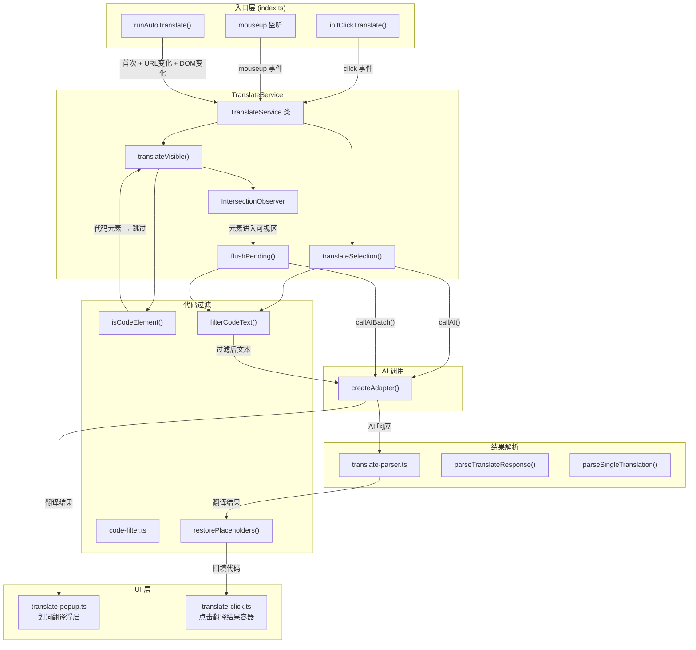
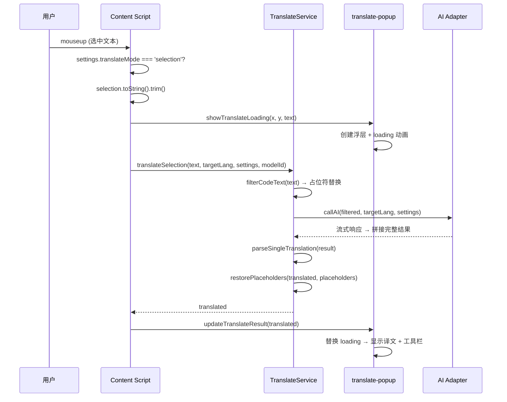
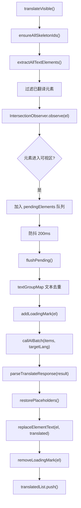
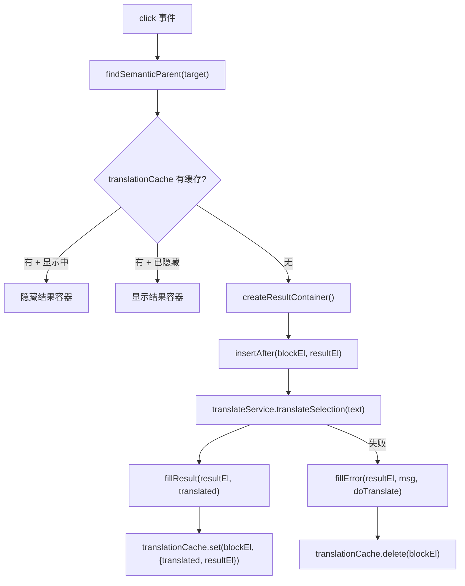
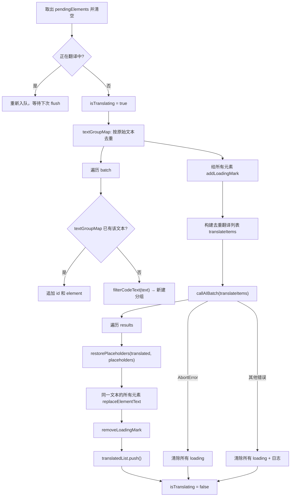
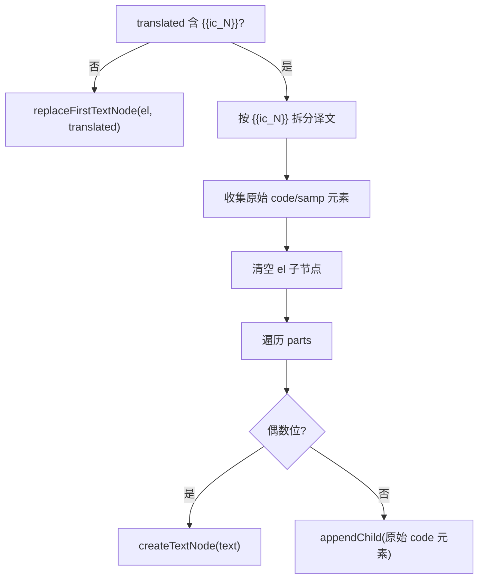
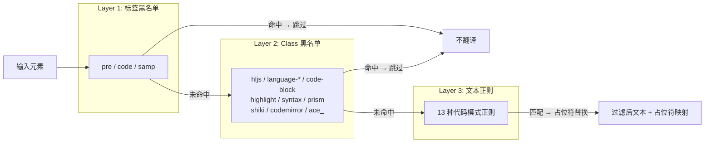
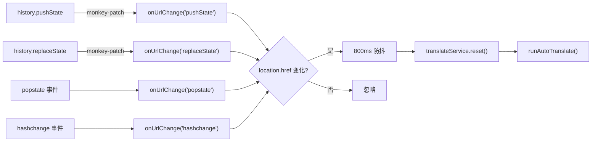
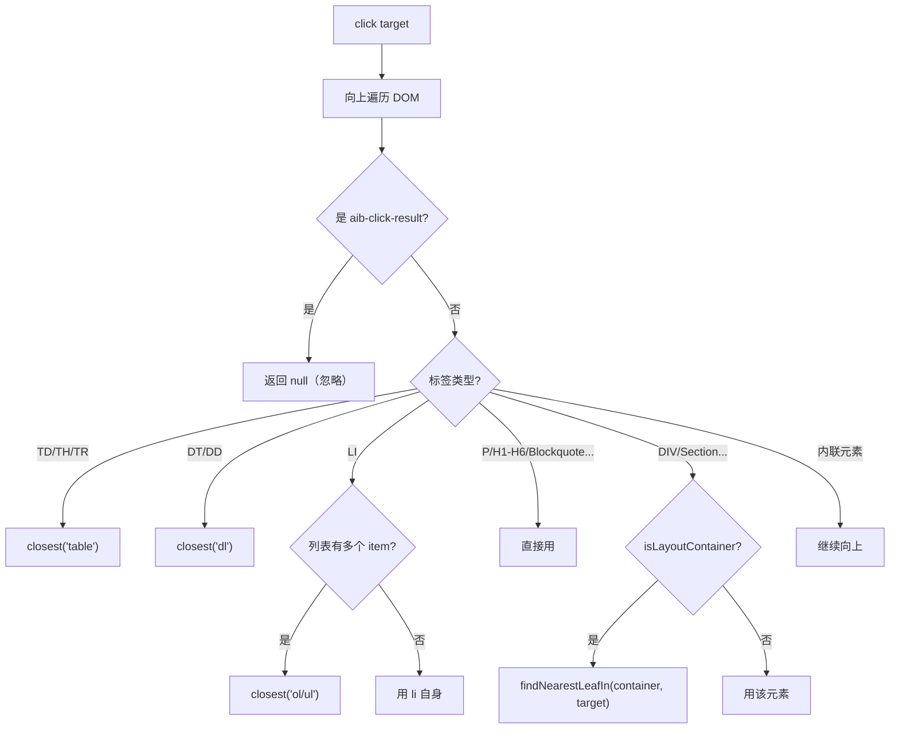
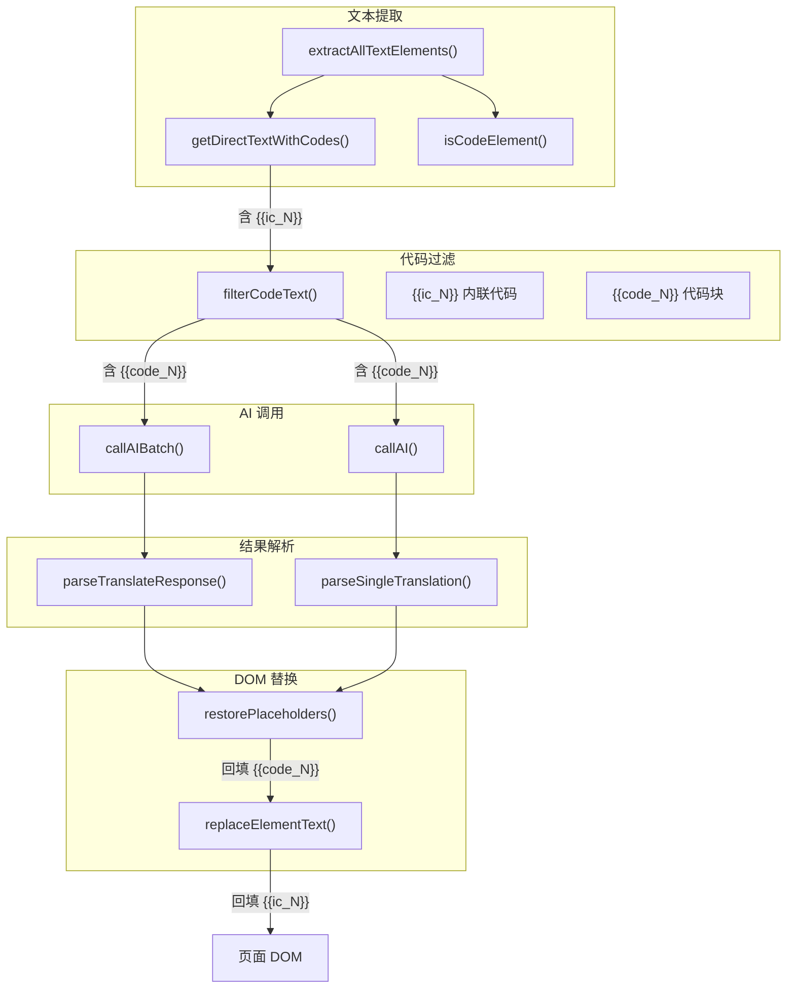

# 翻译功能架构

> 三种翻译模式（划词/自动/点击），三层代码过滤，容错解析器，纯 DOM 实现（不依赖 Vue）。

## 总体架构



---

## 三种翻译模式

### 1. 划词翻译 (selection)



浮层特性：
- 定位在选区附近，自动避让视口边界
- 点击外部 / 页面滚动自动关闭
- 复制按钮
- 错误时显示刷新按钮

### 2. 自动翻译 (auto)



### 3. 点击翻译 (click)



---

## TranslateService 类

源码：`src/browser/translate-service.ts`

### 类结构

```typescript
class TranslateElement {
  id: string;           // data-skeleton-id
  text: string;         // 提取的文本
  el: HTMLElement;       // DOM 元素
  inlineCodes: Map<string, string>;  // {{ic_N}} → 原始代码
}

class TranslateService {
  private translatedList: Array<{ id, original, translated }>;
  private abortController: AbortController | null;
  private isTranslating: boolean;
  private observer: IntersectionObserver | null;
  private pendingElements: TranslateElement[];
  private observedIds: Set<string>;
  private pendingTimer: ReturnType<typeof setTimeout> | null;
  private currentTargetLang: string;
  private currentSettings: AppSettings | null;
  private currentModelId: string | undefined;

  // 公共 API
  async translateSelection(text, targetLang, settings, modelId?): Promise<string>;
  async translateVisible(targetLang, settings, modelId?): Promise<number>;
  abort(): void;
  restoreAll(): void;
  reset(): void;
  get busy(): boolean;
}
```

### translateSelection() — 划词翻译

```typescript
async translateSelection(
  text: string,
  targetLang: string,
  settings: AppSettings,
  modelId?: string,
): Promise<string> {
  const { text: filtered, placeholders } = filterCodeText(text);
  const translated = await this.callAI(filtered, targetLang, settings, false, modelId);
  return restorePlaceholders(translated, placeholders);
}
```

### translateVisible() — 自动翻译入口

```typescript
async translateVisible(
  targetLang: string,
  settings: AppSettings,
  modelId?: string,
): Promise<number> {
  ensureAllSkeletonIds();  // 全量打标
  const elements = this.extractAllTextElements();
  const newElements = elements.filter(el => !translatedIds.has(el.id));

  // 初始化 IntersectionObserver
  if (!this.observer) {
    this.observer = new IntersectionObserver(
      (entries) => this.onIntersection(entries),
      { rootMargin: '0px', threshold: 0 },
    );
  }

  // 注册新元素到 observer
  for (const el of newElements) {
    this.observer.observe(el.el);
    this.observedIds.add(el.id);
  }

  return newElements.length;
}
```

### flushPending() — 批量翻译核心



### 文本去重 (textGroupMap)

相同文本的多个元素只发送一次翻译请求，结果回填到所有相同文本的元素：

```typescript
const textGroupMap = new Map<string, {
  ids: string[];           // 所有相同文本的元素 ID
  elements: TranslateElement[];
  filtered: string;        // 过滤后的文本
  placeholders: Map<string, string>;
}>();
```

### getDirectTextWithCodes() — 文本提取

只遍历直接子节点，不递归：

```typescript
private getDirectTextWithCodes(el: HTMLElement): { text: string; inlineCodes: Map<string, string> } {
  for (const node of el.childNodes) {
    if (node.nodeType === Node.TEXT_NODE) {
      text += node.textContent;        // 文本节点 → 直接拼接
    } else if (node.nodeType === Node.ELEMENT_NODE) {
      if (tag === 'code' || tag === 'samp') {
        text += `{{ic_${counter}}}`;   // 内联代码 → 占位符
        inlineCodes.set(key, child.textContent);
      }
      // 其他元素 → 跳过（不递归）
    }
  }
  // fallback: aria-label / title
  if (!text) text = el.getAttribute('aria-label') || el.getAttribute('title') || '';
  return { text: text.trim().slice(0, 500), inlineCodes };
}
```

示例：`<p>The <code>AudioTrackButton</code> controls</p>` → `text: "The {{ic_01}} controls"`, `inlineCodes: {"{{ic_01}}": "AudioTrackButton"}`

### replaceElementText() — DOM 替换

保留内联代码结构，只替换文本节点：



示例：
- 原始 DOM: `<p>The <code>AudioTrackButton</code> controls</p>`
- 译文: `"应该显示在 {{ic_01}} 控件上"`
- 结果: `<p>应该显示在 <code>AudioTrackButton</code> 控件上</p>`

### Loading 标记

自动翻译的 loading 是 12x12px 旋转圆圈，注入到元素内部：

```typescript
private addLoadingMark(el: HTMLElement): void {
  const mark = document.createElement('span');
  mark.className = 'aib-tl-loading';
  mark.setAttribute('translate', 'no');  // 防止被翻译
  el.appendChild(mark);
}
```

样式：
```css
.aib-tl-loading {
  display: inline-block;
  width: 12px; height: 12px;
  border: 2px solid #409eff;
  border-top-color: transparent;
  border-radius: 50%;
  animation: aib-tl-spin 0.6s linear infinite;
}
```

---

## 代码过滤 (code-filter.ts)

源码：`src/browser/code-filter.ts`

### 三层过滤机制



### Layer 1 + 2: isCodeElement()

```typescript
function isCodeElement(el: HTMLElement): boolean {
  const tag = el.tagName.toLowerCase();

  if (tag === 'pre') return true;

  if (tag === 'code') {
    // 父级是 pre → 跳过
    if (parent.tagName === 'pre') return true;
    // 独立 code 块（无文本兄弟节点）→ 跳过
    let hasTextSibling = false;
    for (const node of parent.childNodes) {
      if (node.nodeType === Node.TEXT_NODE && node.textContent?.trim()) {
        hasTextSibling = true;
      }
    }
    if (!hasTextSibling) return true;
  }

  if (tag === 'samp') return true;

  // Class 特征匹配
  const lower = el.className.toLowerCase();
  for (const keyword of CODE_CLASS_KEYWORDS) {
    if (lower.includes(keyword)) return true;
  }
}
```

### Layer 3: 文本正则

13 种代码模式，按优先级排列（先匹配长模式）：

| 序号 | Label | 正则 | 匹配内容 |
|------|-------|------|----------|
| 1 | `block-comment` | `/\/\*[\s\S]*?\*\//g` | 多行注释 |
| 2 | `backtick` | `` /`[^`\n]+`/g `` | 反引号包裹 |
| 3 | `line-comment` | `/\/\/[^\n]*/g` | 单行注释 |
| 4 | `url` | `/https?:\/\/[^\s<>)"'，。！？]+/g` | URL |
| 5 | `cli` | `/^[\s]*[$>#][ \t]+[^\n]+/gm` | 命令行 |
| 6 | `json` | `/\{[^}]*"[^"]*"\s*:[^}]*\}/g` | JSON 片段 |
| 7 | `func-call` | `/\b[a-zA-Z_$][\w$]*\s*\([^)]*\)/g` | 函数调用 |
| 8 | `prop-chain` | `/\b[a-zA-Z_$][\w$]*(?:\.[a-zA-Z_$][\w$]*){2,}\b/g` | 属性链 |
| 9 | `brace-block` | `/\{[^{}\n]{2,}\}/g` | 花括号块 |
| 10 | `bracket-block` | `/\[[^\[\]\n]{2,}\]/g` | 方括号块 |
| 11 | `keywords` | 编程关键字连续 2+ 个 | function/const/let/... |
| 12 | `version` | `/\b\d+\.\d+\.\d+(?:[\w.-]*)\b/g` | 版本号 |
| 13 | `filepath` | `/(?:\/[\w.-]+){2,}\.\w+/g` | 文件路径 |

### filterCodeText() — 文本过滤

```typescript
function filterCodeText(text: string): FilterResult {
  const placeholders = new Map<string, string>();
  let counter = 0;
  let result = text;

  for (const { pattern } of CODE_PATTERNS) {
    const re = new RegExp(pattern.source, pattern.flags);
    result = result.replace(re, (match) => {
      // 跳过纯中文内容
      if (/^[一-鿿\s，。！？、；：""''（）【】《》]+$/.test(match)) {
        return match;
      }
      counter++;
      const key = `{{code_${String(counter).padStart(2, '0')}}}`;
      placeholders.set(key, match);
      return key;
    });
  }

  return { text: result, placeholders };
}
```

纯中文检测避免误杀中文方括号/花括号等标点。

### restorePlaceholders() — 占位符回填

```typescript
function restorePlaceholders(text: string, placeholders: Map<string, string>): string {
  let result = text;
  for (const [key, original] of placeholders) {
    result = result.split(key).join(original);
  }
  return result;
}
```

---

## 翻译结果解析 (translate-parser.ts)

源码：`src/browser/translate-parser.ts`

### parseTranslateResponse() — 批量翻译解析

三层容错：

```mermaid
flowchart TD
    A["AI 响应文本"] --> B["策略 1: JSON.parse(trimmed)"]
    B -->|成功 + 是数组| C["validateResults() → 返回"]
    B -->|失败| D["策略 2: 正则提取 [...] 块"]

    D -->|"regex: /\[[\s\S]*?\]/g"| E["从最后一个匹配开始尝试"]
    E -->|JSON.parse 成功| F["validateResults() → 返回"]
    E -->|失败| G["继续下一个块"]

    D -->|无匹配| H["策略 3: 逐行提取"]
    H --> I["regex: /\{\"id\":\"eN\",\"translated\":\"...\"\}/g"]
    I --> J["unescapeJson() → 返回"]
```

### validateResults() — 结果验证

```typescript
function validateResults(arr: unknown[]): TranslateResult[] {
  return arr.filter(
    (item): item is TranslateResult =>
      typeof item === 'object' && item !== null &&
      typeof item.id === 'string' &&
      typeof item.translated === 'string' &&
      /^e\d+$/.test(item.id),  // id 格式: e1, e2, e3...
  );
}
```

### parseSingleTranslation() — 划词翻译解析

```mermaid
flowchart TD
    A["AI 响应文本"] --> B["JSON.parse(trimmed)"]
    B -->|成功 + 有 translated 字段| C["返回 obj.translated"]
    B -->|失败| D["正则匹配 \"translated\":\"...\""]
    D -->|匹配| E["unescapeJson(m[1])"]
    D -->|不匹配| F["去除常见前后缀"]

    F --> F1["去掉 '以下是/这是/翻译结果：' 前缀"]
    F1 --> F2["去掉 '希望/以上...' 后缀"]
    F2 --> G["返回清理后的文本"]
```

### unescapeJson() — JSON 反转义

```typescript
function unescapeJson(s: string): string {
  try {
    return JSON.parse(`"${s}"`);  // 利用 JSON.parse 反转义
  } catch {
    return s;  // 解析失败返回原值
  }
}
```

---

## URL 变化检测

源码：`entrypoints/content/index.ts`

### 实现方式



### 防抖设计

800ms 防抖避免 SPA 连续路由跳转时重复触发翻译。`reset()` 清空已翻译列表和 observer，`runAutoTranslate()` 重新扫描。

---

## 点击翻译 (translate-click.ts)

源码：`src/browser/translate-click.ts`

### findSemanticParent() — 语义父级查找



### 缓存机制

```typescript
const translationCache = new WeakMap<HTMLElement, {
  translated: string;
  resultEl: HTMLElement;
}>();
```

使用 `WeakMap` 避免内存泄漏。元素被 GC 时缓存自动清理。

交互逻辑：
- 首次点击 → 请求 AI → 显示翻译
- 再次点击（显示中）→ 隐藏翻译
- 再次点击（已隐藏）→ 显示缓存的翻译

---

## IntersectionObserver 配置

```typescript
this.observer = new IntersectionObserver(
  (entries) => this.onIntersection(entries),
  { rootMargin: '0px', threshold: 0 },
);
```

| 参数 | 值 | 说明 |
|------|-----|------|
| `rootMargin` | `'0px'` | 不扩展可视区域边界 |
| `threshold` | `0` | 元素任何部分可见即触发 |

元素进入可视区后立即加入 `pendingElements` 队列并 `unobserve`，防止重复触发。

---

## 整体数据流



两种占位符的区别：
- `{{ic_N}}`：内联代码（`<code>` 元素），由 `getDirectTextWithCodes` 生成，`replaceElementText` 在 DOM 替换时回填
- `{{code_N}}`：文本中的代码模式（正则匹配），由 `filterCodeText` 生成，`restorePlaceholders` 在字符串层面回填
