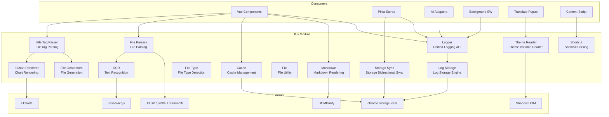
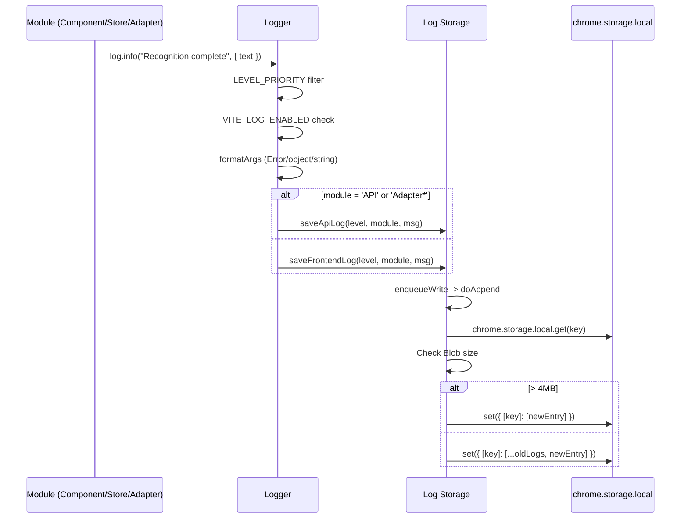
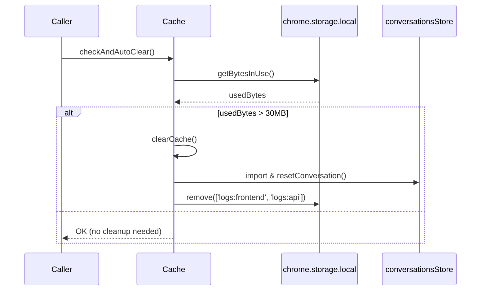
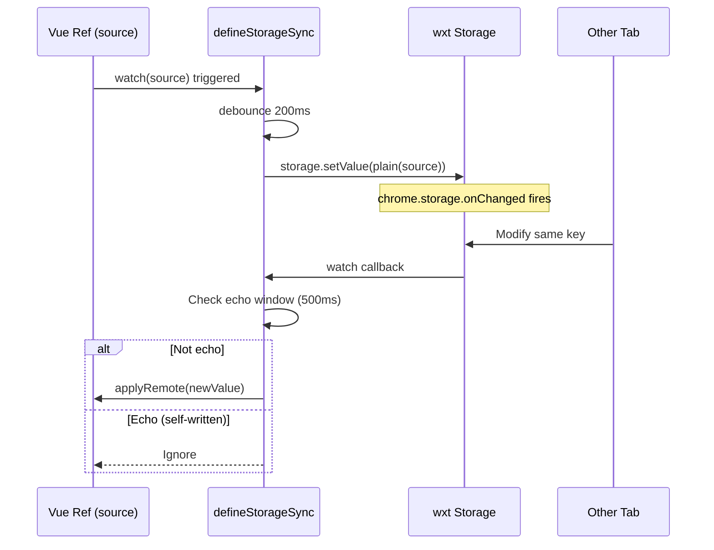

# Utils Module Architecture

[中文](./utils.md)

## Module Overview

`src/utils/` contains shared infrastructure used by multiple modules across the project. These utilities contain no business logic; they provide foundational capabilities for upper-layer modules (components, stores, adapters, etc.).

| File | Responsibility |
|------|---------------|
| `logger.ts` | Unified logging API, categorized by module, written to `chrome.storage.local` |
| `log-storage.ts` | Log storage engine, frontend/API log separation, 4MB auto-rotation, download export |
| `cache.ts` | Cache management, clears conversation messages and logs, 30MB threshold auto-cleanup |
| `shortcut.ts` | Keyboard shortcut parsing and matching, supports Ctrl/Shift/Alt/Meta combinations |
| `markdown.ts` | Markdown -> HTML rendering (highlight.js + KaTeX + DOMPurify), with plain variant |
| `theme-reader.ts` | Reads extension CSS variables from outside Shadow DOM, with dark theme default cache |
| `storage-sync.ts` | Reactive ref <-> chrome.storage bidirectional sync, 200ms debounce + 500ms echo window |
| `file-type.ts` | File type detection and classification (60+ code extension mappings) |
| `file-parsers.ts` | File parsing entry point, supports image/text/code/PDF/Word/Excel, with OCR |
| `file-generators.ts` | File generation tools (Excel/PDF/Word/CSV/image), with download triggers |
| `file-tag-parser.ts` | `[FILE:xxx]...[/FILE]` tag parsing from AI responses and file card rendering |
| `file.ts` | File utility (File -> dataURL) |
| `ocr.ts` | OCR text recognition, based on Tesseract.js, supports Chinese-English mixed content |
| `echart-renderer.ts` | ECharts chart renderer, supports DOM/Canvas/PNG/SVG output |

## Architecture Design



## Core Type Definitions

### LogLevel

```typescript
// src/utils/logger.ts
type LogLevel = 'DEBUG' | 'INFO' | 'WARN' | 'ERROR'
const LEVEL_PRIORITY: Record<LogLevel, number> = {
  DEBUG: 0,
  INFO: 1,
  WARN: 2,
  ERROR: 3,
}
```

### LogEntry

```typescript
// src/utils/log-storage.ts
interface LogEntry {
  time: string        // "YYYY-MM-DD HH:mm:ss"
  level: LogLevel
  module: string      // "ComponentName" | "Store:X" | "Adapter:X" | "API"
  msg: string
}
```

### AttachmentType (File Types)

```typescript
// src/types.ts (used by file-type.ts)
type AttachmentType = 'image' | 'text' | 'code' | 'pdf' | 'word' | 'excel' | 'binary'
```

### Storage Sync Options

```typescript
// src/utils/storage-sync.ts
interface SyncOptions<T> {
  source: Ref<T>                    // Reactive data ref
  storage: StorageItemLike<T>       // wxt storage item
  ready: Ref<boolean>               // Ready flag, won't write when false
  applyRemote: (nv: T) => void      // Remote value -> apply to source
  debounce?: number                 // Debounce delay (ms), default 200
  echoWindow?: number               // Self-write echo ignore window (ms), default 500
}
```

### ChartConfig

```typescript
// src/utils/echart-renderer.ts
interface ChartConfig {
  option: EChartsOption  // ECharts option
  width?: number         // Default 800
  height?: number        // Default 500
  theme?: string         // 'light' | 'dark' | custom theme name
}
```

### ParsedFile (File Tag Parsing)

```typescript
// src/utils/file-tag-parser.ts
type FileCategory = 'text' | 'data' | 'excel' | 'json' | 'pdf' | 'chart'

interface ParsedFile {
  filename: string
  content: string
  extension: string
  category: FileCategory
  chartConfig?: ChartConfig
  size: number
  index: number
}
```

## Implementation Details

### Logger (logger.ts)

Unified logging API, categorized by module, written to `chrome.storage.local`.

**Core Mechanisms**:
- **Lazy loading**: `loadLogStorage()` dynamically imports `./log-storage` and caches write functions
- **Level filtering**: `LEVEL_PRIORITY` comparison; logs below `globalMinLevel` are discarded
- **Environment check**: `import.meta.env.VITE_LOG_ENABLED` being false skips all logging
- **Auto-routing**: Module name `'API'` or starting with `'Adapter'` -> `logs:api` key; everything else -> `logs:frontend` key
- **Argument formatting**: Error objects extract `message + stack`; objects use `JSON.stringify` (indent 2); circular references fallback to `String()`

**Exports**:
- `Logger` class: `debug()`, `info()`, `warn()`, `error()` methods
- `setLogLevel(level)`: Set global minimum log level

### Log Storage (log-storage.ts)

Log storage engine with frontend/API log separation.

**Storage Keys**: `logs:frontend` (frontend logs), `logs:api` (API logs)

**Write Queue**: `writeQueues` uses Promise chains to guarantee write order per key.

**4MB Auto-rotation**: In `doAppend()`, after appending, checks `Blob` size. When exceeding `MAX_STORAGE_BYTES` (4MB), clears old logs and keeps only the current entry.

**Download Export**: `downloadLogs()` fetches both frontend and API logs, triggers browser download via `Blob + <a>` tag. Filename format: `frontend-{date}.log` / `api-{date}.log`.

**Export API**: `saveFrontendLog`, `saveApiLog`, `getFrontendLogs`, `getApiLogs`, `clearAllLogs`, `downloadLogs`

### Cache (cache.ts)

Cache management module with manual clear and auto-cleanup features.

**Cache Limit**: `CACHE_LIMIT = 30MB`

**clearCache()**:
1. Dynamically imports `conversationsStore` to avoid circular dependencies
2. Calls `convStore.resetConversation()` to clear conversation messages
3. `chrome.storage.local.remove(LOG_KEYS)` to clear logs (`logs:frontend`, `logs:api`)
4. **Does NOT clear**: Configuration (stored in wxt/storage), notes, input history

**checkAndAutoClear()**:
1. Calls `chrome.storage.local.getBytesInUse()` to get used space
2. Automatically calls `clearCache()` when exceeding 30MB
3. Silently ignores `getBytesInUse` failures

### Shortcut (shortcut.ts)

Keyboard shortcut parsing and matching.

**matchShortcut(e, shortcut)**: Splits shortcut string (e.g., `"Ctrl+Shift+B"`) into parts, checks modifier keys (Ctrl/Control, Shift, Alt/Option, Meta/Cmd/Command), last part is the key name.

**eventToShortcut(e)**: Converts KeyboardEvent to shortcut string. Standalone modifier keys return null; requires at least one modifier + one key; space becomes `'Space'`; single characters are uppercased.

### Markdown (markdown.ts)

Markdown -> HTML rendering.

**Dependencies**: `markdown-it`, `highlight.js`, `markdown-it-katex`, `dompurify`

**renderMarkdown()**: Full rendering including:
- Code block language labels + copy button (SVG icon)
- Table wrapper container + Excel download button
- KaTeX math formulas
- DOMPurify sanitization (whitelist covers SVG, KaTeX math tags, common HTML elements)

**renderMarkdownPlain()**: Stripped version, no copy button, no download button, no language labels.

**DOMPurify Whitelist** (`PURIFY_CONFIG`):
- `ADD_TAGS`: SVG tags, table tags, KaTeX math tags (math, semantics, mrow, etc.)
- `ADD_ATTR`: SVG attributes, common attributes, KaTeX attributes
- `ALLOW_DATA_ATTR: true`

### Theme Reader (theme-reader.ts)

Reads extension CSS variables from outside Shadow DOM, used by translate-popup and similar components injected into `document.body`.

**Two-tier Host Lookup**:
1. Via `data-aib-host`, `aib-app`, `.aib-root-host` selectors
2. Full DOM traversal, checking `shadowRoot` + `--aib-primary` inline style

**DARK_DEFAULTS**: 25 CSS variables with dark theme hardcoded default values (e.g., `--aib-primary: #a855f7`).

**getThemeVar(name)**: Reads from `getComputedStyle(host)`, falls back to `DARK_DEFAULTS`.

**Cache**: `cachedHost` + `cacheValid` module-level variables cache lookup results. `invalidateThemeCache()` manually invalidates the cache.

### Storage Sync (storage-sync.ts)

Implements bidirectional sync between reactive ref and chrome.storage.

**Core Mechanisms**:
- `plain(v)`: `JSON.parse(JSON.stringify(toRaw(v)))` to strip proxy and reactivity
- **Cross-tab sync**: `storage.watch()` listens for changes, 500ms echo window ignores self-triggered echoes
- **Local changes**: `watch(source, ...)` deep watch, 200ms debounce write
- **Context check**: `isContextValid()` checks if `chrome.runtime.id` is valid
- **Explicit write**: `flush()` bypasses debounce for immediate write

**Exports**: `defineStorageSync()` returns `{ isApplyingRemote, markSelfWrite, flush }`

### File Type (file-type.ts)

File type detection and classification tool.

**Code Extension Mapping**: `CODE_EXTENSIONS` contains 60+ extension -> language identifier mappings (JS/TS/Python/Java/Go/Rust, etc.).

**detectFileType(file)**: Detection priority:
1. MIME prefix `image/` -> `'image'`
2. PDF extension or MIME -> `'pdf'`
3. Word extension or MIME -> `'word'`
4. Excel MIME (excluding csv/tsv) or xls/xlsx extension -> `'excel'`
5. `CODE_EXTENSIONS` match -> `'code'`
6. `TEXT_EXTENSIONS` match -> `'text'`
7. No extension + `TEXT_FILENAMES` match -> `'text'`
8. MIME `text/*` -> `'text'`
9. No extension + no MIME or `application/octet-stream` -> `'text'`
10. Other -> `'binary'`

**Other Exports**: `getExtension()`, `getCodeLang()`, `getFileTypeIcon()`, `formatFileSize()`

### File Parsers (file-parsers.ts)

Unified file parsing entry point, converts different file types to a unified `Attachment` structure.

**parseFile(file)**: Dispatches to corresponding parser based on `detectFileType()` result:
- `image` -> `parseImage()`: Generates dataURL, OCR triggered asynchronously by caller
- `text`/`code` -> `parseText()`: UTF-8 read, code files auto-detect language
- `pdf` -> `parsePdf()`: pdfjs-dist extracts text, Worker uses main-thread fake worker mode
- `word` -> `parseWord()`: mammoth extracts plain text
- `excel` -> `parseExcel()`: xlsx library reads, CSV/TSV reads as text directly
- `binary` -> `parseBinary()`: Tries reading as text first, falls back to metadata only

**Fallback Strategy**: Non-binary types that fail parsing or have empty content call `tryReadAsText()` to attempt text reading.

**Size Limits**:
- Text content: 500KB (`MAX_TEXT_CONTENT_SIZE`)
- Text files: 2MB (`MAX_TEXT_FILE_SIZE`)
- Binary files: 10MB (`MAX_BINARY_FILE_SIZE`)
- Images: 20MB (`MAX_IMAGE_FILE_SIZE`)

**Original File Cache**: `originalFileCache` (Map) caches attachment id -> File reference for preview modal downloads.

**OCR**: `ocrAttachment()` performs Tesseract.js OCR on parsed image attachments, updating the `content` field in-place.

### File Generators (file-generators.ts)

Unified file generation tools.

**Excel Generation**:
- `generateXlsx(rows, sheetName)`: 2D array -> Excel Blob
- `generateXlsxFromCsv(csvContent)`: CSV text -> Excel Blob
- `generateXlsxFromContent(content)`: Smart parsing (TSV/pipe-delimited/plain text) -> Excel Blob

**Word Generation**: `generateDocx(content)` uses docx library, splits content by lines into paragraphs.

**PDF Generation**:
- `generatePdf(content)`: Plain text -> HTML -> Canvas screenshot -> PDF
- `generatePdfFromMarkdown(markdown)`: Markdown -> simple HTML -> Canvas -> PDF
- `htmlToPdf()`: Core function, scoped class name isolation + A4 pagination + auto-scale-down to avoid canvas height limit

**Download Tools**: `triggerDownload(blob, filename)`, `triggerDownloadFromDataUrl()`, `triggerDownloadFromUrl()`

**Formatting Tools**: `formatBytes()`, `formatJson()`, `isTextExtension()`, `getMimeType()`

### File Tag Parser (file-tag-parser.ts)

`[FILE:xxx]...[/FILE]` tag parser for AI responses.

**Tag Regex** (`FILE_TAG_REGEX`): Compatible with standard format, Windows line endings, space after colon, lowercase tags, unclosed tags, and other AI output formats.

**parseFileTags(text)**: Extracts all file tags from text, parsing filename, content, extension, and category. `.chart` files additionally parse as `ChartConfig`.

**File Category Mapping** (`EXTENSION_CATEGORY`):
- Text: txt/md/html/css/js/ts/py/java/go, etc.
- Data: csv/tsv
- Excel: xlsx/xls
- JSON: json
- PDF: pdf
- Chart: chart

**renderFileCards(text)**: Replaces `[FILE]` tags with file card HTML, supporting download buttons, chart previews, etc.

**generateFileBlob(file)**: Generates appropriate Blob based on file category (text/text, data/CSV+BOM, Excel/xlsx, JSON/formatted, PDF/canvas screenshot, Word/docx).

**Event Handling**: `extractDownloadInfo(event)` extracts download info from click events; `handleFileDownload()` executes the corresponding download action.

### File (file.ts)

Simple file utility module.

**fileToDataURL(file)**: Uses `FileReader.readAsDataURL()` to convert File to base64 dataURL.

### OCR (ocr.ts)

Front-end OCR text recognition based on Tesseract.js.

**Language**: `chi_sim+eng` (Simplified Chinese + English mixed)

**Language Pack Path**: `chrome.runtime.getURL('/tesseract')` loaded from extension locally, avoiding CSP blocking CDN requests.

**Timeout Protection**: 30-second timeout (`OCR_TIMEOUT`) to prevent permanent hanging from language pack download failures.

**recognizeImage(dataUrl, onProgress)**: Returns recognized text, progress via `onProgress(0~1)` callback. Returns empty string on failure.

### EChart Renderer (echart-renderer.ts)

ECharts chart renderer supporting multiple output formats.

**Dynamic Loading**: `loadECharts()` uses `import('echarts')` for on-demand loading, module-level cache prevents duplicate loading.

**Config Parsing** (`parseChartConfig`): Supports two formats:
1. Full format: `{ "option": {...}, "width": 800, "height": 500 }`
2. Simplified format: Direct option object (backward compatible, must include series/xAxis/yAxis/radar/tooltip)

**Render Functions**:
- `renderChartToElement(container, config)`: Renders to DOM container, returns cleanup function
- `renderChartToCanvas(config)`: Off-screen Canvas rendering (2x resolution)
- `renderChartToBlob(config)`: Renders to PNG Blob
- `renderChartToSvg(config)`: Renders to SVG string

**Config Templates**: `createBarChartConfig`, `createLineChartConfig`, `createPieChartConfig`, `createRadarChartConfig`

## Data Flow

### Log Write Chain



### Cache Auto-Clear Chain



### Storage Sync Bidirectional Sync



## Configuration & Extension

| Config | Location | Default | Description |
|--------|----------|---------|-------------|
| `VITE_LOG_ENABLED` | Build env var | Build-time injected | false in production, skips all logging |
| `globalMinLevel` | logger.ts module var | `'DEBUG'` | Adjustable via `setLogLevel()` |
| `MAX_STORAGE_BYTES` | log-storage.ts | 4MB | Per-key storage limit |
| `CACHE_LIMIT` | cache.ts | 30MB | Auto-clear threshold |
| `LOG_KEYS` | cache.ts | `['logs:frontend', 'logs:api']` | Keys removed during cache clear |
| `DARK_DEFAULTS` | theme-reader.ts | 25 CSS vars | Dark theme default values |
| `OCR_TIMEOUT` | ocr.ts | 30s | OCR timeout |
| `OCR_LANG` | ocr.ts | `'chi_sim+eng'` | OCR recognition language |
| `MAX_TEXT_CONTENT_SIZE` | file-parsers.ts | 500KB | Max text content length |
| `MAX_BINARY_FILE_SIZE` | file-parsers.ts | 10MB | Max binary file size |
| `MAX_IMAGE_FILE_SIZE` | file-parsers.ts | 20MB | Max image file size |

**Extension Points**:
- Add LogLevel types
- Add cache cleanup keys (add to `LOG_KEYS`)
- Add theme variables (add to `DARK_DEFAULTS`)
- Add Markdown plugins (via `md.use()`)
- Add file types (add to `CODE_EXTENSIONS` / `TEXT_EXTENSIONS`)
- Add ECharts config templates (refer to `createBarChartConfig` etc.)

## Known Limitations

1. **Log persistence**: chrome.storage.local has a 5MB total limit; rotation loses all old data
2. **Silent log loss**: `loadLogStorage` catch and `doAppend` catch silently ignore errors
3. **Theme cache**: Full DOM traversal fallback has performance cost with many elements
4. **Theme cache consistency**: `cachedHost`/`cacheValid` are module-level variables; dynamic DOM changes require manual `invalidateThemeCache()` calls
5. **Markdown security**: DOMPurify allows `style` and `data-*` attributes, limited CSS injection risk
6. **Shortcut conflicts**: `matchShortcut` doesn't handle browser/system shortcut conflicts
7. **No remote log collection**: Logs only stored locally
8. **PDF generation**: Canvas screenshot approach; A4 pagination based on fixed pixel height, may not be precise at different DPIs
9. **OCR timeout**: Returns empty string after 30s timeout when language pack download fails, no retry mechanism
10. **ECharts first load**: Dynamic import adds first-render delay; can be mitigated with `preloadECharts()`
11. **cache.ts simplification**: No longer maintains a separate `CACHE_KEYS` array; conversation clearing is done via `conversationsStore.resetConversation()`
