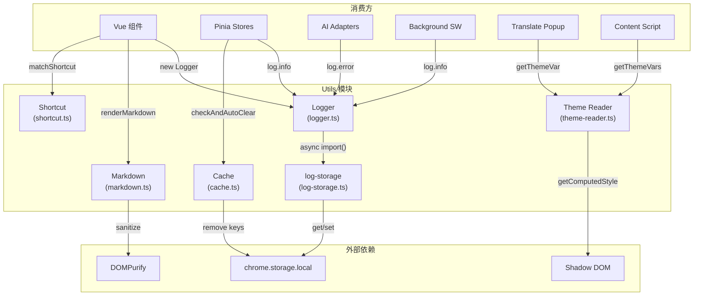
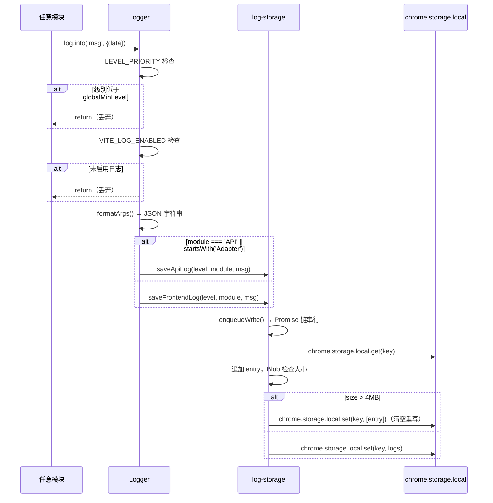
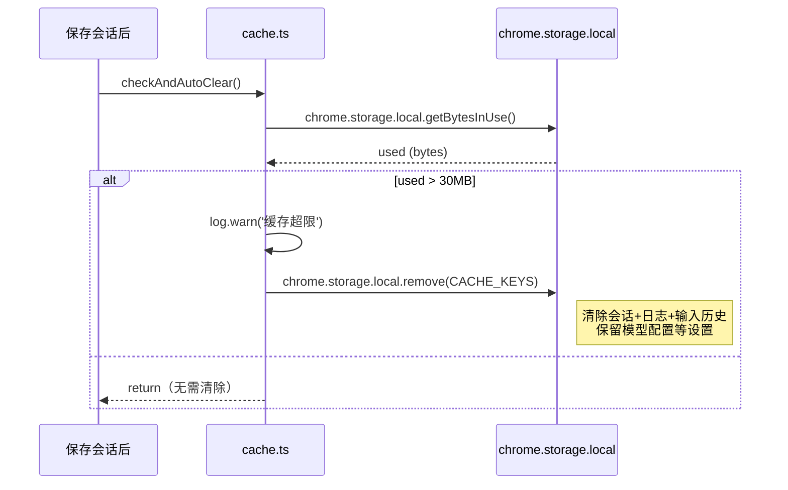

# Utils 模块架构文档

通用工具模块，提供日志、缓存、快捷键、Markdown 渲染、主题读取等基础能力。

## 模块概述

`src/utils/` 包含项目中多个模块共享的基础设施。这些工具不包含业务逻辑，而是为上层模块（组件、Store、适配器等）提供底层能力。

| 文件 | 职责 | 行数 |
|------|------|------|
| `logger.ts` | 统一日志 API，按模块分类写入 `chrome.storage.local` | ~100 |
| `log-storage.ts` | 日志存储引擎，前端/API 日志分离，4MB 自动轮转，支持下载导出 | ~120 |
| `cache.ts` | 缓存管理，手动/自动清除会话、日志、输入历史，30MB 阈值自动清理 | ~47 |
| `shortcut.ts` | 快捷键解析与匹配，支持 Ctrl/Shift/Alt/Meta 组合 | ~37 |
| `markdown.ts` | Markdown -> HTML 渲染（highlight.js + KaTeX + DOMPurify），含纯净版 | ~95 |
| `theme-reader.ts` | 从 Shadow DOM 外部读取扩展 CSS 变量，含暗色主题默认值缓存 | ~96 |

## 架构设计



## 核心类型定义

### LogLevel

```typescript
// logger.ts / log-storage.ts
type LogLevel = 'DEBUG' | 'INFO' | 'WARN' | 'ERROR'

const LEVEL_PRIORITY: Record<LogLevel, number> = {
  DEBUG: 0,
  INFO: 1,
  WARN: 2,
  ERROR: 3,
}
```

级别过滤基于数值比较：`LEVEL_PRIORITY[level] < LEVEL_PRIORITY[globalMinLevel]` 时丢弃。

### LogEntry

```typescript
// log-storage.ts
interface LogEntry {
  time: string        // "YYYY-MM-DD HH:mm:ss"
  level: LogLevel
  module: string      // "ComponentName" | "Store:X" | "Adapter:X" | "API"
  msg: string
}
```

每条日志包含时间戳、级别、模块标识和格式化后的消息体。

### FilterResult（Shortcut 模块无显式类型）

`matchShortcut` 返回 `boolean`，`eventToShortcut` 返回 `string | null`。无独立的 FilterResult 类型。

## 实现细节

### Logger (`logger.ts`)

**类签名：**

```typescript
class Logger {
  constructor(module: string)
  debug(...args: unknown[]): void
  info(...args: unknown[]): void
  warn(...args: unknown[]): void
  error(...args: unknown[]): void
}
```

**延迟加载（Lazy Import）：**

Logger 不在模块顶层导入 `log-storage`，而是通过缓存变量 + 动态 `import()` 实现延迟加载，避免循环依赖和启动开销：

```typescript
let cachedSaveFrontendLog: ((level: LogLevel, module: string, msg: string) => void) | null = null
let cachedSaveApiLog: ((level: LogLevel, module: string, msg: string) => void) | null = null
let logStorageLoaded = false

function loadLogStorage() {
  if (logStorageLoaded) return
  logStorageLoaded = true
  import('./log-storage').then((mod) => {
    cachedSaveFrontendLog = mod.saveFrontendLog
    cachedSaveApiLog = mod.saveApiLog
  }).catch(() => {})
}
```

首次调用 `log()` 时触发 `loadLogStorage()`，后续调用跳过。`catch(() => {})` 静默忽略加载失败。

**级别过滤 + 环境开关：**

```typescript
private log(level: LogLevel, ...args: unknown[]) {
  // 1. 级别过滤
  if (LEVEL_PRIORITY[level] < LEVEL_PRIORITY[globalMinLevel]) return
  // 2. 环境开关：VITE_LOG_ENABLED 为 falsy 时直接跳过
  if (!import.meta.env.VITE_LOG_ENABLED) return
  // 3. 格式化 + 路由写入
  const msg = formatArgs(args)
  if (!logStorageLoaded) loadLogStorage()
  if (this.module === 'API' || this.module.startsWith('Adapter')) {
    cachedSaveApiLog?.(level, this.module, msg)
  } else {
    cachedSaveFrontendLog?.(level, this.module, msg)
  }
}
```

**自动路由规则：**

| 模块名 | 路由目标 | 存储键 |
|--------|----------|--------|
| `'API'` | API 日志 | `logs:api` |
| 以 `'Adapter'` 开头 | API 日志 | `logs:api` |
| 其他所有 | 前端日志 | `logs:frontend` |

**参数格式化：**

```typescript
function formatArgs(args: unknown[]): string {
  return args
    .map((a) => {
      if (a instanceof Error) return `${a.message}\n${a.stack}`
      if (typeof a === 'object') {
        try { return JSON.stringify(a, null, 2) }
        catch { return String(a) }
      }
      return String(a)
    })
    .join(' ')
}
```

Error 对象自动提取 `message + stack`；对象 `JSON.stringify` 带缩进；循环引用 fallback 到 `String()`。

---

### Log Storage (`log-storage.ts`)

**存储键：**

| 键 | 内容 |
|----|------|
| `logs:frontend` | 组件、Store、工具模块日志 |
| `logs:api` | API 请求/响应日志 |

**写入队列：**

```typescript
const writeQueues: Record<string, Promise<void>> = {}

function enqueueWrite(key: string, entry: LogEntry): void {
  const prev = writeQueues[key] || Promise.resolve()
  writeQueues[key] = prev.then(() => doAppend(key, entry)).catch(() => doAppend(key, entry))
}
```

同一 storage key 的写入串行执行（Promise 链），避免并发读写导致日志丢失。即使前一次写入失败，后续写入仍会执行（`.catch(() => doAppend(...))`）。

**4MB 自动轮转：**

```typescript
const MAX_STORAGE_BYTES = 4 * 1024 * 1024 // 4MB 上限，留 1MB 余量

async function doAppend(key: string, entry: LogEntry): Promise<void> {
  const result = await chrome.storage.local.get(key)
  const logs: LogEntry[] = result[key] || []
  logs.push(entry)
  const size = new Blob([JSON.stringify(logs)]).size
  if (size > MAX_STORAGE_BYTES) {
    await chrome.storage.local.set({ [key]: [entry] })  // 清空后仅保留当前条目
  } else {
    await chrome.storage.local.set({ [key]: logs })
  }
}
```

`chrome.storage.local` 总配额 5MB，日志预留 4MB。超限时丢弃全部旧日志，仅保留当前条目。

**下载导出：**

```typescript
export async function downloadLogs(): Promise<void> {
  const [frontendLogs, apiLogs] = await Promise.all([getFrontendLogs(), getApiLogs()])
  const date = new Date().toISOString().slice(0, 10)
  downloadAsFile(`frontend-${date}.log`, formatLogLines(frontendLogs))
  downloadAsFile(`api-${date}.log`, formatLogLines(apiLogs))
}
```

通过 `Blob` + `<a>` 标签触发浏览器下载，日志格式为 `[时间] [级别] [模块] 消息`。

**完整导出 API：**

| 函数 | 签名 | 说明 |
|------|------|------|
| `saveFrontendLog` | `(level, module, msg) => void` | 写入前端日志（仅 debug 包） |
| `saveApiLog` | `(level, module, msg) => void` | 写入 API 日志（仅 debug 包） |
| `getFrontendLogs` | `() => Promise<LogEntry[]>` | 读取前端日志 |
| `getApiLogs` | `() => Promise<LogEntry[]>` | 读取 API 日志 |
| `clearAllLogs` | `() => Promise<void>` | 清除所有日志 |
| `downloadLogs` | `() => Promise<void>` | 触发浏览器下载 `.log` 文件 |

---

### Cache (`cache.ts`)

**清除范围：**

```typescript
const CACHE_LIMIT = 30 * 1024 * 1024; // 30MB

const CACHE_KEYS = [
  'ai-browser-conversation',   // 会话消息
  'logs:frontend',             // 前端日志
  'logs:api',                  // API 日志
  'ai-browser-input-history',  // 输入历史
];
```

注意：不清除模型配置等设置数据（存储在 `wxt/storage` 中，不在 `chrome.storage.local`）。

**自动清除：**

```typescript
export async function checkAndAutoClear(): Promise<void> {
  try {
    const used = await chrome.storage.local.getBytesInUse();
    if (used > CACHE_LIMIT) {
      const usedMB = (used / (1024 * 1024)).toFixed(1);
      log.warn(`缓存超限 (${usedMB}MB > 30MB)，自动清除`);
      await clearCache();
    }
  } catch {
    // getBytesInUse 失败时静默忽略
  }
}
```

建议在保存会话后调用 `checkAndAutoClear()`。Logger 自身通过 `CACHE_KEYS` 中的 `logs:frontend` 和 `logs:api` 也被纳入清除范围。

---

### Shortcut (`shortcut.ts`)

**`matchShortcut(e, shortcut)`** — 判断键盘事件是否匹配快捷键字符串。

```typescript
export function matchShortcut(e: KeyboardEvent, shortcut: string): boolean {
  if (!shortcut) return false;
  const parts = shortcut.split('+').map((s) => s.trim().toLowerCase());
  const wantCtrl = parts.includes('ctrl') || parts.includes('control');
  const wantShift = parts.includes('shift');
  const wantAlt = parts.includes('alt') || parts.includes('option');
  const wantMeta = parts.includes('meta') || parts.includes('cmd') || parts.includes('command');
  const key = parts[parts.length - 1];
  if (!key) return false;
  return (
    e.ctrlKey === wantCtrl &&
    e.shiftKey === wantShift &&
    e.altKey === wantAlt &&
    e.metaKey === wantMeta &&
    e.key.toLowerCase() === key.toLowerCase()
  );
}
```

- 格式：`"Ctrl+Shift+B"`，按 `+` 分割
- 支持别名：`Ctrl`/`Control`、`Alt`/`Option`、`Meta`/`Cmd`/`Command`
- 最后一段为按键名，前面为修饰键
- 所有修饰键必须精确匹配（`===`）

**`eventToShortcut(e)`** — 将键盘事件转为快捷键字符串。

```typescript
export function eventToShortcut(e: KeyboardEvent): string | null {
  if (['Control', 'Shift', 'Alt', 'Meta'].includes(e.key)) return null;
  const parts: string[] = [];
  if (e.ctrlKey) parts.push('Ctrl');
  if (e.shiftKey) parts.push('Shift');
  if (e.altKey) parts.push('Alt');
  if (e.metaKey) parts.push('Meta');
  let k = e.key;
  if (k === ' ') k = 'Space';
  else if (k.length === 1) k = k.toUpperCase();
  parts.push(k);
  if (parts.length < 2) return null;
  return parts.join('+');
}
```

- 单独按修饰键返回 `null`
- 至少需要一个修饰键 + 一个普通键
- 空格键转为 `Space`，单字符转大写

---

### Markdown (`markdown.ts`)

**依赖栈：**

| 库 | 用途 |
|----|------|
| `markdown-it` | Markdown 解析引擎 |
| `highlight.js` | 代码语法高亮 |
| `markdown-it-katex` | LaTeX 数学公式渲染 |
| `dompurify` | XSS 防护，白名单过滤 |

**标准渲染 `renderMarkdown(text)`：**

```typescript
export function renderMarkdown(text: string): string {
  if (!text) return '';
  return DOMPurify.sanitize(md.render(text), PURIFY_CONFIG);
}
```

特性：
- **代码块**：语言标签（`<span class="aib-code-lang">`）+ 复制按钮（SVG 图标），包裹在 `<div class="aib-code-wrapper">` 中
- **表格**：自定义渲染规则，包裹在 `<div class="aib-table-wrapper">` 中，附带 Excel 下载按钮
- **数学公式**：KaTeX 渲染，`throwOnError: false`，错误颜色使用 CSS 变量 `var(--aib-danger, #cc0000)`
- **XSS 防护**：DOMPurify 白名单过滤

**纯净版渲染 `renderMarkdownPlain(text)`：**

```typescript
export function renderMarkdownPlain(text: string): string {
  if (!text) return '';
  return DOMPurify.sanitize(mdPlain.render(text), PURIFY_CONFIG);
}
```

与标准版的区别：无复制按钮、无下载按钮、无语言标签，用于非交互场景（如消息气泡预览）。

**highlight 回调：**

```typescript
highlight(str: string, lang: string): string {
  let highlighted: string;
  if (lang && hljs.getLanguage(lang)) {
    try {
      highlighted = hljs.highlight(str, { language: lang, ignoreIllegals: true }).value;
    } catch {
      highlighted = md.utils.escapeHtml(str);
    }
  } else {
    highlighted = md.utils.escapeHtml(str);
  }
  // ... 包裹 HTML
}
```

支持语言检测时使用 `hljs.highlight()`，否则 fallback 到 `escapeHtml()` 转义。

**DOMPurify 白名单（`PURIFY_CONFIG`）：**

```typescript
const PURIFY_CONFIG = {
  ADD_TAGS: [
    'svg', 'path', 'line', 'polyline', 'rect', 'circle', 'pre', 'code', 'span',
    'table', 'thead', 'tbody', 'tr', 'th', 'td', 'button', 'div', 'details', 'summary',
    // KaTeX 所需标签
    'math', 'semantics', 'mrow', 'mi', 'mo', 'mn', 'msup', 'msub', 'mfrac',
    'msubsup', 'mover', 'munder', 'munderover', 'msqrt', 'mroot', 'mtable',
    'mtr', 'mtd', 'maction', 'menclose', 'mpadded', 'mphantom', 'mglyph',
    'annotation', 'annotation-xml',
  ],
  ADD_ATTR: [
    // SVG 属性
    'viewBox', 'fill', 'stroke', 'stroke-width', 'stroke-linecap', 'stroke-linejoin',
    'd', 'x', 'y', 'x1', 'y1', 'x2', 'y2', 'rx', 'ry', 'cx', 'cy', 'r', 'points',
    'width', 'height',
    // 通用属性
    'class', 'id', 'title', 'style', 'colspan', 'rowspan',
    // KaTeX 属性
    'aria-hidden', 'mathvariant', 'mathsize', 'mathcolor', 'mathbackground',
    'stretchy', 'symmetric', 'largeop', 'movablelimits', 'accent',
    'fence', 'separator', 'lspace', 'rspace', 'minsize', 'maxsize',
    'depth', 'height', 'valign', 'rowalign', 'columnalign', 'groupalign',
    'columnlines', 'rowlines', 'columnspan', 'rowspan', 'frame',
    'framespacing', 'data-*',
  ],
  ALLOW_DATA_ATTR: true,
};
```

白名单涵盖三类标签/属性：SVG 图标、KaTeX 数学公式、通用 HTML 元素。

---

### Theme Reader (`theme-reader.ts`)

**背景：** 翻译弹窗（translate-popup / translate-click）注入到 `document.body`，无法直接访问 Shadow DOM 内的 `:host` CSS 变量。此模块从 Shadow DOM host 元素读取变量值。

**Shadow DOM Host 查找：**

```typescript
let cachedHost: HTMLElement | null = null
let cacheValid = false

function findExtensionHost(): HTMLElement | null {
  if (cachedHost && cacheValid) return cachedHost
  // 第一优先：通过 data 属性或标签名直接查找
  const candidates = document.querySelectorAll('[data-aib-host], aib-app, .aib-root-host')
  for (const el of candidates) {
    if (el.shadowRoot) {
      cachedHost = el as HTMLElement
      cacheValid = true
      return cachedHost
    }
  }
  // 第二优先：遍历所有元素，查找带 shadowRoot 且包含 --aib-primary 变量的元素
  const allElements = document.querySelectorAll('*')
  for (const el of allElements) {
    if (el.shadowRoot && (el as HTMLElement).style.getPropertyValue('--aib-primary')) {
      cachedHost = el as HTMLElement
      cacheValid = true
      return cachedHost
    }
  }
  return null
}
```

查找策略分两层：
1. 优先通过 `data-aib-host`、`aib-app` 标签、`.aib-root-host` 类名快速定位
2. 回退到全量遍历 `document.querySelectorAll('*')`，检查每个元素是否有 `shadowRoot` 且内联样式包含 `--aib-primary`

**DARK_DEFAULTS 缓存：**

```typescript
const DARK_DEFAULTS: Record<string, string> = {
  '--aib-primary': '#a855f7',
  '--aib-primary-soft': 'rgba(168,85,247,0.08)',
  '--aib-primary-glow': 'rgba(168,85,247,0.3)',
  '--aib-bg': '#0d0816',
  '--aib-bg-soft': '#130e20',
  '--aib-bg-hover': '#1a142c',
  '--aib-bg-card': '#120d1e',
  '--aib-border': 'rgba(168,85,247,0.12)',
  '--aib-border-strong': 'rgba(168,85,247,0.25)',
  '--aib-text': '#f3e8ff',
  '--aib-text-soft': '#c084fc',
  '--aib-text-faint': '#7c3aed',
  '--aib-danger': '#ef4444',
  '--aib-danger-bg': 'rgba(239,68,68,0.12)',
  '--aib-danger-border': 'rgba(239,68,68,0.3)',
  '--aib-warning': '#f59e0b',
  '--aib-warning-bg': 'rgba(245,158,11,0.12)',
  '--aib-warning-border': 'rgba(245,158,11,0.3)',
  '--aib-success': '#22c55e',
  '--aib-text-on-primary': '#ffffff',
  '--aib-overlay': 'rgba(0,0,0,0.5)',
  '--aib-overlay-heavy': 'rgba(0,0,0,0.65)',
  '--aib-highlight': 'rgba(255,213,0,0.3)',
  '--aib-md-code-bg': '#1e1e2e',
  '--aib-md-code-color': '#cdd6f4',
}
```

共 25 个 CSS 变量的暗色主题硬编码默认值。当 Shadow DOM host 查找失败时作为 fallback。

**读取 + 缓存失效：**

```typescript
export function getThemeVar(name: string): string {
  const host = findExtensionHost()
  if (host) {
    const val = getComputedStyle(host).getPropertyValue(name).trim()
    if (val) return val
  }
  return DARK_DEFAULTS[name] || ''
}

export function invalidateThemeCache(): void {
  cacheValid = false
}
```

主题切换时需调用 `invalidateThemeCache()` 使缓存失效，下次 `getThemeVar` 会重新查找 host。

## 数据流

### 日志写入链路



### 缓存自动清除链路



## 配置与扩展

| 配置项 | 位置 | 默认值 | 说明 |
|--------|------|--------|------|
| `VITE_LOG_ENABLED` | 构建环境变量 | 构建时注入 | 生产构建为 `false`，日志完全跳过 |
| `globalMinLevel` | `logger.ts` 模块级变量 | `'DEBUG'` | 运行时可通过 `setLogLevel()` 调整 |
| `MAX_STORAGE_BYTES` | `log-storage.ts` 常量 | 4MB (4 * 1024 * 1024) | 单个日志键的存储上限 |
| `CACHE_LIMIT` | `cache.ts` 常量 | 30MB (30 * 1024 * 1024) | 缓存自动清除阈值 |
| `CACHE_KEYS` | `cache.ts` 常量 | 4 个键 | 自动清除时移除的 storage 键列表 |
| `DARK_DEFAULTS` | `theme-reader.ts` 常量 | 25 个 CSS 变量 | Shadow DOM 读取失败时的暗色主题 fallback |

### 扩展方式

- **新增日志级别**：修改 `LogLevel` 类型和 `LEVEL_PRIORITY` 映射
- **新增缓存键**：在 `CACHE_KEYS` 数组中追加
- **新增主题变量**：在 `DARK_DEFAULTS` 对象中追加对应 CSS 变量
- **新增 Markdown 插件**：在 `markdown.ts` 中通过 `md.use(plugin, options)` 注册

## 已知限制

- **日志持久性** — `chrome.storage.local` 总配额 5MB，日志轮转后旧数据完全丢失，无法回溯历史
- **日志静默丢失** — `loadLogStorage()` 的 `catch(() => {})` 和 `doAppend()` 的 `catch` 均静默忽略错误，日志写入失败不会有任何提示
- **主题缓存** — Shadow DOM host 查找的 fallback 路径使用 `document.querySelectorAll('*')` 全遍历，DOM 元素极多时有性能开销
- **主题缓存一致性** — `cachedHost` 和 `cacheValid` 是模块级变量，如果 Shadow DOM host 被动态移除/重建，需要手动调用 `invalidateThemeCache()`
- **Markdown 安全** — DOMPurify 白名单允许 `style` 属性和 `data-*` 属性，理论上存在有限的 CSS 注入风险
- **快捷键冲突** — `matchShortcut` 不处理与浏览器/系统快捷键的冲突，需由上层调用方处理
- **无日志远程上报** — 日志仅存储在本地，无法远程收集或聚合分析
