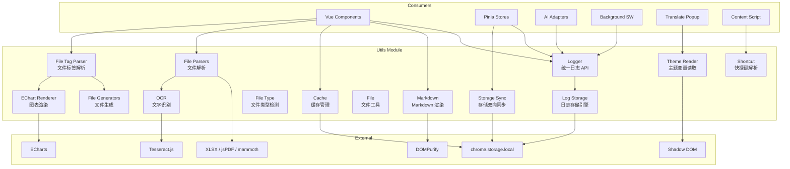
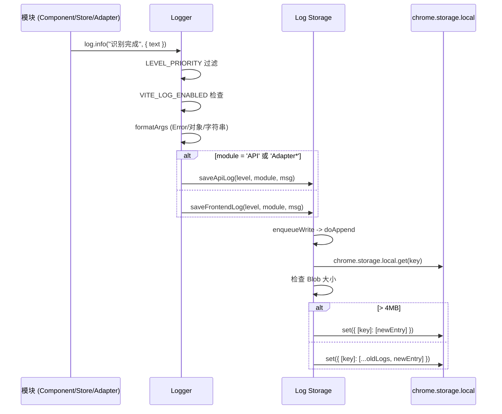
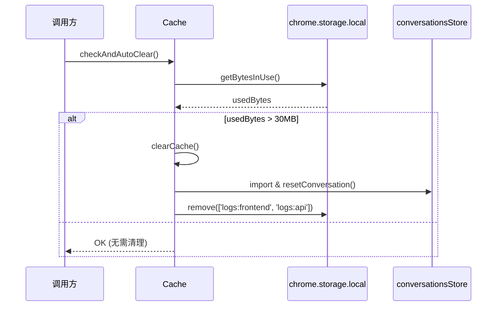
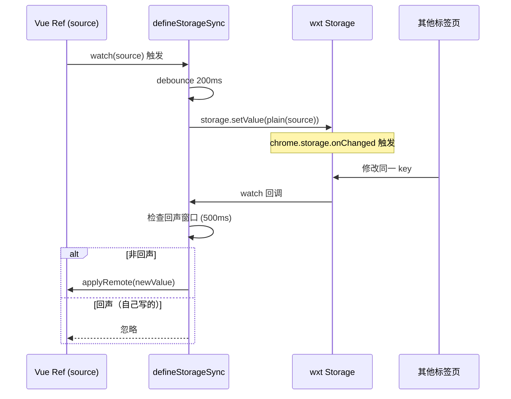

# Utils 模块架构文档

[English](./utils-en.md)

## 模块概述

`src/utils/` 包含项目中多个模块共享的基础设施。这些工具不包含业务逻辑，而是为上层模块（组件、Store、适配器等）提供底层能力。

| 文件 | 职责 |
|------|------|
| `logger.ts` | 统一日志 API，按模块分类写入 `chrome.storage.local` |
| `log-storage.ts` | 日志存储引擎，前端/API 日志分离，4MB 自动轮转，支持下载导出 |
| `cache.ts` | 缓存管理，清除会话消息和日志，30MB 阈值自动清理 |
| `shortcut.ts` | 快捷键解析与匹配，支持 Ctrl/Shift/Alt/Meta 组合 |
| `markdown.ts` | Markdown -> HTML 渲染（highlight.js + KaTeX + DOMPurify），含纯净版 |
| `theme-reader.ts` | 从 Shadow DOM 外部读取扩展 CSS 变量，含暗色主题默认值缓存 |
| `storage-sync.ts` | reactive ref 与 chrome.storage 双向同步，200ms 防抖 + 500ms 回声窗口 |
| `file-type.ts` | 文件类型检测与分类（60+ 代码扩展名映射） |
| `file-parsers.ts` | 文件解析入口，支持图片/文本/代码/PDF/Word/Excel，含 OCR |
| `file-generators.ts` | 文件生成工具（Excel/PDF/Word/CSV/图片），含下载触发 |
| `file-tag-parser.ts` | AI 回复中 `[FILE:xxx]...[/FILE]` 标签解析与文件卡片渲染 |
| `file.ts` | 文件工具（File -> dataURL） |
| `ocr.ts` | OCR 文字识别，基于 Tesseract.js，支持中英文混合 |
| `echart-renderer.ts` | ECharts 图表渲染器，支持 DOM/Canvas/PNG/SVG 多种输出 |

## 架构设计



## 核心类型定义

### LogLevel

```typescript
// src/utils/logger.ts
type LogLevel = 'DEBUG' | 'INFO' | 'WARN' | 'ERROR'
const LEVEL_PRIORITY: Record<LogLevel, number> = {
  DEBUG: 0,
  INFO: 1,
  WARN: 2,
  ERROR: 3,
}
```

### LogEntry

```typescript
// src/utils/log-storage.ts
interface LogEntry {
  time: string        // "YYYY-MM-DD HH:mm:ss"
  level: LogLevel
  module: string      // "ComponentName" | "Store:X" | "Adapter:X" | "API"
  msg: string
}
```

### AttachmentType (文件类型)

```typescript
// src/types.ts (used by file-type.ts)
type AttachmentType = 'image' | 'text' | 'code' | 'pdf' | 'word' | 'excel' | 'binary'
```

### Storage Sync Options

```typescript
// src/utils/storage-sync.ts
interface SyncOptions<T> {
  source: Ref<T>                    // 响应式数据 ref
  storage: StorageItemLike<T>       // wxt storage item
  ready: Ref<boolean>               // ready 标志，false 时不写入
  applyRemote: (nv: T) => void      // 来自远端的值 -> 应用到 source
  debounce?: number                 // 防抖延时（ms），默认 200
  echoWindow?: number               // 自我写入回声忽略窗口（ms），默认 500
}
```

### ChartConfig

```typescript
// src/utils/echart-renderer.ts
interface ChartConfig {
  option: EChartsOption  // ECharts 配置项
  width?: number         // 默认 800
  height?: number        // 默认 500
  theme?: string         // 'light' | 'dark' | 自定义主题名
}
```

### ParsedFile (文件标签解析)

```typescript
// src/utils/file-tag-parser.ts
type FileCategory = 'text' | 'data' | 'excel' | 'json' | 'pdf' | 'chart'

interface ParsedFile {
  filename: string
  content: string
  extension: string
  category: FileCategory
  chartConfig?: ChartConfig
  size: number
  index: number
}
```

## 实现细节

### Logger (logger.ts)

统一日志 API，按模块分类写入 `chrome.storage.local`。

**核心机制**:
- **懒加载**: `loadLogStorage()` 通过 `import('./log-storage')` 动态加载，缓存写入函数
- **级别过滤**: `LEVEL_PRIORITY` 比较，低于 `globalMinLevel` 的日志被丢弃
- **环境检查**: `import.meta.env.VITE_LOG_ENABLED` 为 false 时跳过所有日志
- **自动路由**: 模块名为 `'API'` 或以 `'Adapter'` 开头 -> `logs:api` 键；其他 -> `logs:frontend` 键
- **参数格式化**: Error 对象提取 `message + stack`；对象 `JSON.stringify`（缩进 2）；循环引用 fallback 到 `String()`

**导出**:
- `Logger` 类：`debug()`、`info()`、`warn()`、`error()` 方法
- `setLogLevel(level)`：设置全局最低日志级别

### Log Storage (log-storage.ts)

日志存储引擎，前端/API 日志分离存储。

**存储键**: `logs:frontend`（前端日志）、`logs:api`（API 日志）

**写入队列**: `writeQueues` 使用 Promise 链保证同一 key 的写入顺序。

**4MB 自动轮转**: `doAppend()` 中，追加后检查 `Blob` 大小，超过 `MAX_STORAGE_BYTES`（4MB）时清除旧日志，仅保留当前条目。

**下载导出**: `downloadLogs()` 同时获取前端和 API 日志，通过 `Blob + <a>` 标签触发浏览器下载，文件名格式 `frontend-{date}.log` / `api-{date}.log`。

**导出 API**: `saveFrontendLog`、`saveApiLog`、`getFrontendLogs`、`getApiLogs`、`clearAllLogs`、`downloadLogs`

### Cache (cache.ts)

缓存管理模块，提供手动清除和自动清理功能。

**缓存上限**: `CACHE_LIMIT = 30MB`

**clearCache()**:
1. 动态导入 `conversationsStore` 避免循环依赖
2. 调用 `convStore.resetConversation()` 清除会话消息
3. `chrome.storage.local.remove(LOG_KEYS)` 清除日志（`logs:frontend`、`logs:api`）
4. **不清除**: 配置（存储在 wxt/storage）、笔记、输入历史

**checkAndAutoClear()**:
1. 调用 `chrome.storage.local.getBytesInUse()` 获取已用空间
2. 超过 30MB 时自动调用 `clearCache()`
3. `getBytesInUse` 失败时静默忽略

### Shortcut (shortcut.ts)

快捷键解析与匹配。

**matchShortcut(e, shortcut)**: 将快捷键字符串（如 `"Ctrl+Shift+B"`）拆分为 parts，检查修饰键（Ctrl/Control、Shift、Alt/Option、Meta/Cmd/Command），最后一部分为键名。

**eventToShortcut(e)**: 将 KeyboardEvent 转为快捷键字符串。单独的修饰键返回 null；至少需要一个修饰键 + 一个键；空格转为 `'Space'`；单字符转大写。

### Markdown (markdown.ts)

Markdown -> HTML 渲染。

**依赖**: `markdown-it`、`highlight.js`、`markdown-it-katex`、`dompurify`

**renderMarkdown()**: 完整渲染，包含：
- 代码块语言标签 + 复制按钮（SVG 图标）
- 表格包裹容器 + Excel 下载按钮
- KaTeX 数学公式
- DOMPurify 净化（白名单覆盖 SVG、KaTeX 数学标签、常见 HTML 元素）

**renderMarkdownPlain()**: 精简版，无复制按钮、无下载按钮、无语言标签。

**DOMPurify 白名单** (`PURIFY_CONFIG`):
- `ADD_TAGS`: SVG 标签、表格标签、KaTeX 数学标签（math、semantics、mrow 等）
- `ADD_ATTR`: SVG 属性、通用属性、KaTeX 属性
- `ALLOW_DATA_ATTR: true`

### Theme Reader (theme-reader.ts)

从 Shadow DOM 外部读取扩展 CSS 变量，用于 translate-popup 等注入到 `document.body` 的组件。

**两级 host 查找**:
1. 通过 `data-aib-host`、`aib-app`、`.aib-root-host` 选择器查找
2. 全 DOM 遍历，检查 `shadowRoot` + `--aib-primary` 内联样式

**DARK_DEFAULTS**: 25 个 CSS 变量的暗色主题默认值（如 `--aib-primary: #a855f7`）。

**getThemeVar(name)**: 从 `getComputedStyle(host)` 读取，fallback 到 `DARK_DEFAULTS`。

**缓存**: `cachedHost` + `cacheValid` 模块级变量缓存查找结果。`invalidateThemeCache()` 手动使缓存失效。

### Storage Sync (storage-sync.ts)

实现 reactive ref 与 chrome.storage 的双向同步。

**核心机制**:
- `plain(v)`: `JSON.parse(JSON.stringify(toRaw(v)))` 解 proxy + 去响应式
- **跨页面同步**: `storage.watch()` 监听变化，500ms 回声窗口忽略自己刚写入触发的回声
- **本地变化**: `watch(source, ...)` 深度监听，200ms 防抖写入
- **上下文检查**: `isContextValid()` 检测 `chrome.runtime.id` 是否有效
- **显式写入**: `flush()` 绕过防抖立即写入

**导出**: `defineStorageSync()` 返回 `{ isApplyingRemote, markSelfWrite, flush }`

### File Type (file-type.ts)

文件类型检测与分类工具。

**代码扩展名映射**: `CODE_EXTENSIONS` 包含 60+ 扩展名 -> 语言标识的映射（JS/TS/Python/Java/Go/Rust 等）。

**detectFileType(file)**: 检测优先级：
1. MIME 前缀 `image/` -> `'image'`
2. PDF 扩展名或 MIME -> `'pdf'`
3. Word 扩展名或 MIME -> `'word'`
4. Excel MIME（排除 csv/tsv）或 xls/xlsx 扩展名 -> `'excel'`
5. `CODE_EXTENSIONS` 匹配 -> `'code'`
6. `TEXT_EXTENSIONS` 匹配 -> `'text'`
7. 无扩展名 + `TEXT_FILENAMES` 匹配 -> `'text'`
8. MIME `text/*` -> `'text'`
9. 无扩展名 + 无 MIME 或 `application/octet-stream` -> `'text'`
10. 其他 -> `'binary'`

**其他导出**: `getExtension()`、`getCodeLang()`、`getFileTypeIcon()`、`formatFileSize()`

### File Parsers (file-parsers.ts)

统一文件解析入口，将不同文件类型解析为统一的 `Attachment` 结构。

**parseFile(file)**: 根据 `detectFileType()` 结果分发到对应解析器：
- `image` -> `parseImage()`：生成 dataURL，OCR 由调用方异步触发
- `text`/`code` -> `parseText()`：UTF-8 读取，代码文件自动检测语言
- `pdf` -> `parsePdf()`：pdfjs-dist 提取文本，Worker 使用主线程 fake worker 模式
- `word` -> `parseWord()`：mammoth 提取纯文本
- `excel` -> `parseExcel()`：xlsx 库读取，CSV/TSV 直接读文本
- `binary` -> `parseBinary()`：先尝试按文本读取，失败则仅保留元信息

**兜底策略**: 非 binary/ 类型解析失败或内容为空时，调用 `tryReadAsText()` 尝试按文本读取。

**大小限制**:
- 文本内容: 500KB (`MAX_TEXT_CONTENT_SIZE`)
- 文本文件: 2MB (`MAX_TEXT_FILE_SIZE`)
- 二进制文件: 10MB (`MAX_BINARY_FILE_SIZE`)
- 图片: 20MB (`MAX_IMAGE_FILE_SIZE`)

**原始文件缓存**: `originalFileCache` (Map) 缓存 attachment id -> File 引用，供预览 modal 下载使用。

**OCR**: `ocrAttachment()` 对已解析的图片附件执行 Tesseract.js OCR，就地更新 `content` 字段。

### File Generators (file-generators.ts)

统一文件生成工具。

**Excel 生成**:
- `generateXlsx(rows, sheetName)`: 二维数组 -> Excel Blob
- `generateXlsxFromCsv(csvContent)`: CSV 文本 -> Excel Blob
- `generateXlsxFromContent(content)`: 智能解析（TSV/管道符/纯文本）-> Excel Blob

**Word 生成**: `generateDocx(content)` 使用 docx 库，按行分割为段落。

**PDF 生成**:
- `generatePdf(content)`: 纯文本 -> HTML -> Canvas 截图 -> PDF
- `generatePdfFromMarkdown(markdown)`: Markdown -> 简易 HTML -> Canvas -> PDF
- `htmlToPdf()`: 核心函数，scoped 类名隔离 + A4 分页 + 自动降 scale 避免 canvas 高度上限

**下载工具**: `triggerDownload(blob, filename)`、`triggerDownloadFromDataUrl()`、`triggerDownloadFromUrl()`

**格式化工具**: `formatBytes()`、`formatJson()`、`isTextExtension()`、`getMimeType()`

### File Tag Parser (file-tag-parser.ts)

AI 回复中 `[FILE:xxx]...[/FILE]` 标签解析器。

**标签正则** (`FILE_TAG_REGEX`): 兼容标准格式、Windows 换行、冒号后空格、小写标签、无闭合标签等多种 AI 输出格式。

**parseFileTags(text)**: 从文本中提取所有文件标签，解析文件名、内容、扩展名、分类。`.chart` 文件额外解析为 `ChartConfig`。

**文件分类映射** (`EXTENSION_CATEGORY`):
- 文本类: txt/md/html/css/js/ts/py/java/go 等
- 数据类: csv/tsv
- Excel 类: xlsx/xls
- JSON 类: json
- PDF 类: pdf
- 图表类: chart

**renderFileCards(text)**: 将 `[FILE]` 标签替换为文件卡片 HTML，支持下载按钮、图表预览等。

**generateFileBlob(file)**: 根据文件分类生成对应 Blob（文本/text、数据/CSV+BOM、Excel/xlsx、JSON/格式化、PDF/canvas 截图、Word/docx）。

**事件处理**: `extractDownloadInfo(event)` 从点击事件提取下载信息；`handleFileDownload()` 执行对应下载动作。

### File (file.ts)

简单的文件工具模块。

**fileToDataURL(file)**: 使用 `FileReader.readAsDataURL()` 将 File 转为 base64 dataURL。

### OCR (ocr.ts)

基于 Tesseract.js 的前端 OCR 文字识别。

**语言**: `chi_sim+eng`（中文简体 + 英文混合）

**语言包路径**: `chrome.runtime.getURL('/tesseract')` 从扩展本地加载，避免 CSP 阻止 CDN 请求。

**超时保护**: 30 秒超时 (`OCR_TIMEOUT`)，防止语言包下载失败导致永久卡住。

**recognizeImage(dataUrl, onProgress)**: 返回识别文字，进度通过 `onProgress(0~1)` 回调。失败时返回空字符串。

### EChart Renderer (echart-renderer.ts)

ECharts 图表渲染器，支持多种输出格式。

**动态加载**: `loadECharts()` 使用 `import('echarts')` 按需加载，模块级缓存避免重复加载。

**配置解析** (`parseChartConfig`): 支持两种格式：
1. 完整格式: `{ "option": {...}, "width": 800, "height": 500 }`
2. 简化格式: 直接是 option 对象（向后兼容，需包含 series/xAxis/yAxis/radar/tooltip）

**渲染函数**:
- `renderChartToElement(container, config)`: 渲染到 DOM 容器，返回清理函数
- `renderChartToCanvas(config)`: 离屏 Canvas 渲染（2x 分辨率）
- `renderChartToBlob(config)`: 渲染为 PNG Blob
- `renderChartToSvg(config)`: 渲染为 SVG 字符串

**配置模板**: `createBarChartConfig`、`createLineChartConfig`、`createPieChartConfig`、`createRadarChartConfig`

## 数据流

### 日志写入链



### 缓存自动清理链



### Storage Sync 双向同步



## 配置与扩展

| 配置项 | 位置 | 默认值 | 说明 |
|--------|------|--------|------|
| `VITE_LOG_ENABLED` | 构建环境变量 | 构建时注入 | 生产环境为 false，跳过所有日志 |
| `globalMinLevel` | logger.ts 模块变量 | `'DEBUG'` | 通过 `setLogLevel()` 调整 |
| `MAX_STORAGE_BYTES` | log-storage.ts | 4MB | 单键存储上限 |
| `CACHE_LIMIT` | cache.ts | 30MB | 自动清理阈值 |
| `LOG_KEYS` | cache.ts | `['logs:frontend', 'logs:api']` | 清除缓存时移除的日志键 |
| `DARK_DEFAULTS` | theme-reader.ts | 25 个 CSS 变量 | 暗色主题默认值 |
| `OCR_TIMEOUT` | ocr.ts | 30s | OCR 超时时间 |
| `OCR_LANG` | ocr.ts | `'chi_sim+eng'` | OCR 识别语言 |
| `MAX_TEXT_CONTENT_SIZE` | file-parsers.ts | 500KB | 文本内容最大长度 |
| `MAX_BINARY_FILE_SIZE` | file-parsers.ts | 10MB | 二进制文件最大大小 |
| `MAX_IMAGE_FILE_SIZE` | file-parsers.ts | 20MB | 图片最大大小 |

**扩展点**:
- 添加 LogLevel 类型
- 添加缓存清理键（在 `LOG_KEYS` 中添加）
- 添加主题变量（在 `DARK_DEFAULTS` 中添加）
- 添加 Markdown 插件（通过 `md.use()`）
- 添加文件类型（在 `CODE_EXTENSIONS` / `TEXT_EXTENSIONS` 中添加）
- 添加 ECharts 配置模板（参考 `createBarChartConfig` 等）

## 已知限制

1. **日志持久性**: chrome.storage.local 总计 5MB 上限，轮转时丢失所有旧数据
2. **静默日志丢失**: `loadLogStorage` 的 catch 和 `doAppend` 的 catch 静默忽略错误
3. **Theme 缓存**: 全 DOM 遍历 fallback 在元素多时有性能开销
4. **Theme 缓存一致性**: `cachedHost`/`cacheValid` 是模块级变量；动态 DOM 变更需手动调用 `invalidateThemeCache()`
5. **Markdown 安全**: DOMPurify 允许 `style` 和 `data-*` 属性，存在有限的 CSS 注入风险
6. **快捷键冲突**: `matchShortcut` 不处理浏览器/系统快捷键冲突
7. **无远程日志收集**: 日志仅存储在本地
8. **PDF 生成**: Canvas 截图方式，A4 分页基于固定像素高度，不同 DPI 下可能不精确
9. **OCR 超时**: 语言包下载失败时 30 秒超时后返回空字符串，无重试机制
10. **ECharts 首次加载**: 动态 import 增加首次渲染延迟，可通过 `preloadECharts()` 预加载
11. **cache.ts 简化**: 不再维护独立的 `CACHE_KEYS` 数组，会话清除通过 `conversationsStore.resetConversation()` 实现
