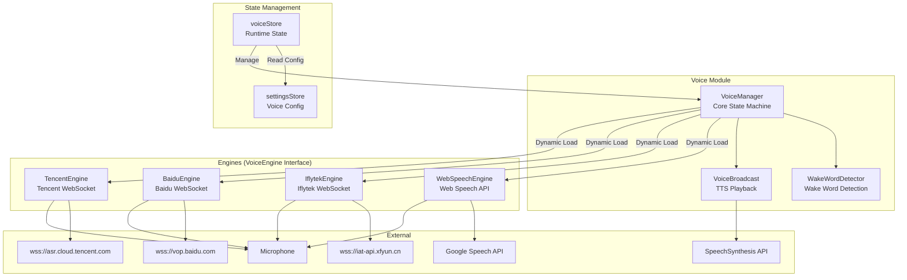
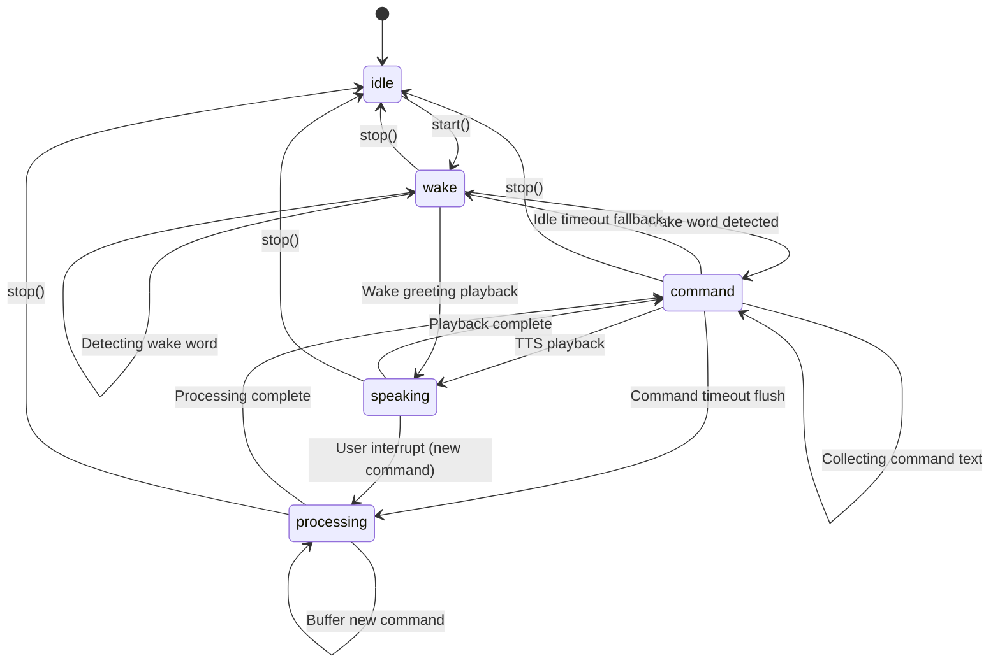
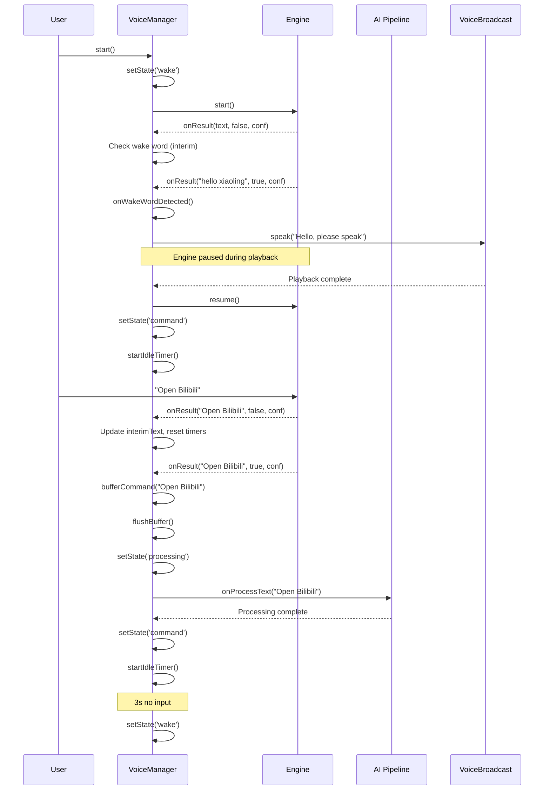
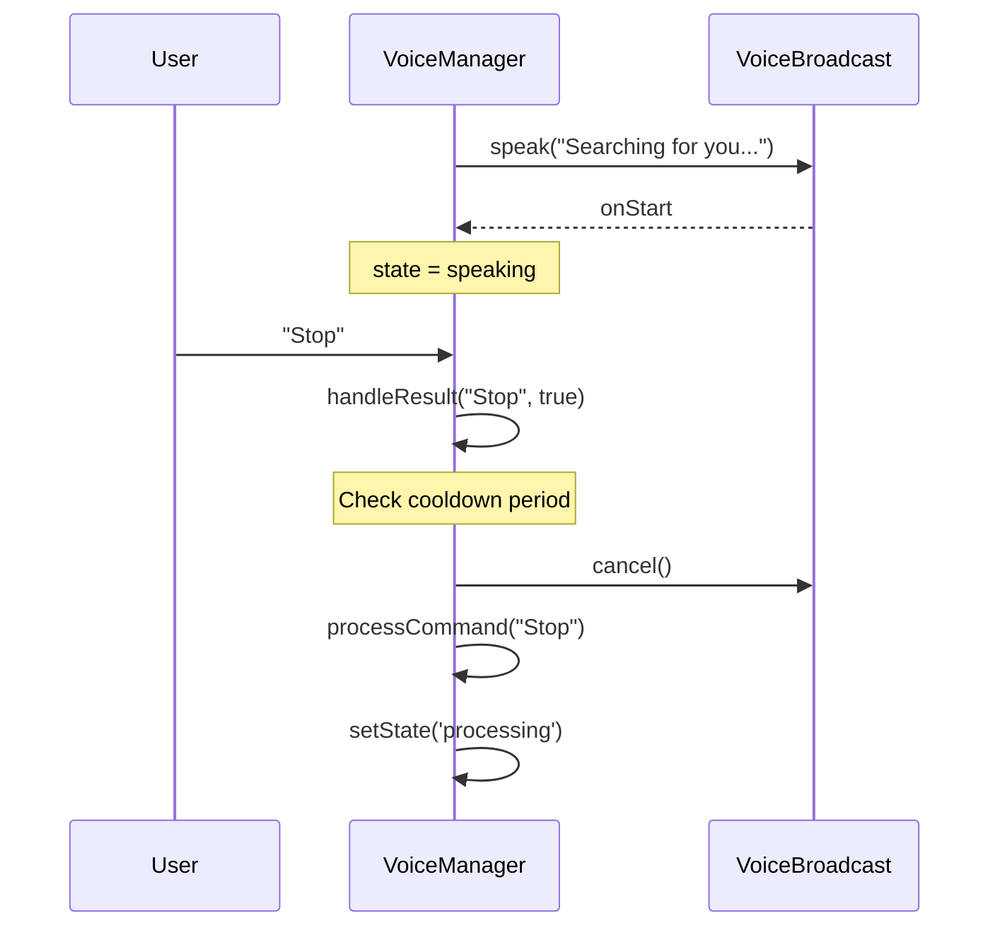
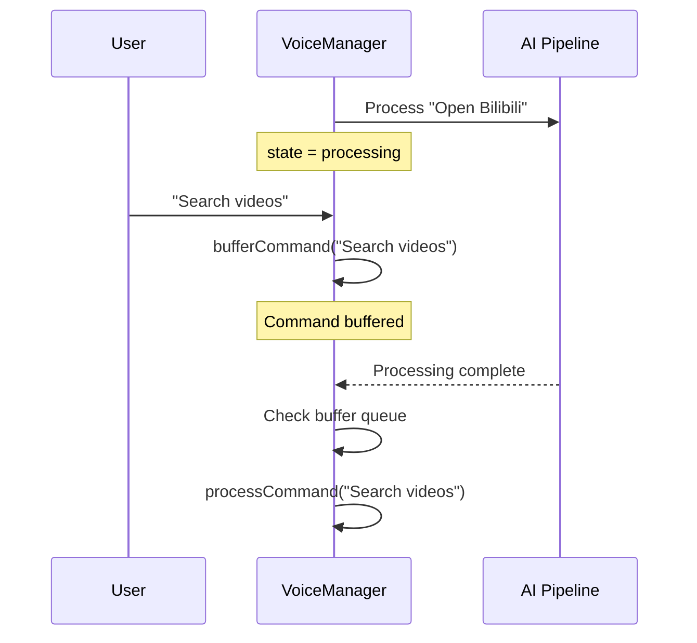

# Voice Module Architecture

[中文](./voice.md)

## Module Overview

The voice module implements the complete voice interaction lifecycle: wake word detection -> speech recognition -> AI command processing -> TTS playback. It uses a **four-engine architecture** (Web Speech API / Iflytek / Baidu / Tencent) with a unified `VoiceEngine` interface to abstract away engine differences. The core design principle is **the engine never pauses; recognition results are filtered by state** -- the engine runs continuously, and VoiceManager decides how to handle recognition output based on the current state.

**Key Features**:
- Four-engine recognition: Web Speech API (zero-config for overseas), Iflytek (top quality in China), Baidu (free 3000 min/month), Tencent (free 1000 min/month)
- Wake word detection: sliding window + edit distance algorithm, supports "wake word + command" in a single utterance
- TTS playback: based on `SpeechSynthesisUtterance`, engine paused during playback to prevent self-listening
- Cross-tab microphone lock: mutual exclusion via `BroadcastChannel`
- Voice command buffering: commands received during processing are buffered and auto-executed after completion
- External broadcast events: TTS playback triggered via `aib-broadcast` CustomEvent

**Source Files**:

| File | Responsibility |
|------|---------------|
| `src/voice/index.ts` | Module export entry point |
| `src/voice/voice-manager.ts` | Core state machine and business logic |
| `src/voice/broadcast.ts` | TTS voice playback wrapper |
| `src/voice/wake-word.ts` | Wake word detector (sliding window + edit distance) |
| `src/voice/engines/types.ts` | Unified engine interface definition |
| `src/voice/engines/web-speech-engine.ts` | Web Speech API engine |
| `src/voice/engines/baidu-engine.ts` | Baidu real-time ASR engine |
| `src/voice/engines/iflytek-engine.ts` | Iflytek speech dictation engine |
| `src/voice/engines/tencent-engine.ts` | Tencent real-time ASR engine |
| `src/stores/voice.ts` | Voice runtime state management (Pinia store) |

## Architecture Design



### State Machine



## Core Type Definitions

### VoiceEngine Unified Interface

```typescript
// src/voice/engines/types.ts
type VoiceEngineStatus = 'idle' | 'listening' | 'processing' | 'error'

interface VoiceEngineConfig {
  lang?: string          // Default zh-CN
  continuous?: boolean   // Default true
  interimResults?: boolean // Default true
}

interface VoiceEngine {
  readonly name: string
  readonly isActive: boolean
  readonly status: VoiceEngineStatus
  start(): void
  stop(): void
  pause(): void
  resume(): void
  isAlive(): boolean
  onResult: ((text: string, isFinal: boolean, confidence: number) => void) | null
  onError: ((error: string) => void) | null
  onStatusChange: ((status: VoiceEngineStatus) => void) | null
  destroy(): void
}
```

### VoiceManager State and Config

```typescript
// src/voice/voice-manager.ts
type VoiceManagerState = 'idle' | 'wake' | 'command' | 'processing' | 'speaking'

interface VoiceManagerConfig {
  engineType: 'web-speech' | 'iflytek' | 'baidu' | 'tencent'
  iflytekConfig: { appId: string; apiKey: string; apiSecret?: string } | undefined
  baiduConfig: { appId: string; apiKey: string; apiSecret: string } | undefined
  tencentConfig: { appId: string; apiKey: string; apiSecret: string } | undefined
  lang?: string
  wakeWord?: string
  enableTts?: boolean
  ttsRate?: number
  ttsVolume?: number
  bufferTimeout?: number
  idleTimeout?: number

  onStateChange?: (state: VoiceManagerState) => void
  onInterimText?: (text: string) => void
  onUserMessage?: (text: string) => void
  onAssistantMessage?: (text: string) => void
  onError?: (error: string) => void
  onAbortProcess?: () => void
  getBroadcastCondition?: () => boolean
}
```

### Wake Word Match Result

```typescript
// src/voice/wake-word.ts
interface WakeWordMatch {
  matched: boolean   // Whether wake word was matched
  command: string    // Text after wake word (empty = pure wake word)
}
```

### TTS Broadcast Config

```typescript
// src/voice/broadcast.ts
type BroadcastPriority = 'high' | 'normal'

interface BroadcastOptions {
  lang?: string    // Default zh-CN
  rate?: number    // Default 1.0
  volume?: number  // Default 1.0
}
```

### Engine Configs

```typescript
// Iflytek
interface IflytekConfig {
  appId: string
  apiKey: string
  apiSecret?: string  // Optional; simplified auth when absent
}

// Baidu
interface BaiduConfig {
  appId: string
  apiKey: string
  apiSecret: string
}

// Tencent
interface TencentConfig {
  appId: string
  apiKey: string
  apiSecret: string
}
```

### Voice Store Runtime State

```typescript
// src/stores/voice.ts
type VoiceStatus = 'idle' | 'listening' | 'processing' | 'error'
type SessionState = 'idle' | 'wake' | 'command' | 'processing' | 'speaking'

// Store exports
interface VoiceStoreExports {
  status: Ref<VoiceStatus>
  sessionState: Ref<SessionState>
  interimText: Ref<string>
  finalText: Ref<string>
  settingsVersion: Ref<number>
  setStatus(s: VoiceStatus): void
  setSessionState(s: SessionState): void
  updateText(text: string, isFinal: boolean): void
  reset(): void
  getVoiceSettings(): VoiceSettings
  bumpSettingsVersion(): void
}
```

## Implementation Details

### VoiceManager State Machine

VoiceManager is the core of the voice module, managing the entire voice interaction lifecycle.

**Core Constants**:
- `DEFAULT_COMMAND_TIMEOUT = 1500ms` -- Command buffer merge timeout
- `DEFAULT_IDLE_TIMEOUT = 3000ms` -- Timeout for command state to fall back to wake
- `WAKE_COOLDOWN = 3000ms` -- Wake cooldown to prevent duplicate triggers from the same utterance

**State Filtering Logic** (`handleResult`):

| State | Interim Results | Final Results |
|-------|----------------|---------------|
| `wake` | Check wake word, trigger if matched | Check wake word, enter command if matched; supports "wake word + command" |
| `command` | Update display text, reset idle/buffer timers | Add to buffer queue, execute after timeout merge |
| `processing` | Ignore | Buffer command, auto-execute after current processing completes |
| `speaking` | Ignore | Ignore during cooldown; otherwise interrupt playback and execute command |

**Command Deduplication**: `flushBuffer()` merges buffered text, then compares with `lastCommand`. Duplicate commands within `COMMAND_TIMEOUT` are not re-executed.

**External Broadcast Events**: `start()` registers an `aib-broadcast` CustomEvent listener. External code can trigger TTS via `window.dispatchEvent(new CustomEvent('aib-broadcast', { detail: { text } }))`.

**Broadcast Condition Control**: In `speak()`, wake greeting ("您好，请说") broadcasts unconditionally; other broadcasts require `canBroadcast()` to check the `getBroadcastCondition` callback.

**Engine Health Check**: `ensureEngineAlive()` is called when transitioning from processing/speaking to wake/command. It checks `engine.isAlive()` and restarts the engine if it has died.

**Engine Dynamic Loading**: Iflytek, Baidu, and Tencent engines are lazy-loaded via `import()`. WebSpeechEngine is created synchronously.

### WebSpeechEngine

Based on the browser-native `SpeechRecognition` / `webkitSpeechRecognition` API.

**Error Handling Strategy**:
| Error Type | Handling |
|-----------|----------|
| `aborted` | Set `_aborted` flag; `onend` restarts after 2s delay |
| `no-speech` / `audio-capture` | Restart after 1s delay |
| `not-allowed` | Stop engine, report "Microphone permission denied" |
| `network` | Stop engine, report "Network error" |
| Other | Restart after 2s delay |

**Auto-restart**: In `onend`, `_paused` state prevents restart; `_aborted` delays 2s; `continuous` mode delays 300ms; non-continuous delays 1s.

**Health Check**: `isAlive()` checks `_isActive && recognition !== null`.

### IflytekEngine

Iflytek speech dictation engine, WebSocket connection to `wss://iat-api.xfyun.cn/v2/iat`.

**Authentication**:
- Without `apiSecret`: simplified auth `?appid=xxx&apikey=xxx`
- With `apiSecret`: HMAC-SHA256 signature full authentication

**Three-Frame Protocol**:
1. First frame (status=0): Parameters only, includes `app_id`, `business` (language, domain, accent, etc.), `data` (format, encoding)
2. Audio frames (status=1): PCM 16kHz audio data per frame (Base64 encoded)
3. Last frame (status=2): Empty audio, marks end of recognition

**Result Handling**: `pgs='apd'` for append mode, otherwise replace mode; `ls=true` indicates final result.

**Client-side VAD**: 10 frames of silence (~2.5 seconds) auto-sends last frame, silence energy threshold 0.01.

**Continuous Recognition**: After final result, automatically calls `reconnect()` to re-establish WebSocket connection and continue listening.

### BaiduEngine

Baidu intelligent cloud real-time ASR engine, WebSocket connection to `wss://vop.baidu.com/realtime_asr`.

**Protocol Flow**:
1. JSON start frame (type=START): Contains `appid`, `appkey`, `dev_pid`, `cuid`, `format`, `sample`
2. Binary audio frames: Raw PCM 16kHz 16-bit binary data
3. JSON finish frame (type=FINISH)

**Result Types**:
- `MID_TEXT`: Temporary recognition result (interim)
- `FIN_TEXT`: Final recognition result (final); auto-reconnects after receiving
- `HEARTBEAT`: Heartbeat frame, ignored

**Language Mapping**: `zh-CN` -> `dev_pid 15372`, `en-US` -> `dev_pid 17372`

**Client-side VAD**: Same as Iflytek, 10 frames of silence auto-sends finish frame.

### TencentEngine

Tencent cloud real-time ASR engine, WebSocket connection to `wss://asr.cloud.tencent.com/asr/v2/{appId}`.

**Authentication**: HMAC-SHA256 signature with parameters including `app_id`, `expired` (24-hour expiry), `nonce`, `secret_id`, `timestamp`, `voice_id`, `signature`.

**Protocol Flow**:
1. JSON config frame (type=start): Contains `appid`, `voice_id`, `voice_format`, `engine_model_type`, `needvad`
2. Binary audio frames: Raw PCM 16kHz binary data
3. JSON end frame (type=end)

**Result Handling**: Processes when `message === 'result'`; `slice_type === 2` indicates final result, triggers auto-reconnect with regenerated signature.

**Language Models**: `zh-CN` -> `16k_zh`, `en-US` -> `16k_en`

### VoiceBroadcast (TTS)

Promise wrapper around the browser-native `SpeechSynthesisUtterance` API.

**Key Behavior**:
- New speech automatically cancels current speech (`cancel()` + new Utterance)
- Errors call `resolve()` instead of `reject()`, avoiding blocking callers
- Callbacks: `onStart`, `onEnd`

### WakeWordDetector

Wake word detection using sliding window + edit distance algorithm.

**Algorithm Flow**:
1. Text normalization: remove punctuation and spaces, convert to lowercase
2. Sliding window: window size from `wakeLen - threshold` to `wakeLen + threshold`
3. Calculate edit distance for each window position
4. Find the position with minimum edit distance, extract text after wake word as command

**Error Threshold**: `max(1, floor(wakeLen / 4))` -- allows 1 error per 4 characters

**Interim/Final Distinction**: Both use the same error threshold, but interim results are incomplete so matching is naturally more lenient through the sliding window.

**Index Mapping**: `normalizedIndexToOriginal()` maps normalized indices back to original text positions for correct command extraction.

### Wake Sound

Generated via `AudioContext`: 800Hz sine wave, volume 0.1, exponential decay to 0.001 over 0.3 seconds then stopped.

### Voice Store

`src/stores/voice.ts` defines Pinia store `aib-voice` for runtime state only.

**Responsibility Separation**:
- **voiceStore**: Runtime state (`status`, `sessionState`, `interimText`, `finalText`)
- **settingsStore**: Voice configuration (`voiceEngineType`, `voiceAppId`, `voiceApiKey`, etc.)

**getVoiceSettings()**: Reads voice-related config from `settingsStore.settings`, returns a unified config object. Fields include `engineType`, `appId`, `apiKey`, `apiSecret`, `engineConfs`, `recognitionLang`, `wakeWord`, `alwaysOnVoice`, `enableTts`, `ttsRate`, `ttsVolume`, `bufferTimeout`, `idleTimeout`.

**settingsVersion**: Auto-increments on each settings save via `bumpSettingsVersion()`. App.vue watches this value to rebuild VoiceManager.

## Data Flow

### Full Voice Session Flow



### Voice Interrupt During Playback



### Buffered Command During Processing



## Configuration & Extension

### Adding a New Engine

1. Create a new engine file under `src/voice/engines/`, implementing the `VoiceEngine` interface
2. Add a new config field in `VoiceManagerConfig` (e.g., `newEngineConfig`)
3. Add a corresponding branch in `VoiceManager.createEngine()`
4. Export the new engine and config type in `src/voice/index.ts`

### Engine Selection Guide

| Scenario | Recommended Engine | Reason |
|----------|-------------------|--------|
| Overseas users | Web Speech API | Zero config, native browser support |
| Domestic (quality priority) | Iflytek | Top recognition quality, free 50k calls/day |
| Domestic (cost priority) | Baidu | Free 3000 min/month + 50k short voice calls |
| Domestic (alternative) | Tencent | Free 1000 min/month |

### Key Configuration Parameters

| Parameter | Default | Description |
|-----------|---------|-------------|
| `wakeWord` | "你好，小灵" | Customizable wake word |
| `enableTts` | true | Enable TTS playback |
| `ttsRate` | 1.5 | TTS speech rate |
| `ttsVolume` | 0.8 | TTS volume |
| `bufferTimeout` | 1500ms | Command buffer merge timeout |
| `idleTimeout` | 3000ms | Command state idle fallback to wake |
| `lang` | "zh-CN" | Recognition language |

### Voice Store Config Source

Voice configuration is managed centrally by `settingsStore`. voiceStore reads it via `getVoiceSettings()`. Key field mapping:

| settingsStore Field | Meaning |
|---------------------|---------|
| `voiceEngineType` | Engine type |
| `voiceAppId` / `voiceApiKey` / `voiceApiSecret` | Engine credentials |
| `voiceEngineConfs` | Multi-engine config array |
| `voiceRecognitionLang` | Recognition language |
| `voiceWakeWord` | Wake word |
| `voiceAlwaysOn` | Always-on voice mode |
| `voiceEnableTts` | TTS toggle |
| `voiceTtsRate` / `voiceTtsVolume` | TTS parameters |
| `voiceBufferTimeout` / `voiceIdleTimeout` | Timeout parameters |

## Known Limitations

1. **ScriptProcessorNode deprecated** -- All third-party engines use `ScriptProcessorNode`, needs migration to `AudioWorklet`
2. **Web Speech API depends on Google services** -- May be unreliable in China
3. **Engine pause/resume non-atomic** -- Audio frames may be lost during pause
4. **Wake word edit distance O(n*m) complexity** -- Performance degrades with long wake words
5. **TTS/recognition conflict** -- If TTS is interrupted by system audio, it may be recognized as user input
6. **Single engine per VoiceManager** -- Switching engines requires destroy + create
7. **Microphone exclusive** -- BroadcastChannel mutex ensures only one tab uses the microphone at a time
8. **COMMAND_TIMEOUT undefined** -- `voice-manager.ts` line 437 references undefined `COMMAND_TIMEOUT` constant (should be `DEFAULT_COMMAND_TIMEOUT`)
9. **Voice Store manages runtime state only** -- Voice config changes require `bumpSettingsVersion()` to trigger VoiceManager rebuild
