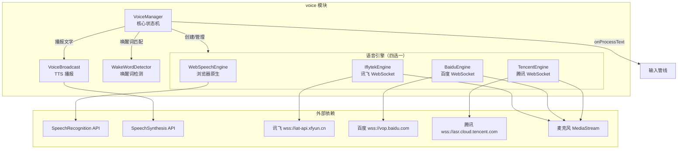
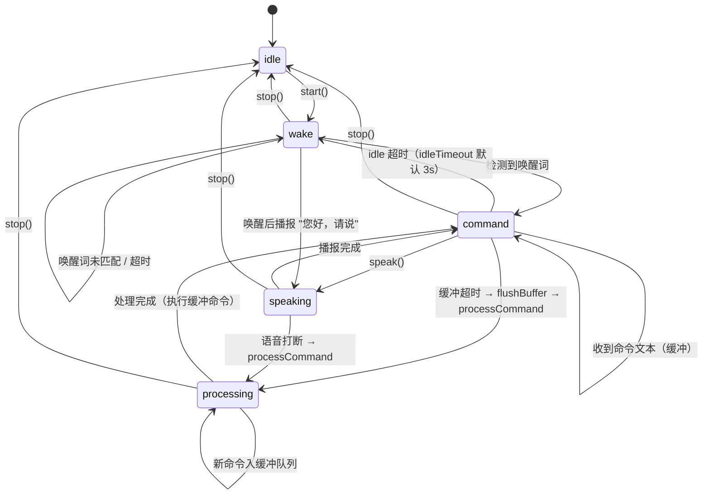
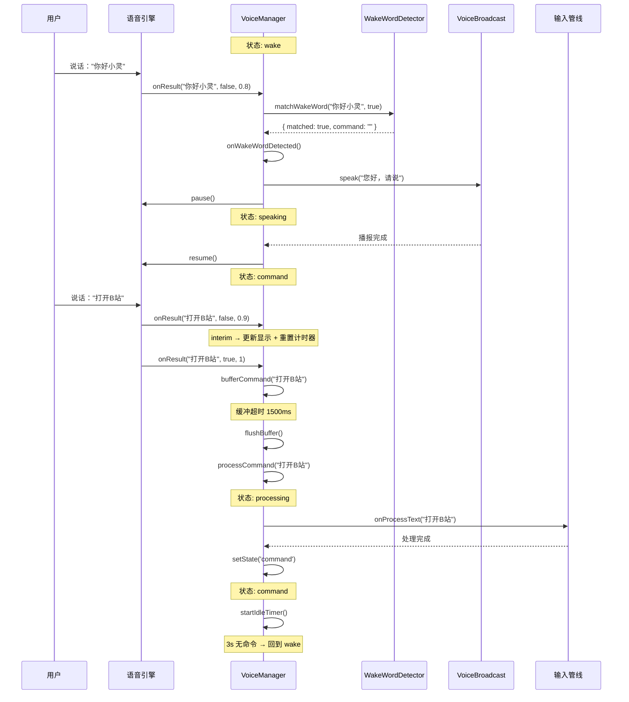
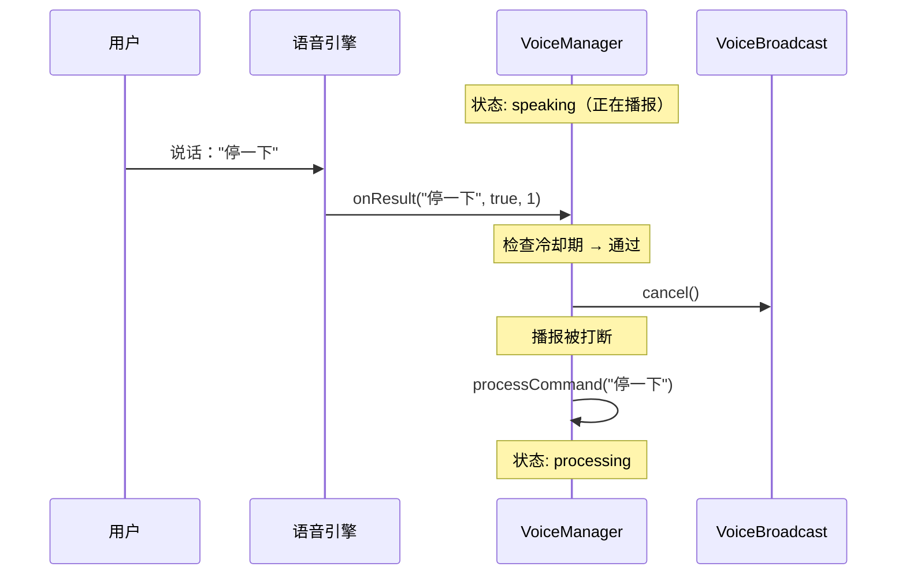
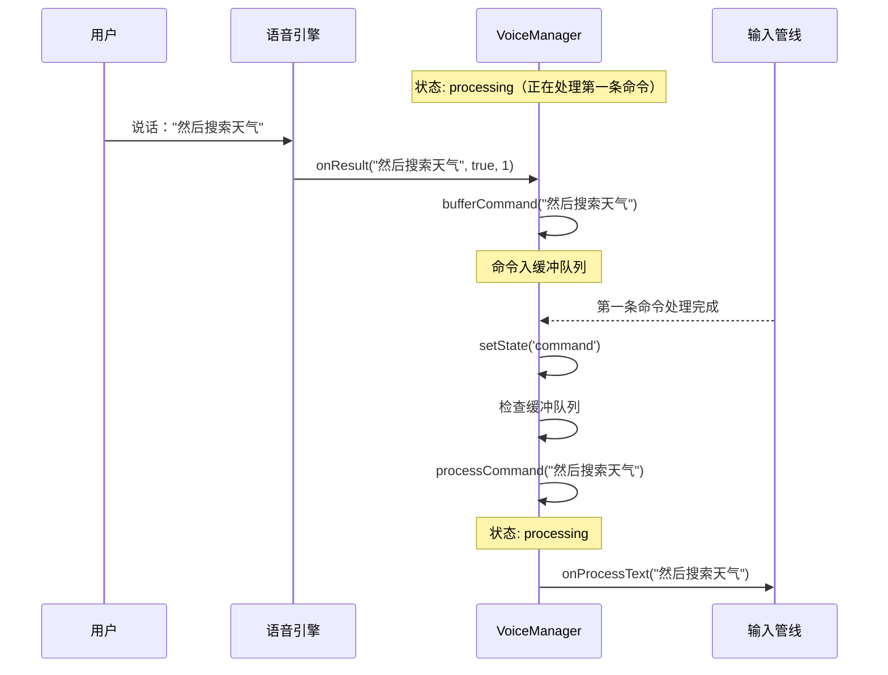

# Voice Module

## 模块概述

语音模块实现完整的语音交互生命周期：唤醒词检测 -> 语音识别 -> AI 指令处理 -> 语音播报。采用**四引擎架构**（Web Speech API / 讯飞 / 百度 / 腾讯），通过统一的 `VoiceEngine` 接口屏蔽底层差异。核心设计原则是**引擎永远不 pause，用状态过滤识别结果**——引擎持续运行，VoiceManager 根据当前状态决定如何处理识别输出。

**关键特性**:
- 四引擎识别：Web Speech API（海外零配置）、讯飞（国内顶级质量）、百度（免费 3000 分钟/月）、腾讯（免费 1000 分钟/月）
- 唤醒词检测：滑动窗口 + 编辑距离算法，支持 "唤醒词+命令" 一句话连说
- TTS 播报：基于 `SpeechSynthesisUtterance`，播报期间暂停引擎防止自听
- 跨标签页麦克风锁：通过 `BroadcastChannel` 实现互斥访问
- 语音缓冲队列：处理中的命令自动缓冲，处理完后自动执行

**源文件**:
- `src/voice/index.ts` - 模块导出入口
- `src/voice/voice-manager.ts` - 核心状态机与业务逻辑
- `src/voice/broadcast.ts` - TTS 语音播报
- `src/voice/wake-word.ts` - 唤醒词检测器
- `src/voice/engines/types.ts` - 引擎统一接口定义
- `src/voice/engines/web-speech-engine.ts` - Web Speech API 引擎
- `src/voice/engines/baidu-engine.ts` - 百度实时语音识别引擎
- `src/voice/engines/iflytek-engine.ts` - 讯飞语音听写引擎
- `src/voice/engines/tencent-engine.ts` - 腾讯实时语音识别引擎

## 架构设计



### 状态机



## 核心类型定义

### VoiceEngine 统一接口

```typescript
// src/voice/engines/types.ts

/** 语音识别状态 */
type VoiceEngineStatus = 'idle' | 'listening' | 'processing' | 'error'

/** 语音引擎配置 */
interface VoiceEngineConfig {
  /** 语言，默认 zh-CN */
  lang?: string
  /** 是否连续识别，默认 true */
  continuous?: boolean
  /** 是否返回中间结果，默认 true */
  interimResults?: boolean
}

/** 语音引擎统一接口 */
interface VoiceEngine {
  readonly name: string
  readonly isActive: boolean
  readonly status: VoiceEngineStatus

  start(): void
  stop(): void
  pause(): void
  resume(): void
  isAlive(): boolean

  onResult: ((text: string, isFinal: boolean, confidence: number) => void) | null
  onError: ((error: string) => void) | null
  onStatusChange: ((status: VoiceEngineStatus) => void) | null

  destroy(): void
}
```

### VoiceManager 状态与配置

```typescript
// src/voice/voice-manager.ts

type VoiceManagerState = 'idle' | 'wake' | 'command' | 'processing' | 'speaking'

interface VoiceManagerConfig {
  engineType: 'web-speech' | 'iflytek' | 'baidu' | 'tencent'
  iflytekConfig: { appId: string; apiKey: string; apiSecret?: string } | undefined
  baiduConfig: { appId: string; apiKey: string; apiSecret: string } | undefined
  tencentConfig: { appId: string; apiKey: string; apiSecret: string } | undefined
  lang?: string
  wakeWord?: string
  enableTts?: boolean
  ttsRate?: number
  ttsVolume?: number
  bufferTimeout?: number
  idleTimeout?: number

  onStateChange?: (state: VoiceManagerState) => void
  onInterimText?: (text: string) => void
  onUserMessage?: (text: string) => void
  onAssistantMessage?: (text: string) => void
  onError?: (error: string) => void
  onAbortProcess?: () => void
  getBroadcastCondition?: () => boolean
}
```

### 唤醒词匹配结果

```typescript
// src/voice/wake-word.ts

interface WakeWordMatch {
  /** 是否匹配到唤醒词 */
  matched: boolean
  /** 唤醒词之后的命令部分（为空表示纯唤醒词） */
  command: string
}
```

### TTS 播报配置

```typescript
// src/voice/broadcast.ts

type BroadcastPriority = 'high' | 'normal'

interface BroadcastOptions {
  lang?: string    // 默认 zh-CN
  rate?: number    // 默认 1.0
  volume?: number  // 默认 1.0
}
```

### 各引擎独立配置

```typescript
// 讯飞
interface IflytekConfig {
  appId: string
  apiKey: string
  apiSecret?: string  // 可选，无则用简化鉴权
}

// 百度
interface BaiduConfig {
  appId: string
  apiKey: string
  apiSecret: string
}

// 腾讯
interface TencentConfig {
  appId: string
  apiKey: string
  apiSecret: string
}
```

## 实现细节

### VoiceManager 状态机

VoiceManager 是语音模块的核心，管理五个状态之间的转换。关键设计：**引擎永远不 pause**，而是通过状态过滤识别结果。

**状态过滤逻辑**（`handleResult` 方法）:

| 当前状态 | interim 结果 | final 结果 |
|---------|-------------|-----------|
| `wake` | 检查唤醒词，匹配则触发唤醒 | 检查唤醒词，匹配则进入 command |
| `command` | 更新显示 + 重置计时器 | 入缓冲队列 |
| `processing` | 忽略 | 缓冲命令，处理完后自动执行 |
| `speaking` | 忽略 | 打断播报，执行命令 |

**核心常量**:

```typescript
const DEFAULT_COMMAND_TIMEOUT = 1500   // 缓冲合并超时（ms）
const DEFAULT_IDLE_TIMEOUT = 3000      // command 空闲回退超时（ms）
const WAKE_COOLDOWN = 3000             // 唤醒冷却时间，防重复触发（ms）
```

**引擎动态加载**:

第三方引擎（讯飞、百度、腾讯）通过 `import()` 动态加载，避免打包时引入不必要的依赖。Web Speech 引擎直接同步创建：

```typescript
private createEngine(): void {
  if (this.config.engineType === 'iflytek' && this.config.iflytekConfig) {
    import('./engines/iflytek-engine').then(({ IflytekEngine }) => {
      this.engine = new IflytekEngine(this.config.iflytekConfig!, { ... })
      this.setupEngineCallbacks()
      if (this._isActive) this.engine.start()
    })
  } else if (this.config.engineType === 'baidu' && this.config.baiduConfig) {
    import('./engines/baidu-engine').then(({ BaiduEngine }) => { ... })
  } else if (this.config.engineType === 'tencent' && this.tencentConfig) {
    import('./engines/tencent-engine').then(({ TencentEngine }) => { ... })
  } else {
    this.engine = new WebSpeechEngine({ ... })
    this.setupEngineCallbacks()
  }
}
```

**引擎健康检查**:

每次从 `processing`/`speaking` 回到 `wake`/`command` 时，自动检查引擎是否存活：

```typescript
private ensureEngineAlive(): void {
  const alive = this.engine?.isAlive()
  if (alive) return
  log.warn('引擎已死亡，重启中...')
  this.engine?.stop()
  this.engine?.start()
}
```

**播报条件控制**:

`speak()` 方法区分唤醒词播报和其他播报——唤醒词播报（"您好，请说"）无条件执行，其他播报需要 `getBroadcastCondition()` 返回 true（通常要求侧边栏打开且处于语音助手界面模式）。播报期间引擎被暂停，防止 TTS 声音被识别。

### WebSpeechEngine（浏览器原生）

基于 `SpeechRecognition` / `webkitSpeechRecognition` API，零配置，海外用户默认引擎。

**自动重启机制**:
- `aborted` 错误 → 标记 `_aborted`，`onend` 延迟 2s 重启（避免竞争）
- `no-speech` / `audio-capture` → 1s 后重启
- `network` → 停止，不重启（依赖 Google 服务）
- `not-allowed` → 停止，报权限错误
- `onend` → 连续模式 300ms 后重启，非连续模式 1s 后重启
- `pause()` 状态 → 不重启

**isAlive 检查**: `_isActive && recognition !== null`

### IflytekEngine（讯飞）

国内用户引擎，识别质量顶级，免费 5 万次/天。

**协议流程**:
1. 获取麦克风权限（16kHz 单声道）
2. 构建鉴权 URL（支持简化鉴权和 HMAC-SHA256 完整鉴权）
3. WebSocket 连接 `wss://iat-api.xfyun.cn/v2/iat`
4. 第一帧：发送 JSON 参数（`status=0`，含 `app_id`、`language`、`domain`、`vad_eos`、`dwa: 'wpgs'`）
5. 后续帧：发送 JSON 音频数据（`status=1`，Base64 编码的 PCM）
6. 最后一帧：`status=2`，空音频

**结果处理**:
- `pgs === 'apd'` → 追加模式，累加到 `finalText`
- 否则 → 替换模式
- `ls === true` → 识别完成，触发 `onResult(text, true, 1)`，然后 `reconnect()` 继续监听

**VAD 静音检测**: 客户端能量检测，连续 10 帧静音（约 2.5 秒）自动发送最后一帧。

**重连机制**: final 结果后关闭旧 WebSocket，重新鉴权连接，实现连续识别。

### BaiduEngine（百度）

免费额度 3000 分钟/月 + 5 万次短语音。

**协议流程**:
1. 获取麦克风权限（16kHz 单声道）
2. WebSocket 连接 `wss://vop.baidu.com/realtime_asr?sn=UUID`
3. 发送 JSON 开始帧（`type: 'START'`，含 `appid`、`appkey`、`dev_pid`、`cuid`、`format: 'pcm'`、`sample: 16000`）
4. 发送二进制音频帧（PCM 16kHz 16bit，Binary opcode）
5. 接收 JSON 识别结果：`MID_TEXT`（临时）/ `FIN_TEXT`（最终）
6. 发送 JSON 结束帧（`type: 'FINISH'`）

**语言映射**: `zh-CN` → `dev_pid: 15372`，`en-US` → `dev_pid: 17372`

**重连机制**: `FIN_TEXT` 后自动重连；空的 `FIN_TEXT` 也重连（可能是错误句）。

### TencentEngine（腾讯）

免费额度 1000 分钟/月。

**协议流程**:
1. 获取麦克风权限（16kHz 单声道）
2. 构建鉴权 URL：HMAC-SHA256 签名（`secret_id` + `expired` + `nonce` + `timestamp` + `voice_id`）
3. WebSocket 连接 `wss://asr.cloud.tencent.com/asr/v2/{appId}?...`
4. 发送 JSON 配置帧（`type: 'start'`，含 `appid`、`voice_id`、`voice_format: 1`、`engine_model_type`、`needvad: 1`）
5. 发送二进制音频帧（PCM 16kHz 16bit）
6. 接收 JSON 识别结果（`message === 'result'`，`slice_type === 2` 为最终结果）
7. 发送 JSON 结束帧（`type: 'end'`）

**语言映射**: `zh-CN` → `engine_model_type: '16k_zh'`，`en-US` → `engine_model_type: '16k_en'`

**鉴权过期**: `expired = timestamp + 86400`（24 小时），每次重连重新生成。

### VoiceBroadcast（TTS 播报）

基于 Web Speech Synthesis API，封装为 Promise 接口：

```typescript
async speak(text: string): Promise<void> {
  // 取消当前播报
  this.cancel()

  const utterance = new SpeechSynthesisUtterance(text)
  utterance.lang = this.options.lang
  utterance.rate = this.options.rate
  utterance.volume = this.options.volume

  utterance.onstart = () => { this.isSpeaking = true; this.onStart?.() }
  utterance.onend = () => { this.isSpeaking = false; this.onEnd?.(); resolve() }
  utterance.onerror = () => { this.isSpeaking = false; this.onEnd?.(); resolve() }

  window.speechSynthesis.speak(utterance)
}
```

**关键行为**: 新播报自动打断旧播报（`cancel()` + `speak()`），错误时 resolve 而非 reject，保证调用方不会被阻塞。

### WakeWordDetector（唤醒词检测）

采用**滑动窗口 + 编辑距离**算法，支持模糊匹配。

**算法流程**:
1. 文本预处理：`normalize()` 去除标点空格，保留中文/英文/数字，转小写
2. 计算窗口范围：`[wakeLen - maxErrors, wakeLen + maxErrors]`
3. 在窗口范围内滑动，对每个子串计算与唤醒词的编辑距离
4. 选取距离最小且不超过阈值的匹配

**容错阈值**:
- `maxErrors = Math.max(1, floor(wakeWordLength / 4))`（每 4 个字允许 1 个错误，至少 1）
- interim 结果使用相同阈值（interim 文本不完整，但阈值已足够宽松）

**"唤醒词+命令" 提取**:

`matchWakeWord()` 返回 `{ matched, command }`，其中 `command` 是唤醒词在原始文本中之后的部分。通过 `normalizedIndexToOriginal()` 将归一化索引映射回原始文本索引，正确提取命令文本：

```typescript
const originalEnd = this.normalizedIndexToOriginal(text, bestEnd)
const command = text.slice(originalEnd).trim()
// 例："你好小灵打开B站" → matched=true, command="打开B站"
```

**唤醒冷却**: VoiceManager 中 `WAKE_COOLDOWN = 3000ms`，防止同一句话的 final 残留重复触发唤醒。

### 唤醒音效

`playWakeSound()` 使用 `AudioContext` 生成 800Hz 正弦波，0.3 秒淡出：

```typescript
private playWakeSound(): void {
  const audioContext = new AudioContext()
  const oscillator = audioContext.createOscillator()
  const gainNode = audioContext.createGain()
  oscillator.connect(gainNode)
  gainNode.connect(audioContext.destination)
  oscillator.frequency.value = 800
  oscillator.type = 'sine'
  gainNode.gain.value = 0.1
  oscillator.start()
  gainNode.gain.exponentialRampToValueAtTime(0.001, audioContext.currentTime + 0.3)
  oscillator.stop(audioContext.currentTime + 0.3)
}
```

## 数据流

### 语音会话完整流程



### 语音打断播报流程



### 处理中缓冲命令流程



### 跨标签页麦克风互斥

语音引擎启动时需要独占麦克风，通过 `BroadcastChannel` 实现跨标签页互斥。当一个标签页启动语音识别时，广播消息通知其他标签页释放麦克风资源，避免多标签页同时占用麦克风导致冲突。

## 配置与扩展

### 添加新引擎

实现 `VoiceEngine` 接口即可接入：

1. 创建 `src/voice/engines/new-engine.ts`：

```typescript
import type { VoiceEngine, VoiceEngineConfig, VoiceEngineStatus } from './types'

export interface NewEngineConfig {
  appId: string
  apiKey: string
  // ... 其他配置
}

export class NewEngine implements VoiceEngine {
  readonly name = 'new-engine'
  private _status: VoiceEngineStatus = 'idle'
  private _isActive = false

  // 实现所有接口方法
  get isActive() { return this._isActive }
  get status() { return this._status }
  isAlive() { return this._isActive /* && 连接存活 */ }

  start(): void { /* 启动识别 */ }
  stop(): void { /* 停止识别 */ }
  pause(): void { /* 暂停（断开音频管道） */ }
  resume(): void { /* 恢复（重连音频管道） */ }
  destroy(): void { this.stop() }

  onResult: ((text: string, isFinal: boolean, confidence: number) => void) | null = null
  onError: ((error: string) => void) | null = null
  onStatusChange: ((status: VoiceEngineStatus) => void) | null = null
}
```

2. 在 `VoiceManagerConfig` 中添加配置：

```typescript
interface VoiceManagerConfig {
  engineType: 'web-speech' | 'iflytek' | 'baidu' | 'tencent' | 'new-engine'
  newEngineConfig: NewEngineConfig | undefined
  // ...
}
```

3. 在 `VoiceManager.createEngine()` 中添加分支：

```typescript
} else if (this.config.engineType === 'new-engine' && this.config.newEngineConfig) {
  import('./engines/new-engine').then(({ NewEngine }) => {
    this.engine = new NewEngine(this.config.newEngineConfig!, { ... })
    this.setupEngineCallbacks()
    if (this._isActive) this.engine.start()
  })
}
```

4. 在 `src/voice/index.ts` 中导出新引擎和配置类型。

### 引擎选择建议

| 场景 | 推荐引擎 | 原因 |
|------|---------|------|
| 海外用户 | Web Speech API | 零配置，依赖 Google 服务 |
| 国内用户（追求质量） | 讯飞 | 识别质量顶级，免费 5 万次/天 |
| 国内用户（追求性价比） | 百度 | 免费 3000 分钟/月 |
| 国内用户（备选） | 腾讯 | 免费 1000 分钟/月 |

### 关键配置参数

| 参数 | 默认值 | 说明 |
|------|--------|------|
| `wakeWord` | "你好，小灵" | 唤醒词，支持自定义 |
| `enableTts` | true | 是否启用 TTS 播报 |
| `ttsRate` | 1.5 | TTS 语速 |
| `ttsVolume` | 0.8 | TTS 音量 |
| `bufferTimeout` | 1500ms | 语音缓冲合并超时 |
| `idleTimeout` | 3000ms | command 状态空闲回退超时 |
| `lang` | "zh-CN" | 识别语言 |

## 已知限制

1. **ScriptProcessorNode 已废弃**: 百度、讯飞、腾讯三个云端引擎均使用 `createScriptProcessor` 处理音频，该 API 已被 `AudioWorklet` 取代。未来浏览器可能移除支持，需迁移至 `AudioWorkletNode`。

2. **Web Speech API 依赖网络**: Chrome 的语音识别使用 Google 服务，国内网络环境下不可用或不稳定。国内用户应选择讯飞/百度/腾讯引擎。

3. **引擎 pause/resume 非原子操作**: `pause()` 通过断开 `ScriptProcessorNode` 实现，`resume()` 通过重连实现。在 pause 和 resume 之间如果有音频帧丢失，可能导致识别结果不完整。

4. **唤醒词编辑距离算法复杂度**: `matchWakeWord()` 使用 O(n*m) 的滑动窗口 + 编辑距离，当文本较长且唤醒词较长时计算量增大。当前唤醒词通常较短（4-6 字），实际影响不大。

5. **TTS 播报与识别冲突**: 播报期间引擎被 pause，但如果播报被其他音频打断（如系统通知），可能导致 pause 状态未正确恢复。`ensureEngineAlive()` 部分缓解此问题。

6. **单引擎限制**: VoiceManager 同一时间只能使用一个引擎，切换引擎类型需要销毁旧引擎并创建新引擎，期间有短暂的识别中断。

7. **麦克风独占**: 同一浏览器中多个标签页无法同时进行语音识别，通过 `BroadcastChannel` 互斥机制保证同一时间只有一个标签页占用麦克风。
