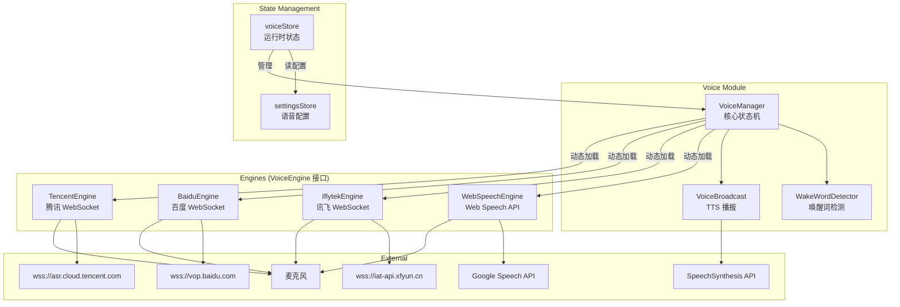
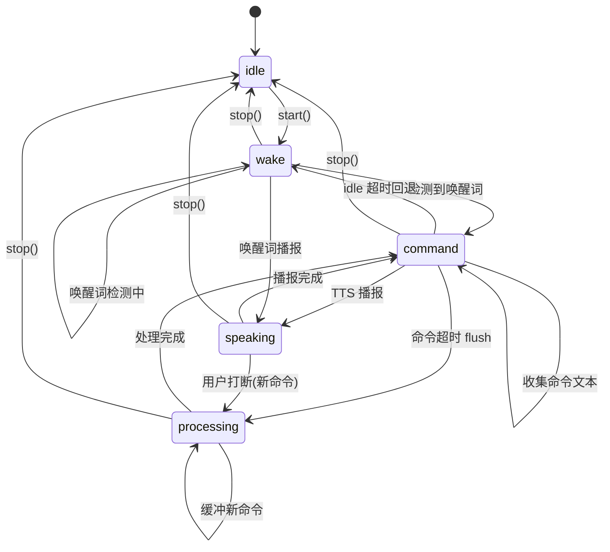
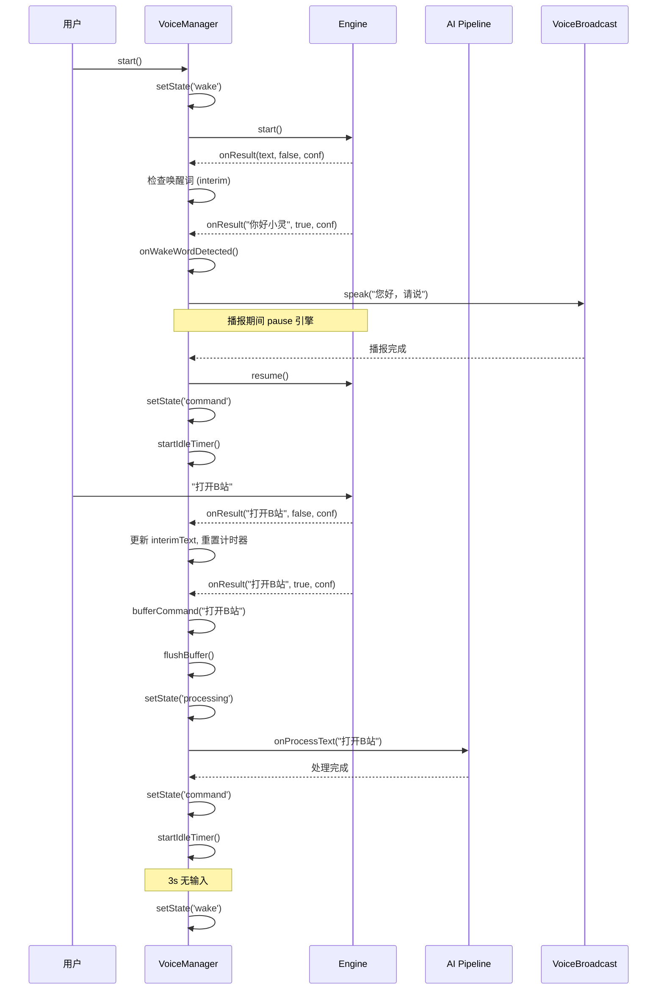
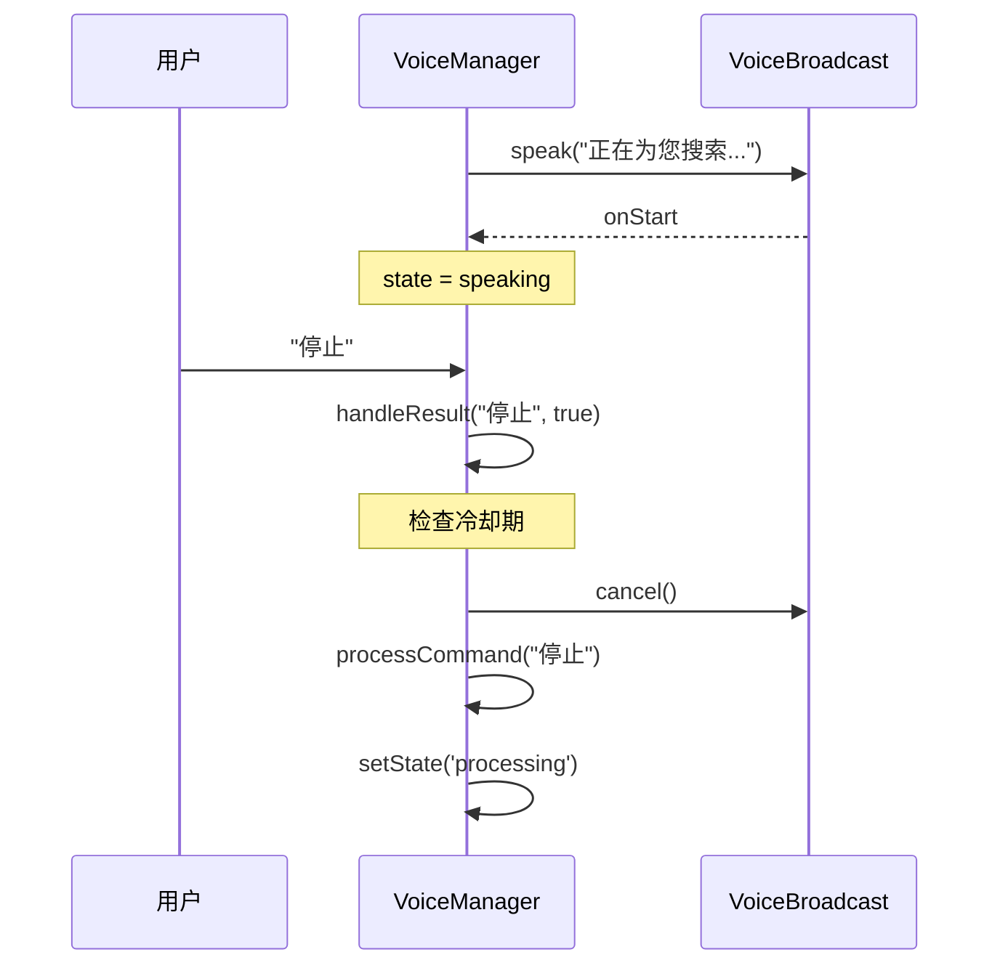
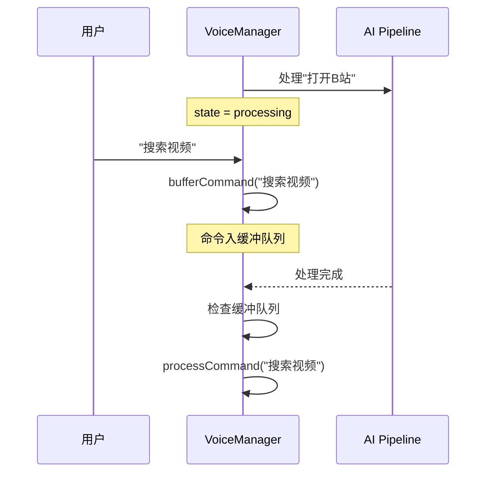

# Voice 模块架构文档

[English](./voice-en.md)

## 模块概述

语音模块实现完整的语音交互生命周期：唤醒词检测 -> 语音识别 -> AI 指令处理 -> 语音播报。采用**四引擎架构**（Web Speech API / 讯飞 / 百度 / 腾讯），通过统一的 `VoiceEngine` 接口屏蔽底层差异。核心设计原则是**引擎永远不 pause，用状态过滤识别结果**——引擎持续运行，VoiceManager 根据当前状态决定如何处理识别输出。

**关键特性**:
- 四引擎识别：Web Speech API（海外零配置）、讯飞（国内顶级质量）、百度（免费 3000 分钟/月）、腾讯（免费 1000 分钟/月）
- 唤醒词检测：滑动窗口 + 编辑距离算法，支持 "唤醒词+命令" 一句话连说
- TTS 播报：基于 `SpeechSynthesisUtterance`，播报期间暂停引擎防止自听
- 跨标签页麦克风锁：通过 `BroadcastChannel` 实现互斥访问
- 语音缓冲队列：处理中的命令自动缓冲，处理完后自动执行
- 外部播报事件：通过 `aib-broadcast` CustomEvent 触发 TTS 播报

**源文件**:

| 文件 | 职责 |
|------|------|
| `src/voice/index.ts` | 模块导出入口 |
| `src/voice/voice-manager.ts` | 核心状态机与业务逻辑 |
| `src/voice/broadcast.ts` | TTS 语音播报封装 |
| `src/voice/wake-word.ts` | 唤醒词检测器（滑动窗口 + 编辑距离） |
| `src/voice/engines/types.ts` | 引擎统一接口定义 |
| `src/voice/engines/web-speech-engine.ts` | Web Speech API 引擎 |
| `src/voice/engines/baidu-engine.ts` | 百度实时语音识别引擎 |
| `src/voice/engines/iflytek-engine.ts` | 讯飞语音听写引擎 |
| `src/voice/engines/tencent-engine.ts` | 腾讯实时语音识别引擎 |
| `src/stores/voice.ts` | 语音运行时状态管理（Pinia store） |

## 架构设计



### 状态机



## 核心类型定义

### VoiceEngine 统一接口

```typescript
// src/voice/engines/types.ts
type VoiceEngineStatus = 'idle' | 'listening' | 'processing' | 'error'

interface VoiceEngineConfig {
  lang?: string          // 默认 zh-CN
  continuous?: boolean   // 默认 true
  interimResults?: boolean // 默认 true
}

interface VoiceEngine {
  readonly name: string
  readonly isActive: boolean
  readonly status: VoiceEngineStatus
  start(): void
  stop(): void
  pause(): void
  resume(): void
  isAlive(): boolean
  onResult: ((text: string, isFinal: boolean, confidence: number) => void) | null
  onError: ((error: string) => void) | null
  onStatusChange: ((status: VoiceEngineStatus) => void) | null
  destroy(): void
}
```

### VoiceManager 状态与配置

```typescript
// src/voice/voice-manager.ts
type VoiceManagerState = 'idle' | 'wake' | 'command' | 'processing' | 'speaking'

interface VoiceManagerConfig {
  engineType: 'web-speech' | 'iflytek' | 'baidu' | 'tencent'
  iflytekConfig: { appId: string; apiKey: string; apiSecret?: string } | undefined
  baiduConfig: { appId: string; apiKey: string; apiSecret: string } | undefined
  tencentConfig: { appId: string; apiKey: string; apiSecret: string } | undefined
  lang?: string
  wakeWord?: string
  enableTts?: boolean
  ttsRate?: number
  ttsVolume?: number
  bufferTimeout?: number
  idleTimeout?: number

  onStateChange?: (state: VoiceManagerState) => void
  onInterimText?: (text: string) => void
  onUserMessage?: (text: string) => void
  onAssistantMessage?: (text: string) => void
  onError?: (error: string) => void
  onAbortProcess?: () => void
  getBroadcastCondition?: () => boolean
}
```

### 唤醒词匹配结果

```typescript
// src/voice/wake-word.ts
interface WakeWordMatch {
  matched: boolean   // 是否匹配到唤醒词
  command: string    // 唤醒词之后的命令部分（为空表示纯唤醒词）
}
```

### TTS 播报配置

```typescript
// src/voice/broadcast.ts
type BroadcastPriority = 'high' | 'normal'

interface BroadcastOptions {
  lang?: string    // 默认 zh-CN
  rate?: number    // 默认 1.0
  volume?: number  // 默认 1.0
}
```

### 各引擎配置

```typescript
// 讯飞
interface IflytekConfig {
  appId: string
  apiKey: string
  apiSecret?: string  // 可选，无 apiSecret 时使用简化鉴权
}

// 百度
interface BaiduConfig {
  appId: string
  apiKey: string
  apiSecret: string
}

// 腾讯
interface TencentConfig {
  appId: string
  apiKey: string
  apiSecret: string
}
```

### Voice Store 运行时状态

```typescript
// src/stores/voice.ts
type VoiceStatus = 'idle' | 'listening' | 'processing' | 'error'
type SessionState = 'idle' | 'wake' | 'command' | 'processing' | 'speaking'

// store 导出
interface VoiceStoreExports {
  status: Ref<VoiceStatus>
  sessionState: Ref<SessionState>
  interimText: Ref<string>
  finalText: Ref<string>
  settingsVersion: Ref<number>
  setStatus(s: VoiceStatus): void
  setSessionState(s: SessionState): void
  updateText(text: string, isFinal: boolean): void
  reset(): void
  getVoiceSettings(): VoiceSettings
  bumpSettingsVersion(): void
}
```

## 实现细节

### VoiceManager 状态机

VoiceManager 是语音模块的核心，管理整个语音交互生命周期。

**核心常量**:
- `DEFAULT_COMMAND_TIMEOUT = 1500ms` — 命令缓冲合并超时
- `DEFAULT_IDLE_TIMEOUT = 3000ms` — command 状态无输入回退到 wake 的超时
- `WAKE_COOLDOWN = 3000ms` — 唤醒冷却时间，防止同一句话重复触发

**状态过滤逻辑** (`handleResult`):

| 状态 | interim 结果 | final 结果 |
|------|-------------|------------|
| `wake` | 检查唤醒词，匹配则唤醒 | 检查唤醒词，匹配则进入 command；支持 "唤醒词+命令" 连说 |
| `command` | 更新显示文本，重置 idle/buffer 计时器 | 入缓冲队列，超时后合并执行 |
| `processing` | 忽略 | 缓冲命令，当前处理完成后自动执行 |
| `speaking` | 忽略 | 冷却期内忽略；否则打断播报，执行命令 |

**命令去重**: `flushBuffer()` 合并缓冲文本后，与 `lastCommand` 比较，相同命令在超时窗口内不重复执行。

**外部播报事件**: `start()` 时注册 `aib-broadcast` CustomEvent 监听器，外部可通过 `window.dispatchEvent(new CustomEvent('aib-broadcast', { detail: { text } }))` 触发 TTS 播报。

**播报条件控制**: `speak()` 方法中，唤醒词播报（"您好，请说"）无条件执行；其他播报需通过 `canBroadcast()` 检查 `getBroadcastCondition` 回调。

**引擎健康检查**: `ensureEngineAlive()` 在从 processing/speaking 回到 wake/command 时调用，检查 `engine.isAlive()`，如果引擎已死亡则重启。

**引擎动态加载**: 讯飞、百度、腾讯引擎通过 `import()` 懒加载，WebSpeechEngine 同步创建。

### WebSpeechEngine

基于浏览器原生 `SpeechRecognition` / `webkitSpeechRecognition` API。

**错误处理策略**:
| 错误类型 | 处理方式 |
|----------|----------|
| `aborted` | 标记 `_aborted`，`onend` 时延迟 2s 重启 |
| `no-speech` / `audio-capture` | 延迟 1s 重启 |
| `not-allowed` | 停止引擎，报错"麦克风权限被拒绝" |
| `network` | 停止引擎，报错"网络错误" |
| 其他 | 延迟 2s 重启 |

**自动重启**: `onend` 事件中，`_paused` 状态阻止重启；`_aborted` 延迟 2s；`continuous` 模式延迟 300ms；非 continuous 延迟 1s。

**健康检查**: `isAlive()` 检查 `_isActive && recognition !== null`。

### IflytekEngine

讯飞语音听写引擎，WebSocket 连接到 `wss://iat-api.xfyun.cn/v2/iat`。

**鉴权方式**:
- 无 `apiSecret` 时：简化鉴权 `?appid=xxx&apikey=xxx`
- 有 `apiSecret` 时：HMAC-SHA256 签名完整鉴权

**三帧协议**:
1. 第一帧（status=0）：仅参数，包含 `app_id`、`business`（语言、领域、口音等）、`data`（格式、编码）
2. 音频帧（status=1）：每帧发送 PCM 16kHz 音频数据（Base64 编码）
3. 最后一帧（status=2）：空音频，标记识别结束

**结果处理**: `pgs='apd'` 追加模式，其他为替换模式；`ls=true` 表示最终结果。

**客户端 VAD**: 10 帧静音（约 2.5 秒）自动发送最后一帧，静音能量阈值 0.01。

**连续识别**: 最终结果后自动 `reconnect()`，重新建立 WebSocket 连接继续监听。

### BaiduEngine

百度智能云实时语音识别引擎，WebSocket 连接到 `wss://vop.baidu.com/realtime_asr`。

**协议流程**:
1. JSON 开始帧（type=START）：包含 `appid`、`appkey`、`dev_pid`、`cuid`、`format`、`sample`
2. 二进制音频帧：PCM 16kHz 16bit 原始二进制数据
3. JSON 结束帧（type=FINISH）

**结果类型**:
- `MID_TEXT`：临时识别结果（interim）
- `FIN_TEXT`：最终识别结果（final），收到后自动重连
- `HEARTBEAT`：心跳帧，忽略

**语言映射**: `zh-CN` -> `dev_pid 15372`，`en-US` -> `dev_pid 17372`

**客户端 VAD**: 与讯飞相同，10 帧静音自动发送结束帧。

### TencentEngine

腾讯云实时语音识别引擎，WebSocket 连接到 `wss://asr.cloud.tencent.com/asr/v2/{appId}`。

**鉴权**: HMAC-SHA256 签名，参数包含 `app_id`、`expired`（24 小时过期）、`nonce`、`secret_id`、`timestamp`、`voice_id`、`signature`。

**协议流程**:
1. JSON 配置帧（type=start）：包含 `appid`、`voice_id`、`voice_format`、`engine_model_type`、`needvad`
2. 二进制音频帧：PCM 16kHz 原始二进制数据
3. JSON 结束帧（type=end）

**结果处理**: `message === 'result'` 时处理；`slice_type === 2` 表示最终结果，收到后自动重连（重新生成签名）。

**语言模型**: `zh-CN` -> `16k_zh`，`en-US` -> `16k_en`

### VoiceBroadcast (TTS)

基于浏览器原生 `SpeechSynthesisUtterance` API 的 Promise 封装。

**关键行为**:
- 新播报自动取消当前播报（`cancel()` + 创建新 Utterance）
- 错误时 `resolve()` 而非 `reject()`，避免阻塞调用方
- 回调：`onStart`、`onEnd`

### WakeWordDetector

滑动窗口 + 编辑距离算法实现唤醒词检测。

**算法流程**:
1. 文本规范化：去除标点、空格，转小写
2. 滑动窗口：窗口大小从 `wakeLen - threshold` 到 `wakeLen + threshold`
3. 对每个窗口位置计算编辑距离
4. 找到最小编辑距离的位置，提取唤醒词之后的文本作为命令

**错误阈值**: `max(1, floor(wakeLen / 4))` — 每 4 个字允许 1 个错误

**interim/final 区分**: 两者使用相同的错误阈值，但 interim 结果不完整所以匹配更宽松（通过滑动窗口自然实现）。

**索引映射**: `normalizedIndexToOriginal()` 将规范化后的索引映射回原始文本位置，用于正确提取命令部分。

### 唤醒音效

通过 `AudioContext` 生成 800Hz 正弦波，0.1 音量，0.3 秒指数衰减到 0.001 后停止。

### Voice Store

`src/stores/voice.ts` 定义 Pinia store `aib-voice`，仅管理运行时状态。

**职责分离**:
- **voiceStore**: 运行时状态（`status`、`sessionState`、`interimText`、`finalText`）
- **settingsStore**: 语音配置（`voiceEngineType`、`voiceAppId`、`voiceApiKey` 等）

**getVoiceSettings()**: 从 `settingsStore.settings` 读取语音相关配置，返回统一的配置对象。字段包括 `engineType`、`appId`、`apiKey`、`apiSecret`、`engineConfs`、`recognitionLang`、`wakeWord`、`alwaysOnVoice`、`enableTts`、`ttsRate`、`ttsVolume`、`bufferTimeout`、`idleTimeout`。

**settingsVersion**: 每次保存设置时 `bumpSettingsVersion()` 自增，App.vue 监听此值变化来重建 VoiceManager。

## 数据流

### 完整语音会话流程



### 语音打断播报



### 处理中缓冲命令



## 配置与扩展

### 添加新引擎

1. 在 `src/voice/engines/` 下创建新引擎文件，实现 `VoiceEngine` 接口
2. 在 `VoiceManagerConfig` 中添加新的配置字段（如 `newEngineConfig`）
3. 在 `VoiceManager.createEngine()` 中添加对应分支
4. 在 `src/voice/index.ts` 中导出新引擎和配置类型

### 引擎选择指南

| 场景 | 推荐引擎 | 原因 |
|------|----------|------|
| 海外用户 | Web Speech API | 零配置，浏览器原生支持 |
| 国内用户（质量优先） | 讯飞 | 识别质量顶级，免费 5 万次/天 |
| 国内用户（成本优先） | 百度 | 免费 3000 分钟/月 + 5 万次短语音 |
| 国内用户（备选） | 腾讯 | 免费 1000 分钟/月 |

### 关键配置参数

| 参数 | 默认值 | 说明 |
|------|--------|------|
| `wakeWord` | "你好，小灵" | 自定义唤醒词 |
| `enableTts` | true | 是否启用 TTS 播报 |
| `ttsRate` | 1.5 | TTS 语速 |
| `ttsVolume` | 0.8 | TTS 音量 |
| `bufferTimeout` | 1500ms | 命令缓冲合并超时 |
| `idleTimeout` | 3000ms | command 状态无输入回退到 wake |
| `lang` | "zh-CN" | 识别语言 |

### Voice Store 配置来源

语音配置统一由 `settingsStore` 管理，voiceStore 通过 `getVoiceSettings()` 读取。关键字段映射：

| settingsStore 字段 | 含义 |
|---------------------|------|
| `voiceEngineType` | 引擎类型 |
| `voiceAppId` / `voiceApiKey` / `voiceApiSecret` | 引擎凭证 |
| `voiceEngineConfs` | 多引擎配置数组 |
| `voiceRecognitionLang` | 识别语言 |
| `voiceWakeWord` | 唤醒词 |
| `voiceAlwaysOn` | 始终开启语音 |
| `voiceEnableTts` | TTS 开关 |
| `voiceTtsRate` / `voiceTtsVolume` | TTS 参数 |
| `voiceBufferTimeout` / `voiceIdleTimeout` | 超时参数 |

## 已知限制

1. **ScriptProcessorNode 已弃用** — 所有第三方引擎使用 `ScriptProcessorNode`，需迁移到 `AudioWorklet`
2. **Web Speech API 依赖 Google 服务** — 国内用户可能无法使用
3. **引擎 pause/resume 非原子操作** — 可能丢失暂停期间的音频帧
4. **唤醒词编辑距离 O(n*m) 复杂度** — 唤醒词过长时性能下降
5. **TTS 与识别冲突** — 如果 TTS 被系统音频打断，可能被识别为用户输入
6. **单引擎限制** — 每个 VoiceManager 实例只能使用一个引擎，切换需销毁重建
7. **麦克风独占** — 通过 BroadcastChannel 互斥，同一时间只有一个标签页可使用麦克风
8. **COMMAND_TIMEOUT 未定义** — `voice-manager.ts` 第 437 行引用了未定义的 `COMMAND_TIMEOUT` 常量（应为 `DEFAULT_COMMAND_TIMEOUT`）
9. **Voice Store 仅管理运行时状态** — 语音配置变更需通过 `bumpSettingsVersion()` 触发 VoiceManager 重建
