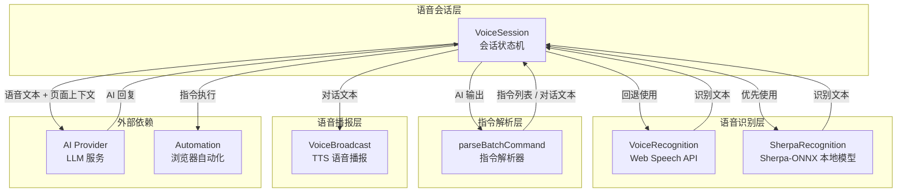
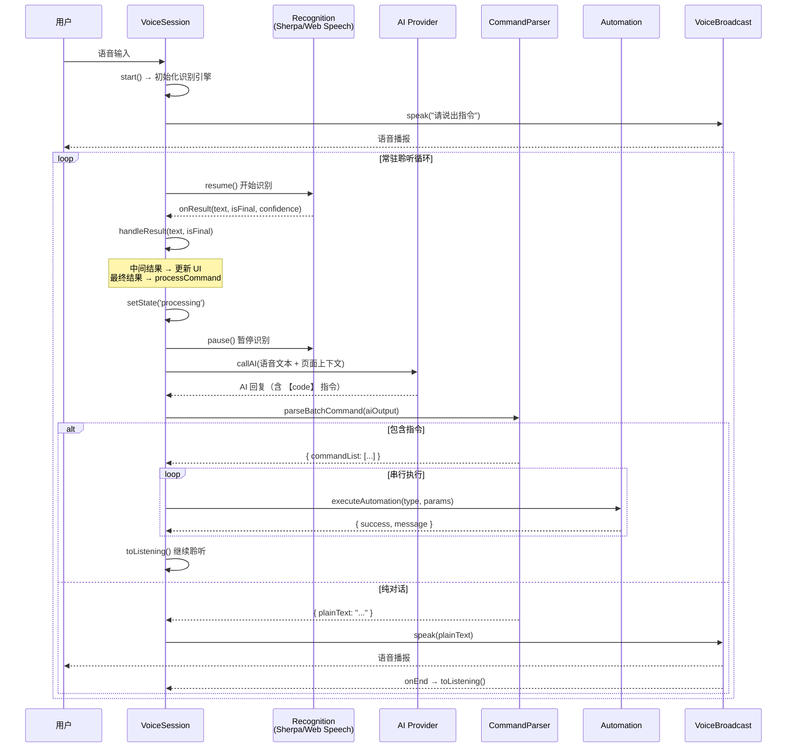

# 语音功能架构

## 目标

提供语音输入、语音指令解析和语音播报能力，让用户通过语音与浏览器 AI 助手进行自然交互。支持在线（Web Speech API）和离线（Sherpa-ONNX）双引擎识别，通过 AI 驱动的指令解析将语音文本转化为可执行的浏览器自动化操作，并通过 TTS 语音播报反馈执行结果。

## 架构总览



## 核心设计决策

### 1. 双引擎识别策略

系统同时支持两套语音识别引擎，按优先级自动切换：

- **Sherpa-ONNX（优先）**：基于 WebAssembly 的本地模型，完全离线运行，不依赖网络。使用 `sherpa-onnx-streaming-zipformer-bilingual-zh-en` 中英双语流式模型，通过 `AudioContext` + `ScriptProcessorNode` 采集 16kHz 单声道音频并实时喂入识别器。
- **Web Speech API（回退）**：浏览器原生 `SpeechRecognition` 接口，依赖 Chrome/Edge 的 Google 语音服务，需要联网。支持连续模式、中间结果、自动重启。

**切换逻辑**：`VoiceSession.start()` 优先初始化 SherpaRecognition，若加载模型或获取麦克风失败，自动回退到 VoiceRecognition。

### 2. AI 驱动的指令解析

指令识别完全由 AI 负责，本地不做正则匹配。AI 输出使用 `【code】...【/code】` 标记包裹可执行指令，`parseBatchCommand()` 从 AI 回复中提取结构化指令。这使得指令理解能力随 AI 模型升级而自动提升。

### 3. 会话状态机

`VoiceSession` 管理完整的语音交互生命周期，状态流转为：

```
IDLE → LISTENING → PROCESSING → SPEAKING → (回到 IDLE，常驻循环)
```

播报完成后自动回到 LISTENING 状态，形成常驻语音交互循环，无需用户反复触发。

### 4. 多指令串行执行

用户一句话可包含多个操作（如"打开 B 站，搜索猫咪视频"），AI 会输出多条有序指令。`VoiceSession` 串行执行这些指令，单条失败不中断后续执行。

## 模块详情

### recognition.ts — VoiceRecognition

基于 Web Speech API 的语音识别封装。

- **类**：`VoiceRecognition`
- **状态**：`VoiceStatus` = `idle` | `listening` | `processing` | `error`
- **核心能力**：
  - 连续对话模式（`continuous: true`）
  - 中间结果回调（`interimResults: true`）
  - 错误自动重启：`no-speech`/`audio-capture` 延迟 1s，`network` 延迟 3s，其他错误延迟 2s
  - 暂停/恢复：`pause()` 停止识别进入 processing 状态，`resume()` 重新启动
- **浏览器兼容**：静态方法 `isSupported()` 检测 `SpeechRecognition` / `webkitSpeechRecognition`

### sherpa-recognition.ts — SherpaRecognition

基于 Sherpa-ONNX 的离线语音识别封装。

- **类**：`SherpaRecognition`
- **模型**：`sherpa-onnx-streaming-zipformer-bilingual-zh-en-2023-02-20`（中英双语流式模型）
- **音频管道**：
  1. `navigator.mediaDevices.getUserMedia()` 获取麦克风（16kHz、单声道、回声消除、降噪）
  2. `AudioContext({ sampleRate: 16000 })` 创建音频上下文
  3. `createScriptProcessor(4096, 1, 1)` 创建音频处理节点
  4. `recognizer.acceptWaveform(16000, samples)` 喂入识别器
- **模型加载**：动态 `import('sherpa-onnx/sherpa-onnx-asr.js')`，首次启动时加载，后续复用
- **资源清理**：`stop()` 时断开 ScriptProcessor、停止 MediaStream 轨道、关闭 AudioContext

### commandParser.ts — parseBatchCommand

AI 驱动的指令解析器，从 AI 输出文本中提取 `【code】` 标记包裹的可执行指令。

- **函数**：`parseBatchCommand(rawText: string): BatchParseResult`
- **指令格式**：`指令类型:参数`（无参指令直接写类型名）
- **支持的指令类型**（`CommandType`）：

| 类型 | 参数 | 说明 |
|------|------|------|
| `open_site` | 完整 URL | 打开指定网站 |
| `search` | 关键词 | 全网搜索 |
| `site_search` | 关键词 | 站内搜索 |
| `open_item` | 数字序号 | 点击页面第 N 个链接 |
| `page_next` | 无 | 下一页 |
| `page_prev` | 无 | 上一页 |
| `video_play` | 无 | 播放视频 |
| `video_pause` | 无 | 暂停视频 |

- **解析逻辑**：
  1. 按 `【/code】` 分割文本，提取含 `【code】` 的块
  2. 逐块解析 `type:params` 格式，验证类型合法性
  3. 无指令标记时判定为纯对话，返回 `plainText`
  4. 支持批量解析，保留指令顺序

### broadcast.ts — VoiceBroadcast

基于 Web Speech Synthesis API 的 TTS 语音播报封装。

- **类**：`VoiceBroadcast`
- **优先级**：`BroadcastPriority` = `high` | `normal`
- **配置**：语言（默认 `zh-CN`）、语速（默认 `1.0`）、音量（默认 `1.0`）
- **核心方法**：
  - `speak(text)` — 播报文字，返回 Promise（播报完成时 resolve），新播报自动取消当前播报
  - `cancel()` — 取消当前播报
- **回调**：`onStart` / `onEnd` 用于状态联动
- **浏览器兼容**：静态方法 `isSupported()` 检测 `speechSynthesis` 是否存在

### session.ts — VoiceSession

语音会话状态机，协调识别、AI 调用、指令执行和播报的完整流程。

- **类**：`VoiceSession`
- **状态**：`SessionState` = `idle` | `listening` | `processing` | `speaking`
- **引擎选择**：`useSherpa` 标志控制优先使用 Sherpa 本地识别，失败时自动回退
- **AI 调用**：
  - 系统 Prompt 定义指令格式和规则（`COMMAND_SYSTEM_PROMPT`）
  - 构建上下文：最近 3 轮语音消息 + 当前页面 URL + 清洗后 HTML
  - 流式调用 AI 适配器获取回复
- **重试机制**：`processWithRetry()` 最多重试 3 次，每次将上次 AI 输出和解析错误附加到上下文，让 AI 自我修正
- **结果分发**：
  - `commands` → 串行执行指令列表
  - `chat` → 播报对话文本
  - `error` → 播报错误提示

## 数据流



## 关键方法签名

```typescript
// ========== VoiceRecognition ==========
class VoiceRecognition {
  constructor(options: VoiceRecognitionOptions)
  static isSupported(): boolean
  start(): void
  stop(): void
  pause(): void
  resume(): void
  toggle(): void
  destroy(): void
  get isActive(): boolean
  get currentStatus(): VoiceStatus
}

interface VoiceRecognitionOptions {
  lang?: string                    // 默认 'zh-CN'
  continuous?: boolean             // 默认 true
  interimResults?: boolean         // 默认 true
  onResult: (text: string, isFinal: boolean, confidence: number) => void
  onStatusChange?: (status: VoiceStatus) => void
  onError?: (error: string) => void
}

// ========== SherpaRecognition ==========
class SherpaRecognition {
  constructor(options: SherpaRecognitionOptions)
  start(): Promise<void>          // 异步：加载模型 + 获取麦克风
  stop(): void
  pause(): void                    // 断开 ScriptProcessor
  resume(): void                   // 重新连接 ScriptProcessor
  toggle(): void
  destroy(): void
  get isActive(): boolean
  get currentStatus(): VoiceStatus
}

// ========== parseBatchCommand ==========
function parseBatchCommand(rawText: string): BatchParseResult

interface BatchParseResult {
  total: number
  commandList: CommandInfo[]
  hasError: boolean
  errorMsg?: string
  plainText?: string               // 无指令时为纯对话文本
}

interface CommandInfo {
  type: CommandType
  params: string
}

type CommandType =
  | 'open_site' | 'search' | 'site_search' | 'open_item'
  | 'page_next' | 'page_prev' | 'video_play' | 'video_pause'

// ========== VoiceBroadcast ==========
class VoiceBroadcast {
  constructor(options?: BroadcastOptions)
  static isSupported(): boolean
  speak(text: string): Promise<void>
  cancel(): void
  destroy(): void
  get speaking(): boolean
  onEnd: (() => void) | null
  onStart: (() => void) | null
}

interface BroadcastOptions {
  lang?: string    // 默认 'zh-CN'
  rate?: number    // 默认 1.0
  volume?: number  // 默认 1.0
}

// ========== VoiceSession ==========
class VoiceSession {
  constructor(options: VoiceSessionOptions)
  start(): Promise<void>
  stop(): void
  destroy(): void
  get state(): SessionState
  get isActive(): boolean
}

interface VoiceSessionOptions {
  getSettings: () => AppSettings
  getRecentMessages: () => VoiceMessage[]
  onStateChange: (state: SessionState) => void
  onTextUpdate: (text: string, isFinal: boolean, confidence: number) => void
  onUserMessage: (text: string) => void
  onAssistantMessage: (content: string, actionResult?: VoiceMessage['actionResult']) => void
  onSystemMessage: (content: string) => void
  executeAutomation: (action: string, params: Record<string, unknown>) => Promise<{ success: boolean; message: string }>
  getPageContext: () => Promise<{ url: string; html: string }>
}

type SessionState = 'idle' | 'listening' | 'processing' | 'speaking'
```

## 错误处理

| 场景 | 处理方式 |
|------|----------|
| 浏览器不支持 Web Speech API | 检测 `isSupported()`，提示用户使用 Chrome/Edge |
| 麦克风权限被拒绝 | 播报提示后停止会话 |
| Sherpa 模型加载失败 | 自动回退到 Web Speech API |
| 识别过程 `no-speech` / `audio-capture` | 延迟 1s 自动重启识别 |
| 识别过程 `network` 错误 | 延迟 3s 自动重启（Web Speech API 依赖网络） |
| AI 返回空回复 | 重试，最多 3 次 |
| 指令解析失败 | 将上次 AI 输出和错误信息附加到上下文，让 AI 自我修正，最多重试 3 次 |
| 单条指令执行失败 | 记录日志，继续执行后续指令，不中断 |
| 语音播报浏览器不支持 | `speak()` 静默 resolve，不阻塞流程 |

## 模块目录结构

```
src/voice/
├── index.ts              # 统一导出
├── recognition.ts        # VoiceRecognition — Web Speech API
├── sherpa-recognition.ts # SherpaRecognition — Sherpa-ONNX 本地模型
├── commandParser.ts      # parseBatchCommand — 指令解析
├── broadcast.ts          # VoiceBroadcast — TTS 语音播报
└── session.ts            # VoiceSession — 会话状态机
```
