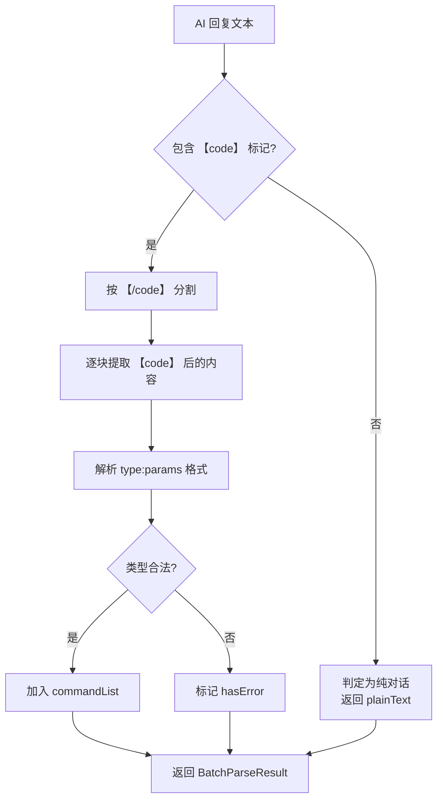

# 语音自动化操作参考

语音 AI 通过 `【code】...【/code】` 标记输出可执行指令，由 `VoiceSession` 串行执行。

## 功能总览

| 操作 | 用途 | 参数 | 触发方式 |
|------|------|------|---------|
| open_site | 打开指定网站 | 完整 URL | 语音 → AI → 指令 |
| search | 全网搜索 | 搜索关键词 | 语音 → AI → 指令 |
| site_search | 站内搜索 | 搜索关键词 | 语音 → AI → 指令 |
| open_item | 点击第 N 个结果 | 数字序号 | 语音 → AI → 指令 |
| page_next | 翻到下一页 | 无 | 语音 → AI → 指令 |
| page_prev | 翻到上一页 | 无 | 语音 → AI → 指令 |
| video_play | 播放视频 | 无 | 语音 → AI → 指令 |
| video_pause | 暂停视频 | 无 | 语音 → AI → 指令 |

---

## 语音命令格式

AI 回复中的命令标签格式：

```
【code】type:params【/code】
```

- 无参指令直接写类型名：`【code】page_next【/code】`
- 有参指令用冒号分隔：`【code】search:猫咪视频【/code】`
- 支持批量解析，保留指令顺序
- 无指令标记时判定为纯对话

---

## 各操作详解

### open_site — 打开网站

**参数：** 完整 URL

**示例：** `【code】open_site:https://www.bilibili.com【/code】`

**行为：** `window.open(url, '_blank')`，自动补全 `https://` 前缀。

---

### search — 全网搜索

**参数：** 搜索关键词

**示例：** `【code】search:猫咪视频【/code】`

**行为：** 打开百度搜索 `https://www.baidu.com/s?wd=关键词`

---

### site_search — 站内搜索

**参数：** 搜索关键词

**示例：** `【code】site_search:猫咪【/code】`

**行为：**

1. `findElement(SEARCH_INPUT_SELECTORS)` 查找搜索输入框
2. 设置 `value` + 触发 `input`/`change` 事件
3. 模拟 Enter 按键 + 表单提交

**搜索输入框选择器（按优先级）：**

| 优先级 | 选择器 | 适用站点 |
|--------|--------|---------|
| 1 | `input[type="search"]` | 通用 |
| 2 | `input[name="wd"]` | 百度 |
| 3 | `input[name="q"]` | Google/Bing |
| 4 | `input[id="kw"]` | 百度 |
| 5 | `input[placeholder*="搜索"]` | 通用 |
| 6 | `.search-input` | 通用 |

---

### open_item — 点击搜索结果

**参数：** 数字序号（从 1 开始）

**示例：** `【code】open_item:3【/code】`

**行为：** `findElements(SEARCH_RESULT_SELECTORS)` 查找所有结果，点击第 N 个。

**搜索结果选择器：**

| 站点 | 选择器 |
|------|--------|
| 百度 | `.result h3 a`, `.c-container h3 a` |
| Google | `.g a h3`, `.yuRUbf a` |
| Bing | `.b_algo h2 a` |
| 通用 | `h3 a`, `.result a`, `.title a` |

---

### page_next / page_prev — 翻页

**参数：** 无

**示例：** `【code】page_next【/code】`

**翻页按钮选择器：**

| 站点 | 下一页 | 上一页 |
|------|--------|--------|
| 百度 | `a.n`, `#page a:last-child` | `a.prec` |
| Google | `#pnnext` | `#pnprev` |
| Bing | `.b_pag a.sb_pagN` | — |
| 通用 | `.next`, `a[rel="next"]` | `.prev`, `a[rel="prev"]` |

**兜底：** 下一页 → 滚动到底部；上一页 → 浏览器后退。

---

### video_play / video_pause — 视频控制

**参数：** 无

**示例：** `【code】video_play【/code】`

**行为：** 查找页面 `<video>` 元素，调用 `play()` 或 `pause()`。

---

## 指令解析流程



**解析结果结构：**

```typescript
interface BatchParseResult {
  total: number           // 指令总数
  commandList: CommandInfo[]  // 指令列表
  hasError: boolean       // 是否有解析错误
  errorMsg?: string       // 错误信息
  plainText?: string      // 无指令时的纯对话文本
}

interface CommandInfo {
  type: CommandType       // 指令类型
  params: string          // 参数
}

type CommandType =
  | 'open_site' | 'search' | 'site_search' | 'open_item'
  | 'page_next' | 'page_prev' | 'video_play' | 'video_pause'
```

---

## 错误处理

| 场景 | 处理方式 |
|------|----------|
| 指令类型不合法 | 标记 `hasError`，跳过该指令 |
| 目标元素未找到 | 返回 `{ success: false, message }`，继续后续指令 |
| 单条指令执行失败 | 记录日志，不中断后续指令 |
| AI 返回空回复 | 重试，最多 3 次 |
| 指令解析失败 | 附加错误信息让 AI 自我修正 |
